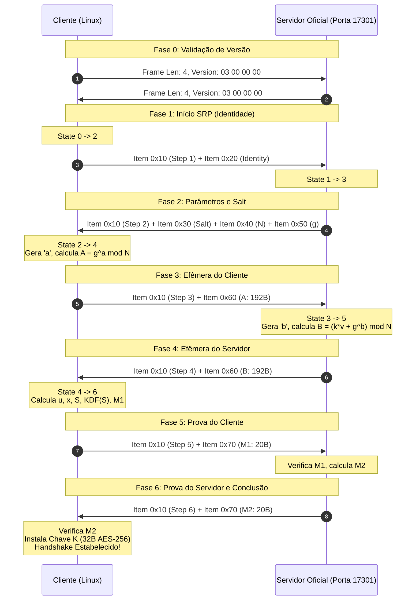

# Especificação Técnica do Handshake de Controle (Família `SHelper_*`)

> **Projeto**: Radmin VPN Linux (Interoperabilidade com Cliente Oficial)  
> **Status**: Fase 2 — Engenharia Reversa e Especificação Forense  
> **Referência Binária**: `shelper.dll` (v1.0.0.1 / v2.1.x) e `RvROLClient.dll` (v2.1.x)  
> **Capturas PCAP de Referência**: `radmin_17301.pcap`, `radmin_vm.pcap`, `radmin_vm2.pcap`  

---

## 1. Visão Geral e Contexto de Descoberta

Na Fase 1 (`SHelper_RSession_*`), a engenharia reversa identificou que `shelper.dll` exporta duas famílias independentes e mutuamente exclusivas de handshake criptográfico:

1. **Família A — `SHelper_RSession_*`** (`0x1006b860`, `0x1006a2b0`, `0x1006ba80`):
   - Handshake baseado em RSA-2048 (`RSA_PKCS1_PADDING`) com troca de bloco de 256 bytes contendo 64 bytes de CSPRNG (`RAND_bytes`).
   - Implementado e verificado na Fase 1.
2. **Família B — `SHelper_*`** (`0x1006ab90`, `0x1006ad20`, `0x1006b1e0`, `0x1006b010`, `0x1006b1d0`):
   - Handshake de autenticação mútua e acordo de chaves baseado em **SRP-6a** (Secure Remote Password, implementação tjw / Thomas J. Wu) com primo modular de 1536 bits e gerador $g = 5$.
   - Utilizado pelo subsistema de controle e gerenciamento de rede (`RvROLClient.dll!FamRT::CSRPHelperInstance`, `RolClient::CSRPClient`, `RolClient::CRosProtocol_SRP_ManageNetwork`).
   - É o protocolo executado nas conexões de controle TCP na porta `17301` identificadas nos PCAPs (`radmin_17301.pcap` fluxos `49494` e `49493`, e `radmin_vm2.pcap` fluxos `49526`, `49537`, `49538`).

### Matriz de Confiança Forense

| Componente / Característica | Classificação | Evidência Binária / de Rede |
|---|---|---|
| Algoritmo Criptográfico (SRP-6a) | **CONFIRMADO** | Tabelas de métodos `0x100ad75c` (`"SRP-6a client (tjw)"`) e `0x100ad7b4` (`"SRP-6a server (tjw)"`) em `shelper.dll`. |
| Versão de Protocolo de Rede (`version = 3`) | **CONFIRMADO** | `shelper.dll!0x1006b1d0` (`return 3`), `0x1006ab80` (`param_1 == 3`), verificado em todos os fluxos de PCAP no pacote inicial `00 00 00 04 03 00 00 00`. |
| Grupo Modular SRP (1536 bits, $g = 5$) | **CONFIRMADO** | Buffer de 192 bytes verificado em `shelper.dll!0x100ac280`, verificado em `0x100699e0` (validador do módulo) e gerador de 1 byte em `0x100ac279` (`0x05`). |
| Multiplicador SRP ($k = 3$) | **CONFIRMADO** | `shelper.dll!0x100607d0`: `piVar1 = FUN_1005f6e0(3)` passando `k = 3` para `0x10060510`. |
| Framing de Itens TLV (`0x100626e0` / `0x10062900`) | **CONFIRMADO** | Tag em 5 bits superiores (`0xF8000000`), comprimento em 27 bits inferiores (`0x07FFFFFF`), cabeçalho de 4 bytes em network byte order (big-endian). |
| Tags do Handshake (`0x10`..`0x70`) | **CONFIRMADO** | Desmontagem de `0x10066680` (Cliente) e `0x100670d0` (Servidor). |
| Máquina de Estados do Cliente (Casos 0, 2, 4, 6) | **CONFIRMADO** | Desmontagem completa de `shelper.dll!0x10066680`. |
| Máquina de Estados do Servidor (Casos 1, 3, 5) | **CONFIRMADO** | Desmontagem completa de `shelper.dll!0x100670d0`. |
| Função de Derivação de Chave (KDF de 40 bytes) | **CONFIRMADO** | `shelper.dll!0x10061790`: SHA-1 iterativo sobre `S || counter_be32` gerando 40 bytes (`0x28`). |
| Instalação de Chave AES-256 no `CChannel` | **CONFIRMADO** | `RvROLClient.dll!0x1003dd40` e `0x100df250`: extrai os primeiros 32 bytes (`0x20`) e instala em `SHelper_CChannel_SetKeyEnc` / `SetKeyDec`. |
| Codificação da Identidade / Nome de Usuário | **CONFIRMADO** | `shelper.dll!0x10066680` Caso 0: conversão explícita de `wchar_t` little-endian para UTF-16 big-endian (byte swap por palavra de 16 bits). |
| Estrutura de Credenciais Pós-Handshake | **PARCIAL** | Troca de mensagens autenticadas no catálogo TLV após handshake chaveado (Fase 3). |

---

## 2. Parâmetros do Grupo Criptográfico (SRP-1536)

O grupo criptográfico utilizado por `shelper.dll` é um grupo de 1536 bits compatível com os parâmetros SRP Tom Wu / RFC 5054.

### 2.1 Módulo Primo $N$ (1536 bits / 192 bytes)
Localização: `shelper.dll!0x100ac280`:
```text
e634471e75f2d76a0a3f5e252c5a6efb48edad645d31d9ecbc400416e14f5c6c
2ed378602d6eb8e9478b99e6474932393538b4be7177e0e05d3aaed17b5ae87a
a20f3dad37af019518f45b6dde76b2bfdfb140f379cc15383b304b7975b90796
7553cd6fdaf08d68832b603120430a501067d21beb2ce2275a20036a2dc80f1c
9d3ab9221afd5baceda5c2a31077c54fc6f274aaeba17ddd0b5c68f4f8e751a8
90a58648147a82e6f4f532ccdc939a12942799a713500e17dd4f6ff216cd54c7
```

### 2.2 Gerador $g$
Localização: `shelper.dll!0x100ac279`:
```text
g = 5 (0x05)
```

### 2.3 Multiplicador de Parâmetro $k$
Localização: `shelper.dll!0x100607d0`:
```text
k = 3 (0x03)
```

### 2.4 Função Hash
- **SHA-1** ($160$ bits / $20$ bytes output).
- Rotinas internas: `0x10028810` (`SHA1_Init`), `0x100285f0` (`SHA1_Update`), `0x100286d0` (`SHA1_Final`).

---

## 3. Protocolo de Framing

A comunicação de controle na porta TCP `17301` ocorre em duas camadas de framing:

### 3.1 Camada Externa: Transporte TCP (Length-Prefixed)
Cada mensagem trafegada sobre a conexão TCP possui um prefixo de 4 bytes em **big-endian**, indicando o comprimento exato do payload que se segue:
```text
+-------------------------+-----------------------------------------+
| Comprimento (4B big-end)| Payload (N bytes)                       |
+-------------------------+-----------------------------------------+
```

### 3.2 Negociação Inicial de Versão de Protocolo
Imediatamente após o estabelecimento da conexão TCP (SYN / SYN-ACK / ACK):
1. O Cliente envia um frame de 4 bytes contendo a versão:
   - Wire bytes: `00 00 00 04 03 00 00 00` (Length = 4, Protocol Version = 3 little-endian).
2. O Servidor responde ecoando o frame de versão:
   - Wire bytes: `00 00 00 04 03 00 00 00`.
3. Validação (`0x1006ab80`): se o valor for diferente de `3`, a conexão é abortada.

### 3.3 Camada Interna: Itens TLV (`0x100626e0` e `0x10062900`)
Dentro dos payloads de handshake SRP, os dados são organizados em uma sequência de itens TLV compactos. Cada item possui um cabeçalho fixo de 4 bytes:
```text
Bits 31..27 (5 bits): Identificador da Tag (0x10, 0x20, 0x30, 0x40, 0x50, 0x60, 0x70)
Bits 26..0  (27 bits): Comprimento do valor em bytes (0 .. 134.217.727)
```
Em memória e na rede, o cabeçalho é montado em big-endian:
$$\text{Header} = (\text{Tag} \ \& \ \text{0xF8000000}) \ | \ (\text{Length} \ \& \ \text{0x07FFFFFF})$$

#### Catálogo de Tags Oficiais (`shelper.dll!0x10066680` e `0x100670d0`):

| Tag Valor | Mapeamento no SRP | Descrição e Estrutura |
|---|---|---|
| `0x10000000` | Step Number | Sub-estado do protocolo (4 bytes, `u32` little-endian: 1, 2, 3, 4, 5, 6). |
| `0x20000000` | Identity / Username | Identidade do usuário/máquina (caracteres UTF-16 byte-swapped). |
| `0x30000000` | Salt ($s$) | Salt do usuário gerado pelo servidor ($S$ bytes, tipicamente 16 ou 32 bytes). |
| `0x40000000` | Modulus $N$ | Primo modular de 1536 bits (192 bytes big-endian) ou gerador. |
| `0x50000000` | Generator $g$ | Gerador $g = 5$ (1 byte) ou parâmetro auxiliar. |
| `0x60000000` | Public Ephemeral | Chave efêmera pública ($A$ enviado pelo cliente; $B$ enviado pelo servidor; 192 bytes). |
| `0x70000000` | Proof ($M_1$ / $M_2$) | Prova de posse de chave (20 bytes SHA-1: $M_1$ do cliente; $M_2$ do servidor). |

---

## 4. Máquina de Estados Estrita do Handshake

A máquina de estados executa uma sequência síncrona de 6 passos entre Cliente e Servidor:



### 4.1 Passo 1: Inicialização do Cliente (Estado 0 do Cliente, `0x10066680`)
- **Entrada**: Nenhuma (`in_buf == NULL`).
- **Ações**:
  1. Define `state = 1`, monta Item `0x10000000` com valor `00 00 00 01` (4 bytes LE).
  2. Obtém a identidade do usuário (`wchar_t`), inverte o endianness de cada caractere de 16 bits para UTF-16BE.
  3. Monta Item `0x20000000` com o buffer de identidade.
  4. Transiciona `state = 2` (`WaitingServerParams`).
- **Saída**: Buffer concatenado contendo Item 1 + Item 2.

### 4.2 Passo 2: Parâmetros do Servidor (Estado 1 do Servidor, `0x100670d0`)
- **Entrada**: Buffer do Passo 1.
- **Validações**:
  - Primeiro item DEVE ser `0x10000000` com valor `1`.
  - Segundo item DEVE ser `0x20000000` (identidade).
- **Ações**:
  1. Localiza os dados do usuário (salt $s$ e verifier $v = g^x \pmod N$).
  2. Monta Item `0x10000000` com valor `00 00 00 02`.
  3. Monta Item `0x30000000` com salt $s$.
  4. Monta Item `0x40000000` com o módulo primo $N$ (192 bytes).
  5. Monta Item `0x50000000` com o gerador $g = 5$ (1 byte).
  6. Transiciona `state = 3`.

### 4.3 Passo 3: Efêmera Pública do Cliente (Estado 2 do Cliente, `0x10066680`)
- **Entrada**: Buffer do Passo 2.
- **Validações**:
  - Item `0x10000000` com valor `2`.
  - Item `0x30000000` (salt $s$).
  - Itens `0x40000000` e `0x50000000` validados contra o grupo esperado ($N$ e $g$).
- **Ações**:
  1. Gera expoente secreto efêmero $a$ criptograficamente seguro ($1536$ bits aleatórios via `RAND_bytes`).
  2. Reduz $a \pmod N$.
  3. Calcula a chave efêmera pública:
     $$A = g^a \pmod N$$
  4. Monta Item `0x10000000` com valor `00 00 00 03`.
  5. Monta Item `0x60000000` com $A$ (192 bytes big-endian).
  6. Transiciona `state = 4` (`WaitingServerProof`).

### 4.4 Passo 4: Efêmera Pública do Servidor (Estado 3 do Servidor, `0x100670d0`)
- **Entrada**: Buffer do Passo 3.
- **Validações**:
  - Item `0x10000000` com valor `3`.
  - Item `0x60000000` contendo $A$ ($192$ bytes, $A \not\equiv 0 \pmod N$).
- **Ações**:
  1. Gera expoente secreto efêmero $b$ ($1536$ bits aleatórios).
  2. Calcula a chave pública efêmera do servidor:
     $$B = (k \cdot v + g^b) \pmod N$$
  3. Monta Item `0x10000000` com valor `00 00 00 04`.
  4. Monta Item `0x60000000` com $B$ (192 bytes big-endian).
  5. Transiciona `state = 5`.

### 4.5 Passo 5: Prova do Cliente $M_1$ (Estado 4 do Cliente, `0x10066680`)
- **Entrada**: Buffer do Passo 4.
- **Validações**:
  - Item `0x10000000` com valor `4`.
  - Item `0x60000000` contendo $B$ ($192$ bytes).
  - Valida $B \not\equiv 0 \pmod N$ (`0x10060510`).
- **Ações**:
  1. Calcula o scrambler aleatório $u$:
     $$u = \text{SHA1}(\text{PAD}(A) \ || \ \text{PAD}(B))$$
  2. Calcula a senha privada $x$:
     $$h_{\text{cred}} = \text{SHA1}(\text{username} \ || \ \text{":"} \ || \ \text{password})$$
     $$x = \text{SHA1}(\text{salt} \ || \ h_{\text{cred}})$$
  3. Calcula o segredo pré-mestre $S$:
     $$S = (B - k \cdot (g^x \bmod N))^{a + u \cdot x} \pmod N$$
  4. Executa a KDF sobre $S$ (`0x10061790`) para derivar a chave mestre de 40 bytes:
     $$K_0 = \text{SHA1}(S \ || \ \text{0x00000000}_{\text{be}})$$
     $$K_1 = \text{SHA1}(S \ || \ \text{0x00000001}_{\text{be}})$$
     $$K_{\text{full}} = K_0 \ || \ K_1 \quad (40\text{ bytes})$$
  5. Calcula a prova de cliente $M_1$ (`0x100601b0` + `0x10060510`):
     $$H_{\text{xor}} = \text{SHA1}(N) \oplus \text{SHA1}(g)$$
     $$H_I = \text{SHA1}(\text{username})$$
     $$M_1 = \text{SHA1}(H_{\text{xor}} \ || \ H_I \ || \ \text{salt} \ || \ A \ || \ B \ || \ K_{\text{full}})$$
  6. Monta Item `0x10000000` com valor `00 00 00 05`.
  7. Monta Item `0x70000000` com $M_1$ (20 bytes).
  8. Transiciona `state = 6`.

### 4.6 Passo 6: Prova do Servidor $M_2$ e Finalização (Estado 5 do Servidor & Estado 6 do Cliente)
- **Servidor (`0x100670d0` Caso 5)**:
  1. Valida Item `0x10000000` com valor `5` e Item `0x70000000` com $M_1$.
  2. Calcula $S = (A \cdot v^u)^b \pmod N$, deriva $K_{\text{full}}$, calcula $M_1$ esperado.
  3. Compara $M_1$ recebido com o esperado. Se divergente, rejeita.
  4. Se idêntico, calcula a prova do servidor $M_2$:
     $$M_2 = \text{SHA1}(A \ || \ M_1 \ || \ K_{\text{full}})$$
  5. Monta Item `0x10000000` com valor `00 00 00 06`.
  6. Monta Item `0x70000000` com $M_2$ (20 bytes).
  7. Marca handshake como estabelecido e completo.
- **Cliente (`0x10066680` Caso 6)**:
  1. Valida Item `0x10000000` com valor `6` e Item `0x70000000` com $M_2$.
  2. Calcula $M_2$ esperado:
     $$M_2 = \text{SHA1}(A \ || \ M_1 \ || \ K_{\text{full}})$$
  3. Compara $M_2$ recebido com o calculado (`0x10060900`).
  4. Se idêntico:
     - Marca `is_established = true` e `is_complete = true`.
     - Chave de sessão disponível via `SHelper_GetKey` (`0x1006b010`).

---

## 5. Extração e Instalação da Chave Criptográfica

Conforme desmontado em `RvROLClient.dll!0x1003dd40` e `0x100df250`:
1. `SHelper_GetKey` extrai a chave derivada de 40 bytes $K_{\text{full}}$.
2. O canal seguro requer uma chave de 32 bytes (`0x20`) para AES-256:
   $$K_{\text{session}} = K_{\text{full}}[0..32]$$
3. A chave $K_{\text{session}}$ é instalada diretamente no `FamatechCipherState`:
   - `key_enc = K_session`
   - `key_dec = K_session`
4. Todas as mensagens subsequentes trocadas sobre a conexão de controle são protegidas por **AES-256-CBC** com o padding Famatech (checksum MD5 dobrado + byte de pad length), exatamente como implementado na Fase 1 (`src/crypto/famatech.rs`).
