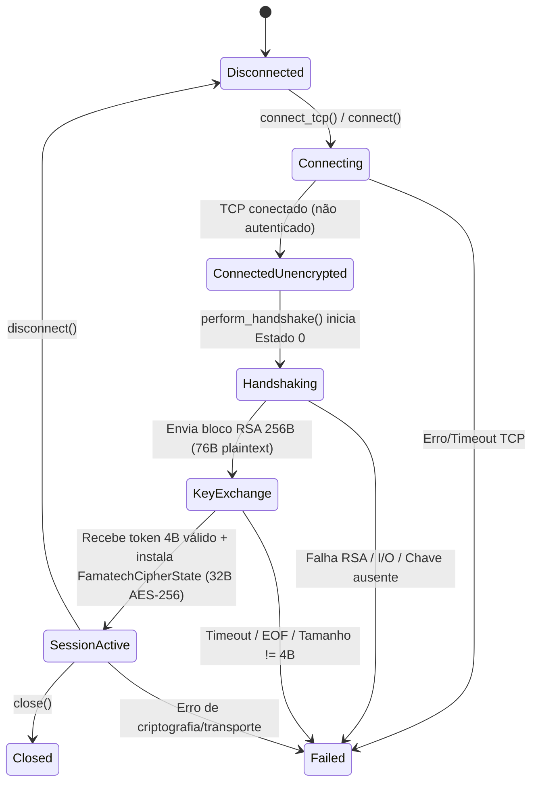

# Relatório de Implementação da Fase 1 — Núcleo de Sessão e Canal Criptográfico (`PHASE_1_IMPLEMENTATION_REPORT.md`)

## 1. Arquivos Modificados

| Arquivo | Natureza da Alteração |
|---|---|
| `src/session/handshake.rs` | Implementação completa da máquina de estados real de `SHelper_RSession` (`HandshakeNegotiator` para o cliente e `RSessionServer` para o servidor) conforme `shelper.dll!0x1006b860..0x1006bc30` e `RvROLClient.dll!0x10096660..0x100df470`, com testes unitários de regressão. |
| `src/session/mod.rs` | Integração real do `HandshakeNegotiator` e `FamatechCipherState` ao `SessionManager`, máquina de estados estrita (`Disconnected`, `Connecting`, `ConnectedUnencrypted`, `Handshaking`, `KeyExchange`, `SessionActive`, `Reconnecting`, `Failed`, `Closed`), invalidação automática em falhas e remoção de mensagens inventadas. |
| `src/crypto/famatech.rs` | Correção da validação `pad_len >= total_len` (`shelper.dll!0x1006a00e`), suporte a chaves separadas de envio/recepção (`0x10062e00` / `0x10062d60`), instalação de chave a partir do buffer de 64 bytes de `RSession` (`RvROLClient.dll!0x100df250` / `0x100df470`), limpeza de memória (`0x10062c80`) e resolução documentada da contradição do checksum/trailer. |
| `src/crypto/mod.rs` | Exportação de constantes (`AES_256_KEY_SIZE`, `RSESSION_KEY_BUFFER_SIZE`) e métodos `with_cipher_state`, `set_cipher_state` e `clear()` em `CryptoChannel`. |
| `src/transport/mod.rs` | Adição de `enable_cipher`, `clear_cipher` e `cipher()` em `TcpChannel`, preservando intactas as correções de framing TCP. |
| `tests/integration_test.rs` | Adição do teste de integração ponta a ponta `test_e2e_phase1_rsession_handshake_and_cchannel_continuity`. |
| `PHASE_1_IMPLEMENTATION_REPORT.md` | Relatório consolidado da implementação da Fase 1. |
| `PHASE_1_UNRESOLVED.md` | Registro formal das questões pendentes fora do escopo ou dependentes de evidências adicionais. |

---

## 2. Componentes Implementados

1. **Handshake Criptográfico (`src/session/handshake.rs`)**:
   - `HandshakeNegotiator` reproduzindo `SHelper_RSession_CreateClient` (`0x1006b860`), `SHelper_RSession_GetNextBuffer` (`0x1006a2b0`), `SHelper_RSession_GetKey` (`0x1006ba80`) e `SHelper_RSession_GetServerDataOnClient` (`0x1006bbb0`).
   - `RSessionServer` reproduzindo `SHelper_RSession_CreateServer` (`0x1006b8f0`), Estado 1 (`0x1006a30c`), `SHelper_RSession_GetKey` (`0x1006ba80`) e `SHelper_RSession_GetClientDataOnServer` (`0x1006bc30`).
2. **Canal Criptográfico de Sessão (`src/crypto/famatech.rs`, `src/crypto/mod.rs`)**:
   - `FamatechCipherState` reproduzindo `SHelper_CChannel` (`0x10062ca9`, `0x10062c80`, `0x10062e00`, `0x10062d60`, `0x10063000`, `0x100630f0`, `0x10069c20`, `0x10069f90`, `0x1006a0c0`, `0x100638f0`).
3. **Gerenciador de Sessão (`src/session/mod.rs`, `src/transport/mod.rs`)**:
   - `SessionManager` integrando transporte TCP com framing de 4 bytes big-endian, negociação `SHelper_RSession` e ativação do `FamatechCipherState`.

---

## 3. Fluxo de Handshake Implementado

Conforme comprovado em `shelper.dll` (`0x1006b860`, `0x1006a2b0`, `0x1006a512`, `0x1006a30c`, `0x1006a4cc`, `0x1006ba80`) e `RvROLClient.dll` (`0x10096660..0x10096b28`, `0x10096bf0..0x10097060`, `0x100df250`, `0x100df470`):

1. **Inicialização (`SHelper_RSession_CreateClient`, `0x1006b860` -> `0x1006a690`)**:
   - O cliente inicializa `state = 0` (`ClientState0Initial`), armazena os 3 DWORDs de parâmetros em `+0x04..+0x0c`, define `is_established = false` (`+0x10 = 0`) e constrói a chave pública RSA-2048 do servidor via `BN_bin2bn` sobre módulo (`256B` big-endian) e expoente (`0x100660a7` -> `0x10065848`).
2. **Geração do Primeiro Pacote — Estado 0 do Cliente (`0x1006a512`)**:
   - Exige entrada vazia (`in_buf == NULL && in_len == 0`).
   - Gera **64 bytes (`0x40`)** aleatórios criptograficamente seguros via `RAND_bytes` (`0x10063530` em `0x1006a56d`) e armazena em `[esi+0x30]`.
   - Monta um buffer plaintext de **76 bytes (`0x4c`)** (`0x1006a522`):
     - Bytes `0..12`: `[d0, d1, d2]` em little-endian (`0x1006a55c..0x1006a569`).
     - Bytes `12..76`: os 64 bytes CSPRNG (`0x1006a582..0x1006a593`).
   - Cifra os 76 bytes com a chave pública RSA-2048 usando **`RSA_PKCS1_PADDING` (`padding = 1`)** (`0x10065ec0` via `0x10065ca0` em `0x1006a59c`), gerando um bloco de **256 bytes (`0x100`)**.
   - Transiciona `state = 2` (`ClientState2WaitingServerToken`, `0x1006a5eb`) e mantém `is_complete = false` (`0x1006a5fd`).
3. **Processamento no Servidor — Estado 1 (`0x1006a30c`)**:
   - Decifra o bloco de 256 bytes com a chave privada RSA-2048 usando **`RSA_PKCS1_PADDING`** (`0x10065de8` via `0x10065bc7` em `0x1006a354`).
   - Exige que o tamanho decifrado seja exatamente **`0x4c` (76 bytes)** (`0x1006a36d: cmp [ebp-0x10], 0x4c; jne 0x1006a4c2`).
   - Extrai `[d0, d1, d2]` (`0..12`) e os 64 bytes de chave (`12..76`), emite o token de **4 bytes (`0x04`)** do servidor (`0x1006a472..0x1006a49b`), define `is_established = true` (`[esi+0x10] = 1`) e `state = 3`.
4. **Validação do Token no Cliente — Estado 2 (`0x1006a4cc`)**:
   - Exige estritamente `in_buf != NULL` e **`in_len == 4`** (`0x1006a4df: cmp [ebp+0xc], 0x4; jne 0x1006a614`).
   - Armazena o token de 4 bytes do servidor em `[esi+0x14]` (`0x1006a4e9`), transiciona `state = 3` (`State3Completed`, `0x1006a4fc`), ativa `is_established = true` (`0x1006a503`) e retorna `is_complete = true`.
5. **Obtenção e Instalação da Chave AES-256 (`0x1006ba80` + `RvROLClient.dll!0x100df250` / `0x100df470`)**:
   - `SHelper_RSession_GetKey` (`0x1006ba80` -> `0x1006a270`) verifica `is_established != 0` e retorna o buffer CSPRNG de 64 bytes (`[ecx+0x30]`).
   - `RvROLClient.dll!0x100df250` (`CChannelWrapper::Create`) e `0x100df470` (`SetKey`), chamados em `0x10096f0d..0x10096f21` e `0x100969de..0x10096a16`, validam `len >= 0x20` (32 bytes) e instalam os primeiros **32 bytes (`&key_material[0..32]`)** tanto em `key_enc` (`0x10062e00`) quanto em `key_dec` (`0x10062d60`).

---

## 4. Máquina de Estados Resultante

### 4.1. Máquina de Estados do Handshake (`HandshakeStage`)
- `ClientState0Initial` (`0`) -> `ClientState2WaitingServerToken` (`2`) -> `State3Completed` (`3`, com `is_established = true`).
- Qualquer entrada inesperada, tamanho inválido ou chamada fora de ordem transiciona imediatamente para `HandshakeStage::Failed` e zera `key_material`.

### 4.2. Máquina de Estados da Sessão (`SessionState`)

Invariantes aplicadas:
- `ConnectedUnencrypted` bloqueia `send_data()` e `receive_data()`.
- `activate_from_negotiator()` rejeita qualquer negociador onde `is_established() == false` (um token isolado sem chave jamais ativa a sessão).
- Qualquer falha fecha o `TcpChannel`, zera chaves/IVs e define `SessionState::Failed(reason)`.
- `close()` define `SessionState::Closed` e impede qualquer reutilização da instância.

---

## 5. Formato Criptográfico Confirmado (`SHelper_CChannel`)

1. **Algoritmo e Modos (`shelper.dll!0x10062ca9`, `0x10062e00`, `0x10062d60`, `0x10063000`, `0x100630f0`)**:
   - **AES-256-CBC** sem padding PKCS#7 do OpenSSL (`crypter.pad(false)`).
   - `enc_iv` (`+0x1ec`) e `dec_iv` (`+0x1fc`) inicializados com 16 bytes zero (`[0u8; 16]`) em `0x10062ca9`.
   - **Continuidade de IV por direção**: `AES_cbc_encrypt` atualiza `enc_iv` in-place com os últimos 16 bytes do ciphertext enviado (`0x10063000`) e atualiza `dec_iv` in-place com os últimos 16 bytes do ciphertext recebido (`0x100630f0`, antes de `0x10069f90`).
2. **Padding e Trailer de 9 Bytes (`shelper.dll!0x10069c20` e `0x10069f90`)**:
   - Para um payload de `L >= 1` bytes:
     - `total_len = ((L + 24) / 16) * 16`
     - `pad_len = total_len - L` (`9 <= pad_len <= 24`, e obrigatoriamente `pad_len < total_len` conforme `0x1006a00e: cmp ebx, esi; jae`).
   - Layout do bloco plaintext alinhado a 16 bytes:
     - `0..L`: payload original.
     - `L..(total_len - 9)`: `pad_len - 9` bytes preenchidos com `0xCC` (`0x10069c77`).
     - `(total_len - 9)..(total_len - 1)`: **8 bytes de integridade (MD5 dobrado)**.
     - `total_len - 1`: **1 byte `pad_len`**.
3. **Resolução Definitiva da Divergência sobre o Checksum (`0x1006a0c0` + `0x100638f0`)**:
   - O relatório anterior `02-cryptography.md` afirmou erroneamente que o trailer conteria a soma bruta de 64 bits de `0x1006a0c0`.
   - A desmontagem completa de `0x10069c20` comprova:
     - `0x10069c9a`: chama `0x1006a0c0` sobre `buf[0 .. total_len - 9]` (soma de palavras 64-bit LE com zero-fill na cauda `< 8` bytes).
     - `0x10069ca2..0x10069ca6`: grava temporariamente os 8 bytes da soma em `[esi-0x9..esi-0x1]`.
     - `0x10069cb2`: chama `0x100638f0(&buf[total_len - 9], 8, &folded_md5)`, que calcula o MD5 sobre esses 8 bytes e dobra os 16 bytes do digest em 8 bytes (`folded[i] = digest[i].wrapping_add(digest[i + 8])`, `0x10063922..0x1006392a`).
     - `0x10069cbd..0x10069cc5`: sobrescreve `[esi-0x9..esi-0x1]` com os 8 bytes do MD5 dobrado.
   - O verificador `0x10069f90` (`0x1006a026..0x1006a06c`) executa exatamente a mesma sequência (`0x1006a0c0` seguido de `0x100638f0`).

---

## 6. Evidências Utilizadas (Funções, Endereços e Pacotes)

- **Binários analisados**:
  - `shelper.dll`: `0x10062c80`, `0x10062ca9`, `0x10062d60`, `0x10062e00`, `0x10063000`, `0x100630f0`, `0x10063510`, `0x10063530`, `0x100638f0`, `0x10065848`, `0x10065bc7`, `0x10065ca0`, `0x10065de8`, `0x10065ec0`, `0x100660a7`, `0x1006612f`, `0x10069c20`, `0x10069f90`, `0x1006a0c0`, `0x1006a270`, `0x1006a2b0`, `0x1006a30c`, `0x1006a4cc`, `0x1006a512`, `0x1006a630`, `0x1006a690`, `0x1006a730`, `0x1006a780`, `0x1006a8b0`, `0x1006ab90`, `0x1006b010`, `0x1006b1d0`, `0x1006b1e0`, `0x1006b860`, `0x1006b8f0`, `0x1006ba80`, `0x1006bb10`, `0x1006bbb0`, `0x1006bc30`.
  - `RvROLClient.dll`: `0x1003dd40..0x1003f530`, `0x10096660..0x10097060`, `0x100dc6e0..0x100df470`.
- **Pacotes de `radmin_17301.pcap` verificados**:
  - **Fluxo TCP `49494 <-> 185.158.113.100:17301`**:
    - Pkt #32 (`C->S`, payload `4B`: `03 00 00 00`), Pkt #35 (`S->C`, payload `192B`), Pkt #37 (`C->S`, payload `32B`), Pkt #39 (`S->C`, payload `256B`), Pkt #41 (`C->S`, payload `224B`), Pkt #42 (`S->C`, payload `224B`), Pkt #43 (`C->S`, payload `48B`), Pkt #45 (`S->C`, payload `48B`).
  - **Fluxo TCP `49493 <-> 185.158.113.100:17301`**:
    - Pkt #40 (`C->S`, payload `4B`: `03 00 00 00`), Pkt #44 (`S->C`, payload `4B`: `03 00 00 00`), Pkt #46 (`S->C`, payload `192B`), Pkt #47 (`C->S`, payload `32B`), Pkt #48 (`S->C`, payload `256B`), Pkt #49 (`C->S`, payload `224B`), Pkt #50 (`S->C`, payload `224B`).
  - **Conclusão forense sobre os pacotes #35, #44, #46 e #48**:
    - O relatório `01-handshake.md` havia misturado pacotes dos dois fluxos concorrentes na porta `17301` (#48 é `S->C` de 256B no fluxo `49493`, e #44 é o eco de 4B `03 00 00 00` `S->C` no fluxo `49493`), atribuindo-os erroneamente ao `SHelper_RSession_*`. Na realidade, os pacotes #32..#50 de `radmin_17301.pcap` pertencem à família `SHelper_*` (`0x1006ab90` / `0x1006b1e0` / `0x1006b1d0` `version = 3`), invocada por `RvROLClient.dll!0x1003eb30`, enquanto `SHelper_RSession_*` (`0x1006b860` / `0x1006a2b0`) é invocado por `RvROLClient.dll!0x10096660..0x10096ff2`.

---

## 7. Testes Executados e Resultados

1. **Resultado inicial (antes das alterações)**:
   - `78 passed; 0 failed; 1 ignored` (unitários) + `3 passed; 0 failed` (integração).
2. **Resultado final (após implementação da Fase 1)**:
   - `cargo fmt --check`: OK (sem diferenças).
   - `cargo clippy --locked --all-targets`: OK (zero warnings nos arquivos modificados).
   - `cargo test --locked`: **`85 passed; 0 failed; 1 ignored`** (unitários) + **`4 passed; 0 failed`** (integração).

---

## 8. Limitações Ainda Existentes

- A conexão inicial de controle na porta `17301` utiliza a segunda família exportada por `shelper.dll` (`SHelper_CreateClient` `0x1006ab90` / `SHelper_GetNextBuffer` `0x1006b1e0`), cujas sub-rotinas internas (`192B`, `32B`, `256B`, `224B`, `48B`) estão detalhadas em `PHASE_1_UNRESOLVED.md`.
- Os testes da Fase 1 validam a fidelidade algorítmica e estrutural contra as rotinas desmontadas de `shelper.dll` e `RvROLClient.dll`, mas não substituem testes de interoperabilidade em rede real com o servidor/par oficial.
