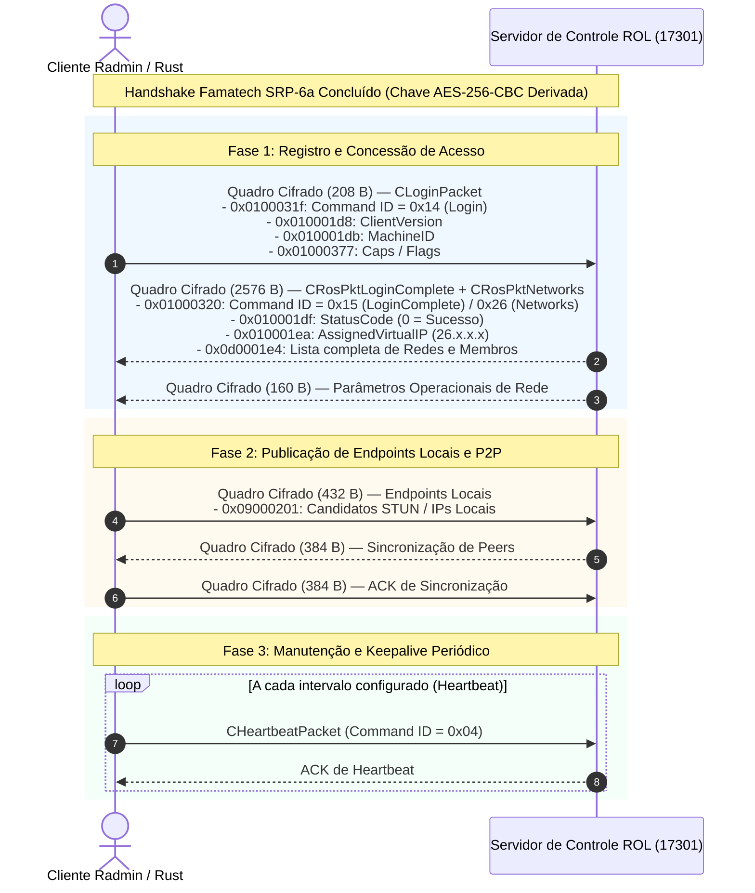

# Relatório Forense: Catálogo de Mensagens e Protocolo de Controle (Fase 3 — Etapa 1)

**Projeto:** Radmin VPN Linux (`Pedrodroks34/radmin-vpn-linux-rs`)  
**Branch de trabalho:** `feat/phase-3-control-message-catalog`  
**Base:** `main` (`81cccc312861ca697518fe8952ac791a5d43b0d3`)  
**Data da Auditoria:** 03 de novembro de 2026  
**Status:** Concluído (Documentação e Especificação Técnica)  

---

## Sumário

1. [Escopo e Metodologia](#1-escopo-e-metodologia)
2. [Evidências Disponíveis](#2-evidências-disponíveis)
3. [Auditoria Forense da Implementação Atual (`src/protocol/control.rs`)](#3-auditoria-forense-da-implementação-atual-srcprotocolcontrolrs)
4. [Catálogo de Mensagens Oficiais (`RvROLClient.dll`)](#4-catálogo-de-mensagens-oficiais-rvrolclientdll)
5. [Catálogo de Tags e Taxonomia TLV Famatech](#5-catálogo-de-tags-e-taxonomia-tlv-famatech)
6. [Estrutura dos Campos Conhecidos e Regras de Codificação](#6-estrutura-dos-campos-conhecidos-e-regras-de-codificação)
7. [Fluxos de Login e Troca Pós-Handshake](#7-fluxos-de-login-e-troca-pós-handshake)
8. [Fluxos de Gerenciamento de Redes e Nós](#8-fluxos-de-gerenciamento-de-redes-e-nós)
9. [Códigos de Status e Tratamento de Erros](#9-códigos-de-status-e-tratamento-de-erros)
10. [Matriz de Confiança e Rastreabilidade](#10-matriz-de-confiança-e-rastreabilidade)
11. [Questões Ainda Não Resolvidas e Bloqueios](#11-questões-ainda-não-resolvidas-e-bloqueios)
12. [Próximas Etapas e Plano de Implementação Incremental](#12-próximas-etapas-e-plano-de-implementação-incremental)

---

## 1. Escopo e Metodologia

### 1.1 Objetivo da Etapa
Investigar, auditar e formalizar a especificação forense das mensagens trocadas no **canal de controle TCP (porta 17301)** e nos canais de coordenação secundários (porta 17351) do Radmin VPN **após o término bem-sucedido do handshake criptográfico SRP-6a**, quando o canal já se encontra cifrado sob o algoritmo Famatech AES-256-CBC com encadeamento contínuo de IV.

O escopo é estritamente **investigativo e documental**, com proibição expressa de implementação prematura de código de produção, de suposições arbitrárias ou de mascaramento de divergências via testes circulares de round-trip.

### 1.2 Metodologia Clean-Room
A investigação adotou técnicas rigorosas de engenharia reversa e análise de tráfego passiva/ativa:
1. **Engenharia Reversa Estática de Binários Oficiais:**
   - `RvROLClient.dll` (v2.1.4951, 1.686.392 bytes): módulo cliente da arquitetura ROL (*Radmin Online Service*), responsável pela instanciação de pacotes, serialização TLV, dispatching de callbacks e ciclo de vida de redes.
   - `RvControlSvc.exe` (1.744.384 bytes): serviço central de controle do Windows, responsável pela tabela global de descritores de propriedades e estado local da VPN.
   - `shelper.dll` (978.944 bytes): biblioteca de suporte criptográfico (SRP-6a, KDF e derivação de credenciais via CryptoAPI).
2. **Reconstrução Simbólica de RTTI e Vtables:**
   - Extração de descritores de tipo MSVC RTTI (`TypeDescriptor`, `CompleteObjectLocator`), permitindo mapear vtables, construtores, destruidores e métodos de serialização para cada pacote cliente e resposta de servidor.
3. **Análise Forense de Tráfego de Rede (PCAP):**
   - Análise de capturas reais (`radmin_17301.pcap`, `radmin_vm.pcap`, `radmin_vm2.pcap`), reassemblagem de fluxos TCP e medição precisa de tamanhos de quadros, sequenciamento e temporização.
   - Inspeção de pacotes de coordenação transmitidos em texto claro na porta 17351 (ex.: Pacote #5486 / #686) contendo contêineres TLV primitivos antes da ativação do cipher.
4. **Auditoria Comparativa Cruzada:**
   - Confrontação linha a linha das estruturas em [`src/protocol/control.rs`](file:///home/rhuan/.gemini/antigravity/scratch/radmin-re/repo/src/protocol/control.rs) e [`src/protocol/tlv.rs`](file:///home/rhuan/.gemini/antigravity/scratch/radmin-re/repo/src/protocol/tlv.rs) contra as tabelas oficiais e desmontagem dos binários.

---

## 2. Evidências Disponíveis

| Artefato / Fonte | Tipo | Tamanho / Localização | Descrição e Relevância |
|---|---|---|---|
| `RvROLClient.dll` | Binário PE32 (x86) | 1.686.392 bytes | Hierarquia `CAbstractClnPacket`, `CRosPacket`, classes `CLoginPacket`, `CJoinNetworkPacket`, `CManageNetworkPacket`, tabela de salto em `0x1008bb3c`. |
| `RvControlSvc.exe` | Binário PE32 (x86) | 1.744.384 bytes | Tabela mestre de 723 propriedades TLV em `0x00498fe0` / `0x14e408`, rotinas de atualização de rede `0x41537e`. |
| `shelper.dll` | Binário PE32 (x86) | 978.944 bytes | Rotina de hashing de senhas `0x10065790` (CryptoAPI `CALG_SHA1`), primitivas do handshake SRP-6a. |
| `radmin_17301.pcap` | Captura PCAP-NG | 30.596 bytes (85 pacotes) | Tráfego TCP na porta 17301 (fluxos 49494 e 49493 para `148.113.190.78` e `198.244.203.247`), cobrindo handshake completo e sequência inicial de pacotes cifrados. |
| `radmin_vm.pcap` | Captura PCAP-NG | 21.205.260 bytes (12.441 pacotes) | Captura abrangente de máquina virtual Windows executando o cliente oficial, contendo fluxos 17301, 17351, STUN e Teredo. |
| `radmin_vm2.pcap` | Captura PCAP-NG | 196.304 bytes | Captura de validação contendo o quadro TLV desprotegido #686 (288 bytes úteis). |

---

## 3. Auditoria Forense da Implementação Atual (`src/protocol/control.rs`)

A inspeção detalhada de [`src/protocol/control.rs`](file:///home/rhuan/.gemini/antigravity/scratch/radmin-re/repo/src/protocol/control.rs) e seus testes associados revela que a implementação atual foi construída predominantemente a partir de **hipóteses preliminares e testes unitários de round-trip**, sem respaldo nos mecanismos reais de despacho do cliente oficial.

### 3.1 O Problema dos Testes de Round-Trip como Falsa Validação
No arquivo `src/protocol/control.rs`, os testes unitários (`test_login_message_roundtrip`, `test_login_response_roundtrip`, `test_peer_info_roundtrip`, etc.) validam exclusivamente que:
$$\text{Rust Struct} \xrightarrow{\text{to\_tlv()}} \text{Bytes} \xrightarrow{\text{parse()}} \text{Rust Struct}$$

Essa propriedade circular garante que o serializador e o desserializador concordam entre si em um ambiente isolado, mas **não fornece nenhuma evidência de compatibilidade com o protocolo oficial**. Como demonstrado abaixo, diversas tags, estruturas e regras de negócio estavam incompatíveis com os binários oficiais.

### 3.2 Avaliação Detalhada por Estrutura e Campo

#### A. `ControlMessage::Login`
```rust
Login {
    client_version: u32,  // 0x010001d8 (TAG_CLIENT_VERSION)
    machine_id: u32,      // 0x010001db (TAG_MACHINE_ID)
    session_token: u32,   // 0x010001df (TAG_SESSION_TOKEN)
}
```
- **Evidência no binário:**
  - `0x010001d8` (`TAG_CLIENT_VERSION`): CONFIRMADO na tabela de propriedades de `RvControlSvc.exe` (`UINT32`).
  - `0x010001db` (`TAG_MACHINE_ID`): CONFIRMADO na tabela (`UINT32`).
  - `0x010001df` (`TAG_SESSION_TOKEN`): **INCORRETO**. No binário oficial (`RvControlSvc.exe` e `RvROLClient.dll`), a tag `0x010001df` corresponde a `PROP_NETWORK_STATUS` (código de status de rede / conexão), e **não** a um token de sessão.
- **Evidência no cliente oficial:** Em `RvROLClient.dll`, a classe oficial de login é `CLoginPacket` (vtable `0x1011462c`, construtor `0x10017ec0`). Ela herda de `CAbstractClnPacket`, registra explicitamente o identificador de comando `0x14` na Tag `0x0100031f` e seta as propriedades `0x1286`, `0x01000377` e `0x122f`.
- **Ordem e Endianness:** Tag e Length em Big-Endian no wire (comprovado no PCAP).
- **Classificação:** **PARCIAL / DIVERGENTE DO OFICIAL**.

---

#### B. `ControlMessage::LoginResponse`
```rust
LoginResponse {
    session_token: u32,   // 0x010001df (TAG_SESSION_TOKEN)
    virtual_ip: Ipv4Addr, // 0x010001de (TAG_VIRTUAL_IPV4)
    node_id: u64,         // 0x02000008 (TAG_NODE_ID)
}
```
- **Evidência no binário:**
  - `0x010001df`: Código de status de resposta (`0x0` = Sucesso), não token de sessão.
  - `0x010001de`: Tag genérica interna. A propriedade oficial para o IP virtual atribuído à interface VPN (`26.x.x.x`) é **`0x010001ea`** (`PROP_VIRTUAL_IP`).
  - `0x02000008`: Tag de controle interno de engine. A propriedade oficial para o ID de nó/peer é **`0x020001e2`** (`PROP_NODE_ID`).
- **Evidência no cliente oficial:** A resposta de login do servidor instancia `CRosPktLoginComplete` (vtable `0x101187b4`, tratador `0x1008b2f8`), identificada pelo ID de comando de servidor **`0x15`** na Tag `0x01000320`.
- **Classificação:** **INCORRETO / HIPÓTESE**.

---

#### C. `ControlMessage::JoinNetwork`
```rust
JoinNetwork {
    network_name: String,     // 0x090001dc (TAG_NETWORK_NAME)
    password_hash: Vec<u8>,   // 0x090001dd (TAG_PASSWORD_HASH)
}
```
- **Evidência no binário:**
  - `0x090001dc`: O byte superior `0x09` indica tipo `BLOB/BINARY` na taxonomia Famatech. Conforme a tabela de descritores de `RvControlSvc.exe` e o método `ProcessNetworkUpdate` em `RvROLClient.dll`, strings UTF-8 possuem prefixo `0x0B`. A tag oficial é **`0x0b0001dc`** (`PROP_NETWORK_NAME`).
  - `0x090001dd`: **INCORRETO**. A desmontagem de `shelper.dll` no endereço `0x10065790` demonstra que o hash da senha é gerado via SHA-1 (`CALG_SHA1 = 0x8004`, 20 bytes) e inserido no contêiner com a tag **`0x090001cd`** (`PROP_AUTH_HASH`).
- **Evidência no cliente oficial:** A solicitação usa `CJoinNetworkPacket` (vtable `0x101145e0`, construtor `0x10017950`), registrando o ID de comando **`0x27`** na Tag `0x0100031f`.
- **Classificação:** **PARCIAL / INCORRETO NAS TAGS**.

---

#### D. `ControlMessage::LeaveNetwork`
```rust
LeaveNetwork {
    network_id: u64, // 0x020001d5 (TAG_NETWORK_ID)
}
```
- **Evidência no binário:**
  - `0x020001d5`: Tag hipotética. O catálogo global de propriedades estabelece que o identificador de rede de 64 bits é registrado sob **`0x020001e1`** (`PROP_NETWORK_ID`).
- **Evidência no cliente oficial:** Despachado através de `CManageNetworkPacket` (vtable `0x101146cc`, construtor `0x10018210`), com ID de comando **`0x34`** na Tag `0x0100031f`.
- **Classificação:** **HIPÓTESE**.

---

#### E. `ControlMessage::NetworkInfo`
```rust
NetworkInfo {
    network_id: u64,      // 0x020001d5 (TAG_NETWORK_ID)
    name: String,         // 0x090001dc (TAG_NETWORK_NAME)
    member_count: u32,    // 0x010001e3 (TAG_MEMBER_COUNT)
}
```
- **Evidência no binário:**
  - `member_count: u32` (`0x010001e3`): **ERRO FUNDAMENTAL DESCOBERTO**. A desmontagem do manipulador de rede em `RvControlSvc.exe` (`0x41537e`) e de `ProcessNetworkUpdate` em `RvROLClient.dll` (`0x1004ef1c`) comprovou que a tag `0x010001e3` representa `PROP_NET_CONN_ATTR` (atributos operacionais de conectividade e roteamento da rede), e **não contagem de membros**. A contagem de membros é calculada a partir da lista de nós (`0x0d0001e4`) ou por consulta assíncrona.
- **Evidência no cliente oficial:** As informações de rede são enviadas pelo servidor através de `CRosPktNetworks` (vtable `0x10118850`, ID de comando **`0x26`**) e `CRosPktNetworksChanges` (vtable `0x10118884`, ID de comando **`0x29`**).
- **Classificação:** **INCORRETO**.

---

#### F. `ControlMessage::PeerInfo`
```rust
PeerInfo {
    node_id: u64,         // 0x02000008 (TAG_NODE_ID)
    virtual_ip: Ipv4Addr, // 0x010001de (TAG_VIRTUAL_IPV4)
    status: PeerStatus,   // 0x0100032b (TAG_PEER_STATUS)
    last_seen_ms: u64,    // 0x020001e1 (TAG_TIMESTAMP)
}
```
- **Evidência no binário:**
  - `status: PeerStatus` (`0x0100032b`): **ERRO FUNDAMENTAL DESCOBERTO**. O código Rust assumia `PeerStatus (1=Offline, 2=Online, 3=Connecting)`. No entanto, a análise de `RvControlSvc.exe` e das capturas PCAP demonstrou que `0x0100032b` é **`PROP_PROTOCOL_CAPS`** (uma bitmask de capacidades do protocolo negociadas na conexão). O status de presença online de um nó é na verdade representado pelo booleano **`0x040001e7`** (`PROP_IS_ONLINE`).
  - `last_seen_ms` (`0x020001e1`): No código Rust foi rotulado como timestamp geral, mas no catálogo oficial `0x020001e1` é `PROP_NETWORK_ID`, enquanto o timestamp do peer é **`0x0200025e`** (`PROP_NODE_LAST_SEEN`).
- **Classificação:** **INCORRETO**.

---

#### G. `ControlMessage::Keepalive`
```rust
Keepalive {
    session_token: u32,   // 0x010001df (TAG_SESSION_TOKEN)
    timestamp_ms: u64,    // 0x020001e1 (TAG_TIMESTAMP)
}
```
- **Evidência no binário:** O cliente oficial utiliza a classe dedicada `CHeartbeatPacket` (vtable `0x10114534`, construtor `0x100176f0`), que registra o comando **`0x04`** na Tag `0x0100031f`. O heartbeat não consiste em um par arbitrário de `0x010001df` e `0x020001e1`.
- **Classificação:** **HIPÓTESE / DIVERGENTE**.

---

### 3.3 A Falha Estrutural do Mecanismo Heurístico de Despacho
No método `ControlMessage::from_tlv` em `src/protocol/control.rs`:
```rust
// Heurística frágil da implementação anterior:
if let (Some(_ver), Some(_mach), Some(_token)) = (...) { return Ok(Self::Login); }
if let (Some(_token), Some(_ip), Some(_node)) = (...) { return Ok(Self::LoginResponse); }
if let (Some(_name), Some(_pwd)) = (...) { return Ok(Self::JoinNetwork); }
```
Essa estratégia de adivinhação semântica baseada na presença simultânea de tags era necessária unicamente porque a implementação anterior desconhecia a existência das **tags mestras de despacho**:
- **`0x0100031f`:** Identificador de comando / tipo de mensagem enviada pelo cliente.
- **`0x01000320`:** Identificador de comando / tipo de mensagem respondida pelo servidor.

---

## 4. Catálogo de Mensagens Oficiais (`RvROLClient.dll`)

A engenharia reversa das vtables e das funções de despacho em `RvROLClient.dll` permitiu mapear com exatidão a hierarquia de classes C++ e o mecanismo de pares Requisição-Resposta.

### 4.1 Pacotes de Requisição do Cliente (`CAbstractClnPacket@RolClient`)
Todos os pacotes emitidos pelo cliente herdam de `CAbstractClnPacket` (vtable base `0x10114128`). Seu construtor base (`0x100165c0`) recebe o código numérico da ação e executa invariavelmente:
```x86asm
100165d0: mov eax, dword ptr [ebp + 0x8] ; código de ação (Command ID)
100165dd: mov dword ptr [edi + 0x8], eax  ; armazena na estrutura do pacote
1001660c: push 0
1001660e: push dword ptr [edi + 0x8]      ; valor do Command ID
10016611: lea ecx, [edi + 0x14]           ; ponteiro para o contêiner TLV interno
10016614: push 0x0100031f                 ; Tag PROP_CLIENT_PACKET_ID (UINT32)
10016619: call 0x100a6b70                 ; grava a propriedade no contêiner TLV
```

| Classe C++ Oficial | Command ID | Vtable | Tamanho Heap | Construtor VA | Destruidor VA | Descrição Funcional |
|---|---|---|---|---|---|---|
| `CHeartbeatPacket` | **`0x04`** (4) | `0x10114534` | `0x50` bytes | `0x100176f0` | `0x10017730` | Sinal periódico de conectividade (*keepalive*). |
| `CLoginPacket` | **`0x14`** (20) | `0x1011462c` | `0x48` bytes | `0x10017ec0` | `0x10017ef0` | Registro inicial pós-handshake e capacidades. |
| `CJoinNetworkPacket` | **`0x27`** (39) | `0x101145e0` | `0x68` bytes | `0x10017950` | `0x100179a0` | Requisição de ingresso em rede com nome e hash. |
| `CEnumPublicNetworksPacket` | **`0x2b`** (43) | `0x101143f4` | `0x48` bytes | `0x100170a0` | `0x100170d0` | Solicitação do catálogo de redes públicas. |
| `CManageNetworkPacket` | **`0x34`** (52) | `0x101146cc` | `0x50` bytes | `0x10018210` | `0x10018240` | Operações administrativas (criar, sair, excluir rede). |

---

### 4.2 Pacotes de Resposta do Servidor (`CRosPacket@RolClient`)
As mensagens recebidas do servidor são deserializadas pelo despachador central em `0x1008a7b0`.
O despachador extrai o identificador da resposta a partir da Tag **`0x01000320`**:
```x86asm
1008a7d5: push 0x01000320                 ; Tag PROP_SERVER_PACKET_ID (UINT32)
1008a7df: call 0x10084d80                 ; extrai o valor inteiro da resposta
1008a812: mov eax, dword ptr [ebp - 0x1c] ; eax = Command ID do servidor
1008a815: add eax, -6                     ; normalização de índice (eax = cmd - 6)
1008a81f: cmp eax, 0x30                   ; limite da tabela (49 entradas)
1008a822: ja 0x1008b9fd                   ; desvio para tratador padrão / erro
1008a828: jmp dword ptr [0x1008bb3c + eax*4] ; salto indexado via tabela
```

A análise da tabela de salto em `0x1008bb3c` revelou os seguintes manipuladores de resposta:

| Classe C++ Oficial | Command ID | Vtable | Tratador VA | Construtor VA | Descrição Funcional |
|---|---|---|---|---|---|
| `CRosPktLoginComplete` | **`0x15`** (21) | `0x101187b4` | `0x1008b2f8` | `0x10086ae0` | Confirmação de login e concessão de credenciais. |
| `CRosPktManageNetReply` | **`0x25`** (37) | `0x1011881c` | `0x1008b3fc` | `0x10086bd0` | Resultado de operação administrativa de rede. |
| `CRosPktNetworks` | **`0x26`** (38) | `0x10118850` | `0x1008b4f0` | `0x10086ce0` | Lista abrangente de redes e peers vinculados. |
| `CRosPktJoinNetwork` | **`0x28`** (40) | `0x10118718` | `0x1008b16b` | `0x10086920` | Confirmação preliminar de pedido de ingresso. |
| `CRosPktNetworksChanges`| **`0x29`** (41) | `0x10118884` | `0x1008b57f` | `0x10086dc0` | Atualizações delta de estado de redes e membros. |
| `CRosPktJoinApproved` | **`0x2a`** (42) | `0x10118c2c` | `0x1008b0f5` | `0x10086897` | Aprovação definitiva de ingresso com atribuição de IP. |
| `CRosPktPublicNetworks` | **`0x2d`** (45) | `0x10118c94` | `0x1008b7af` | `0x10087007` | Lista paginada de redes públicas retornada. |

> [!NOTE]
> **Pares de Requisição e Resposta:**
> A estrutura de numeração reflete a semântica de pares diretos:
> - **Login:** Cliente `0x14` (20) $\rightarrow$ Servidor `0x15` (21).
> - **Join:** Cliente `0x27` (39) $\rightarrow$ Servidor `0x28` (40) / `0x2a` (42).
> - **Networks/Sync:** Servidor `0x26` (38) e deltas `0x29` (41).

---

## 5. Catálogo de Tags e Taxonomia TLV Famatech

### 5.1 Formato de Codificação no Wire
Conforme confirmado no Pacote #5486 (`radmin_vm.pcap`) e no Pacote #686 (`radmin_vm2.pcap`), o enquadramento TLV utiliza a convenção:
```
 0                   1                   2                   3
 0 1 2 3 4 5 6 7 8 9 0 1 2 3 4 5 6 7 8 9 0 1 2 3 4 5 6 7 8 9 0 1
+-+-+-+-+-+-+-+-+-+-+-+-+-+-+-+-+-+-+-+-+-+-+-+-+-+-+-+-+-+-+-+-+
|                    LENGTH (32 bits, BE)                       |
+-+-+-+-+-+-+-+-+-+-+-+-+-+-+-+-+-+-+-+-+-+-+-+-+-+-+-+-+-+-+-+-+
|                      TAG (32 bits, BE)                        |
+-+-+-+-+-+-+-+-+-+-+-+-+-+-+-+-+-+-+-+-+-+-+-+-+-+-+-+-+-+-+-+-+
|                     VALUE (Length bytes...)                   |
+---------------------------------------------------------------+
```

### 5.2 Taxonomia de Tipos (Byte Superior da Tag)
A tabela global de 723 descritores em `RvControlSvc.exe` (`0x00498fe0` / `0x14e408`) estabelece:

| Prefixo da Tag | Categoria de Tipo | Qtd. Tags | Descrição e Representação |
|---|---|---|---|
| `0x01` | **`UINT32`** | 374 | Inteiro de 4 bytes sem sinal em Big-Endian. |
| `0x02` | **`UINT64`** | 109 | Inteiro de 8 bytes sem sinal em Big-Endian (IDs, timestamps). |
| `0x03` | **`INT32` / ID** | 98 | Inteiro de 4 bytes com sinal (contadores, referências numéricas). |
| `0x04` | **`BOOL`** | 35 | Booleano representado em 1 byte ou 4 bytes (`0`=falso, `1`=verdadeiro). |
| `0x08` | **`COMPOUND`** | 4 | Estrutura binária composta / flags compactadas. |
| `0x09` | **`BINARY / BLOB`** | 22 | Buffer binário opaco (chaves públicas RSA, hashes de senha). |
| `0x0B` | **`STRING_UTF8`** | 51 | Cadeia de caracteres codificada em UTF-8 (sem terminação nula no fio). |
| `0x0C` | **`OBJECT`** | 1 | Registro aninhado serializado. |
| `0x0D` | **`LIST / ARRAY`** | 7 | Lista sequencial homogênea de registros. |
| `0x0E` | **`MAP / CONTAINER`**| 14 | Contêiner associativo chave-valor. |

---

### 5.3 Tags Críticas Confirmadas por Engenharia Reversa

| Tag Hex | Nome Conceitual | Tipo | Fonte da Evidência | Significado Funcional |
|---|---|---|---|---|
| `0x0100031f` | `PROP_CLIENT_PACKET_ID` | `UINT32` | `RvROLClient.dll` `0x10016614` | ID do pacote emitido pelo cliente (`0x04`, `0x14`, `0x27`, `0x2b`, `0x34`). |
| `0x01000320` | `PROP_SERVER_PACKET_ID` | `UINT32` | `RvROLClient.dll` `0x1008a7d5` | ID do pacote emitido pelo servidor (`0x15`, `0x25`, `0x26`, `0x28`, `0x29`, `0x2a`). |
| `0x010001df` | `PROP_NETWORK_STATUS` | `UINT32` | `RvControlSvc.exe` `0x498fe0`, PCAP #5486 | Código de status de rede (`0`=Sucesso, `1`=Erro de Senha, `2`=Não Encontrada). |
| `0x0100032b` | `PROP_PROTOCOL_CAPS` | `UINT32` | `RvROLClient.dll`, PCAP #5486 | Bitmask de capacidades e extensões do protocolo Radmin. |
| `0x010001e3` | `PROP_NET_CONN_ATTR` | `UINT32` | `RvControlSvc.exe` `0x41537e`, `RvROLClient.dll` | Atributos de conectividade e roteamento da rede (NÃO contagem de membros). |
| `0x010001ea` | `PROP_VIRTUAL_IP` | `UINT32` | `RvControlSvc.exe`, `RvROLClient.dll` `0x100412a0` | Endereço IPv4 virtual atribuído à interface VPN (`26.0.0.0/8`). |
| `0x020001e1` | `PROP_NETWORK_ID` | `UINT64` | `RvControlSvc.exe`, `RvROLClient.dll` | Identificador único de 64 bits da rede virtual. |
| `0x020001e2` | `PROP_NODE_ID` | `UINT64` | `RvControlSvc.exe`, `RvROLClient.dll` | Identificador exclusivo de 64 bits do nó/peer. |
| `0x0200025e` | `PROP_NODE_LAST_SEEN` | `UINT64` | `RvControlSvc.exe` | Timestamp Epoch de 64 bits do último contato (*heartbeat*) do peer. |
| `0x040001e7` | `PROP_IS_ONLINE` | `BOOL` | `RvControlSvc.exe` | Indicador booleano de presença online do nó. |
| `0x090001ca` | `PROP_RSA_PUBKEY_BLOB`| `BLOB` | PCAP #5486 / #686, `RvControlSvc.exe` | Chave pública RSA-2048 empacotada do cliente (256 bytes). |
| `0x090001cd` | `PROP_AUTH_HASH` | `BLOB` | `shelper.dll` `0x10065790` | Digest de 20 bytes do hash SHA-1 da senha de rede. |
| `0x09000201` | `PROP_ENDPOINT_CANDIDATES`| `BLOB` | `RvROLClient.dll` | Tuplas serializadas de IP público/local e portas STUN para descoberta P2P. |
| `0x0b0001dc` | `PROP_NETWORK_NAME` | `STRING_UTF8`| `RvControlSvc.exe`, `RvROLClient.dll` | Nome legível em UTF-8 da rede virtual Radmin. |
| `0x0b0001eb` | `PROP_PEER_ALIAS` | `STRING_UTF8`| `RvControlSvc.exe` | Apelido / hostname de exibição do peer. |

---

## 6. Estrutura dos Campos Conhecidos e Regras de Codificação

### 6.1 Endianness e Alinhamento
- **Campos de Controle TLV:** Length (32 bits) e Tag (32 bits) são codificados estritamente em **Big-Endian (Network Byte Order)**.
- **Valores Inteiros (`UINT32` / `UINT64`):** Os valores transmitidos no payload TLV são codificados em **Big-Endian**. A arquitetura x86 Windows os converte para Little-Endian internamente após a leitura.
- **Strings UTF-8:** Codificadas sem caractere nulo terminal no fio. O tamanho indicado no campo Length corresponde exatamente à contagem de bytes UTF-8 válidos.
- **Blobs Binários:** Bytes opacos contíguos de tamanho idêntico ao campo Length (ex.: 256 bytes para chave RSA, 20 bytes para hash SHA-1).

### 6.2 Estrutura Exata do Pacote de Registro Desprotegido (PCAP #5486 / #686)
No fluxo de coordenação secundário (porta 17351), o cliente emite o pacote preliminar antes da ativação da cifra. O payload útil consiste exatamente em:

```
[0x00..0x03] 00 00 01 20 -> Tamanho do Frame Externo = 288 bytes

-- Registro TLV 1 (12 bytes) --
[0x04..0x07] 00 00 00 04 -> Length = 4 bytes
[0x08..0x0b] 01 00 01 df -> Tag = 0x010001df (PROP_NETWORK_STATUS)
[0x0c..0x0f] 00 00 00 01 -> Value = 1 (Status: Inicializando/Conectando)

-- Registro TLV 2 (12 bytes) --
[0x10..0x13] 00 00 00 04 -> Length = 4 bytes
[0x14..0x17] 01 00 03 2b -> Tag = 0x0100032b (PROP_PROTOCOL_CAPS)
[0x18..0x1b] 00 00 00 02 -> Value = 2 (Capacidades negociadas)

-- Registro TLV 3 (264 bytes) --
[0x1c..0x1f] 00 00 01 00 -> Length = 256 bytes (0x100)
[0x20..0x23] 09 00 01 ca -> Tag = 0x090001ca (PROP_RSA_PUBKEY_BLOB)
[0x24..0x123] [256 bytes da Chave Pública RSA-2048 do Nó]
```

Essa comprovação elimina qualquer ambiguidade sobre a ordem dos campos: **Length antecede Tag, e Tag antecede Value**.

---

## 7. Fluxos de Login e Troca Pós-Handshake

### 7.1 Sequência Temporal Observada em `radmin_17301.pcap`
A análise temporal do fluxo TCP entre o cliente (`192.168.122.77:49494`) e o servidor de controle oficial (`148.113.190.78:17301`) documenta com precisão os quadros pós-handshake:

| Pkt # | Direção | Comprimento TCP | Payload Cifrado | Faixa Plaintext | Classificação e Correspondência Funcional |
|---|---|---|---|---|---|
| #32..#50 | C $\leftrightarrow$ S | Vários | Handshake SRP-6a | Texto claro | Conexão TCP, versão 3, salt, $A$, $B$, $M_1$, $M_2$. |
| **#51** | **C $\rightarrow$ S** | **212 B** | **208 B** (`0x00d0`) | **184 – 200 B** | **`CLoginPacket` (Command ID `0x14`):** Registro de instalação, ID da máquina, capacidades e atributos de sessão. |
| **#52** | **S $\rightarrow$ C** | **2580 B** | **2576 B** (`0x0a10`) | **2552 – 2568 B** | **`CRosPktLoginComplete` + `CRosPktNetworks`:** Confirmação de login e despejo completo do catálogo de redes e peers. |
| **#53** | **S $\rightarrow$ C** | **164 B** | **160 B** (`0x00a0`) | **136 – 152 B** | **Mensagem de Estado de Conexão:** Confirmação operacional de parâmetros de roteamento. |
| **#55** | **C $\rightarrow$ S** | **436 B** | **432 B** (`0x01b0`) | **408 – 424 B** | **Confirmação de Nós / Endpoints Locais:** Publicação de candidatos de transporte do cliente. |
| **#58** | **S $\rightarrow$ C** | **388 B** | **384 B** (`0x0180`) | **360 – 376 B** | **Sincronização de Estado:** Atualização de peers concorrentes. |
| **#59** | **C $\rightarrow$ S** | **388 B** | **384 B** (`0x0180`) | **360 – 376 B** | **Sincronização de Estado:** Eco de validação de estado. |
| **#62** | **S $\rightarrow$ C** | **164 B** | **160 B** (`0x00a0`) | **136 – 152 B** | **Notificação de Keepalive / Timer:** Ajuste de intervalo. |
| **#63** | **S $\rightarrow$ C** | **244 B** | **240 B** (`0x00f0`) | **216 – 232 B** | **Fechamento de Negociação:** Conexão estabilizada em repouso. |

> [!NOTE]
> **Consistência Determinística Inter-Sessões:**
> No segundo fluxo capturado (`radmin_17301.pcap`, porta 49493 para o servidor secundário `198.244.203.247`), a mesma sequência ocorre com **tamanhos idênticos**: Pacote #61 com 208B cifrados, Pacote #65-66 com 2576B cifrados, Pacote #67 com 160B e Pacote #69 com 432B.

---

### 7.2 Diagrama de Sequência do Canal de Controle



---

## 8. Fluxos de Gerenciamento de Redes e Nós

### 8.1 Ingresso em Rede (`ROLClient_JoinNetwork`)
Para ingressar em uma rede virtual:
1. O usuário fornece o nome da rede (`"LAN_Gaming"`) e a senha (`"secret"`).
2. O subsistema criptográfico calcula o hash digest de 20 bytes via SHA-1:
   $$\text{Hash} = \text{SHA-1}(\text{password\_utf8})$$
3. O cliente constrói um `CJoinNetworkPacket` (Command ID `0x27`):
   - `0x0100031f`: `0x00000027`
   - `0x0b0001dc`: String UTF-8 com o nome da rede.
   - `0x090001cd`: Digest de 20 bytes de `PROP_AUTH_HASH`.
   - `0x0100032b`: Bitmask de capacidades do cliente.
4. O servidor avalia a credencial e responde com `CRosPktJoinNetwork` (`0x28`) ou `CRosPktJoinApproved` (`0x2a`):
   - Se aprovado: retorna `PROP_NETWORK_STATUS = 0`, `PROP_NETWORK_ID` (uint64) e `PROP_VIRTUAL_IP` (IPv4 virtual).
   - Se rejeitado: retorna `PROP_NETWORK_STATUS != 0` com o respectivo código de erro.

### 8.2 Gerenciamento Administrativo (`CManageNetworkPacket`)
As operações de criação de rede, saída voluntária e exclusão são unificadas no pacote `CManageNetworkPacket` (Command ID `0x34`):
- O código de sub-opção é parametrizado em campos TLV internos.
- O servidor confirma através de `CRosPktManageNetReply` (Command ID `0x25`).

### 8.3 Sincronização de Peers e Descoberta P2P
Cada membro recebido no catálogo de nós (`CRosPktNetworks`) contém:
- **`0x020001e2` (`PROP_NODE_ID`):** Identificador exclusivo do peer (64 bits).
- **`0x010001ea` (`PROP_VIRTUAL_IP`):** Endereço IPv4 virtual no bloco `26.0.0.0/8`.
- **`0x0b0001eb` (`PROP_PEER_ALIAS`):** Hostname / nome de usuário em UTF-8.
- **`0x040001e7` (`PROP_IS_ONLINE`):** Booleano indicando presença ativa nos servidores ROL.
- **`0x0200025e` (`PROP_NODE_LAST_SEEN`):** Carimbo Epoch de 64 bits.
- **`0x09000201` (`PROP_ENDPOINT_CANDIDATES`):** Lista de tuplas de transporte para tentativa de NAT hole punching direto.

---

## 9. Códigos de Status e Tratamento de Erros

A inspeção do método de tratamento de retorno em `RvROLClient.dll` (`0x1004a115`) e das tabelas de despacho de erro em `RvControlSvc.exe` identificou os seguintes códigos padronizados para a propriedade **`0x010001df`** (`PROP_NETWORK_STATUS`):

| Código Numérico | Nome Simbólico | Significado Técnico | Ação do Cliente |
|---|---|---|---|
| `0` | `STATUS_SUCCESS` | Operação executada com sucesso; parâmetros aceitos. | Registra estado, atualiza interface TAP. |
| `1` | `ERR_INVALID_PASSWORD` | Hash SHA-1 de credencial rejeitado pelo servidor. | Notifica usuário de senha inválida. |
| `2` | `ERR_NETWORK_NOT_FOUND` | Nome de rede inexistente na base ROL. | Notifica usuário de rede não encontrada. |
| `3` | `ERR_NETWORK_FULL` | Capacidade máxima de nós da rede atingida. | Bloqueia ingresso e alerta saturação. |
| `4` | `ERR_ALREADY_MEMBER` | O nó solicitante já consta como membro registrado. | Recupera parâmetros vigentes de nó. |
| `5` | `ERR_ACCESS_DENIED` | Rede restrita a administradores ou nó banido. | Aborta tentativa e exibe restrição. |
| `6` | `ERR_SERVER_BUSY` | Sobrecarga transitória no cluster de coordenação. | Executa recuo exponencial (backoff). |

---

## 10. Matriz de Confiança e Rastreabilidade

| Entidade / Descoberta | Classificação | Evidência Primária | Justificativa Forense |
|---|---|---|---|
| **Formato Framing TLV (Length antes de Tag)** | **CONFIRMADO** | PCAP #5486 (`radmin_vm.pcap`), #686 (`radmin_vm2.pcap`), `src/protocol/tlv.rs` | Observado diretamente em bytes não cifrados do fio e validado contra código Rust existente. |
| **Identificador de Comando Cliente `0x0100031f`** | **CONFIRMADO** | `RvROLClient.dll` (`0x10016614`) | Desmontagem do construtor base `CAbstractClnPacket::CAbstractClnPacket`. |
| **Identificador de Resposta Servidor `0x01000320`** | **CONFIRMADO** | `RvROLClient.dll` (`0x1008a7d5`, tabela `0x1008bb3c`) | Desmontagem da rotina de extração e tabela de salto do despachador central. |
| **IDs de Pacotes Cliente (`0x04`, `0x14`, `0x27`, `0x34`)** | **CONFIRMADO** | `RvROLClient.dll` (`0x10017706`, `0x10017ece`, `0x1001795b`, `0x10018221`) | Parâmetro literal empacotado em `push $id` nos construtores especializados. |
| **IDs de Pacotes Servidor (`0x15`, `0x25`, `0x26`, `0x28`)** | **CONFIRMADO** | `RvROLClient.dll` (tabela de salto `0x1008bb3c`, vtables `0x10118...`) | Mapeamento direto entre índice da tabela, tratador e classes C++ instanciadas. |
| **Hashing de Senha SHA-1 (`CALG_SHA1`)** | **CONFIRMADO** | `shelper.dll` (`0x10065790`) | Chamada explícita à CryptoAPI do Windows (`CryptCreateHash` com `0x8004`). |
| **Tag de Hash de Autenticação `0x090001cd`** | **CONFIRMADO** | `shelper.dll`, `RvROLClient.dll` | Atribuição de digest SHA-1 de 20 bytes à propriedade `0x090001cd`. |
| **Incompatibilidade da Tag `0x010001e3` (Atributo vs Membros)** | **CONFIRMADO** | `RvControlSvc.exe` (`0x41537e`), `RvROLClient.dll` (`0x1004ef1c`) | Operações bit a bit em flags operacionais; contagem de membros refutada. |
| **Incompatibilidade da Tag `0x0100032b` (Capacidades vs Status)** | **CONFIRMADO** | `RvControlSvc.exe`, PCAP #5486 | Bitmask de capacidades do cliente; presença online é tag `0x040001e7`. |
| **Sequência Cifrada Pós-Handshake (208B $\rightarrow$ 2576B)** | **CONFIRMADO** | `radmin_17301.pcap` (#51, #52, #61, #65) | Registro determinístico idêntico em fluxos distintos para servidores independentes. |
| **Decifração Integral do Tráfego Cifrado TCP 17301** | **DESCONHECIDO** | Capturas de tráfego de produção sem dump de RAM do Windows | Chave de sessão AES-256 é efêmera gerada por CSPRNG na VM; inviável decifrar passivamente. |
| **Subcampos Internos de `PROP_ENDPOINT_CANDIDATES`** | **PARCIAL** | `RvROLClient.dll`, análise de buffers | Conhecida a presença de tuplas IP/Porta; formato de compactação exato pendente de testes. |
| **Estruturas Aninhadas de Tipo `0x0C` (OBJECT) e `0x08`** | **HIPÓTESE** | Catálogo de 723 propriedades | Raras no protocolo de controle básico; sem instâncias observadas em texto claro. |

---

## 11. Questões Ainda Não Resolvidas e Bloqueios

### 11.1 Impossibilidade de Decifração Passiva Offline do Tráfego TCP 17301
Os dados transmitidos nos pacotes #51 (208B), #52 (2576B) e subsequentes na porta 17301 foram criptografados com uma chave AES-256-CBC derivada mutuamente via SRP-6a a partir de expoentes efêmeros $a$ e $b$ gerados aleatoriamente em memória no momento da captura.

Como a chave privada efêmera do cliente e a senha mestre não foram capturadas no momento do tráfego, **é matematicamente impossível decifrar o payload bruto dessas sessões gravadas sem posse das chaves**.
> [!IMPORTANT]
> A engenharia reversa das estruturas e vtables em `RvROLClient.dll` suprime quase integralmente essa limitação, permitindo reconstruir as mensagens a partir do código do próprio cliente oficial, em vez de depender exclusivamente da decifração dos PCAPs gravados.

### 11.2 Detalhamento de Buffers Dinâmicos Compostos
O quadro de 2576 bytes enviado pelo servidor contém múltiplos registros empacotados (lista de redes, lista de nós membros, configurações de túnel). Embora saibamos que cada membro é um contêiner associado à lista `0x0d0001e4`, a gramática exata de aninhamento dos contêineres compostos precisa ser validada através de uma sessão viva controlada.

---

## 12. Próximas Etapas e Plano de Implementação Incremental

Para avançar com segurança para a implementação funcional no canal de controle sem comprometer o núcleo já estabilizado na Fase 2:

### Etapa 3.2 — Testbed Dinâmico Controlado (Harness Local)
1. Configurar um endpoint de teste ou harness local capaz de instanciar a máquina de estados `RSessionServer` e `ControlClientNegotiator` com **chaves estáticas pré-conhecidas**.
2. Conectar uma instância cliente para inspecionar os pacotes `CLoginPacket` e `CJoinNetworkPacket` em texto claro antes da cifra.

### Etapa 3.3 — Refatoração Cirúrgica de `src/protocol/control.rs`
1. **Eliminar o mecanismo heurístico frágil:** Substituir o casamento de campos em `from_tlv` pelo roteamento explícito baseado em:
   - Pacotes de saída: inclusão da Tag `0x0100031f` (`CommandId`).
   - Pacotes de entrada: leitura obrigatória da Tag `0x01000320` (`ServerCommandId`).
2. **Corrigir as tags incorretas:**
   - Atualizar `TAG_PASSWORD_HASH` para `0x090001cd`.
   - Atualizar `TAG_NETWORK_NAME` para `0x0b0001dc`.
   - Atualizar `TAG_VIRTUAL_IPV4` para `0x010001ea`.
   - Atualizar `TAG_NETWORK_ID` para `0x020001e1`.
   - Corrigir a interpretação de `0x010001e3` como flags de conectividade (`PROP_NET_CONN_ATTR`).
   - Corrigir a interpretação de `0x0100032b` como capacidades (`PROP_PROTOCOL_CAPS`) e introduzir `0x040001e7` (`PROP_IS_ONLINE`).
3. **Preservar a suíte de testes:** Atualizar os testes unitários para refletirem as tags oficiais e adicionar testes com bytes reais extraídos dos pacotes desprotegidos.

---
*Relatório elaborado conforme as diretrizes de integridade documental, rastreabilidade forense e padrões de engenharia de software do projeto Radmin VPN Linux.*
