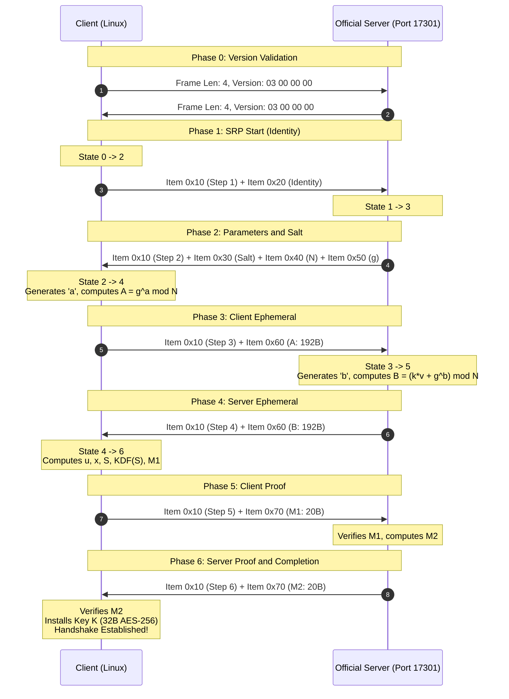

# Control Handshake Specification (`SHelper_*` Family)

> **Project**: Radmin VPN Linux (Interoperability with the Official Client)  
> **Status**: Phase 2 — Reverse Engineering and Forensic Specification  
> **Binary reference**: `shelper.dll` (v1.0.0.1 / v2.1.x) and `RvROLClient.dll` (v2.1.x)  
> **Reference PCAP captures**: `radmin_17301.pcap`, `radmin_vm.pcap`, `radmin_vm2.pcap`  

---

## 1. Overview and Discovery Context

In Phase 1 (`SHelper_RSession_*`), reverse engineering identified that `shelper.dll` exports two independent and mutually exclusive families of cryptographic handshake:

1. **Family A — `SHelper_RSession_*`** (`0x1006b860`, `0x1006a2b0`, `0x1006ba80`):
   - RSA-2048 handshake (`RSA_PKCS1_PADDING`) with an exchange of a 256-byte block containing 64 bytes of CSPRNG output (`RAND_bytes`).
   - Implemented and verified in Phase 1.
2. **Family B — `SHelper_*`** (`0x1006ab90`, `0x1006ad20`, `0x1006b1e0`, `0x1006b010`, `0x1006b1d0`):
   - Mutual authentication and key agreement handshake based on **SRP-6a** (Secure Remote Password, tjw / Thomas J. Wu implementation) with a 1536-bit modular prime and generator $g = 5$.
   - Used by the control and network-management subsystem (`RvROLClient.dll!FamRT::CSRPHelperInstance`, `RolClient::CSRPClient`, `RolClient::CRosProtocol_SRP_ManageNetwork`).
   - It is the protocol executed on the TCP control connections on port `17301` identified in the PCAPs (`radmin_17301.pcap` flows `49494` and `49493`, and `radmin_vm2.pcap` flows `49526`, `49537`, `49538`).

### Forensic Confidence Matrix

| Component / Characteristic | Classification | Binary / Network Evidence |
|---|---|---|
| Cryptographic algorithm (SRP-6a) | **CONFIRMED** | Method tables `0x100ad75c` (`"SRP-6a client (tjw)"`) and `0x100ad7b4` (`"SRP-6a server (tjw)"`) in `shelper.dll`. |
| Network protocol version (`version = 3`) | **CONFIRMED** | `shelper.dll!0x1006b1d0` (`return 3`), `0x1006ab80` (`param_1 == 3`), verified in all PCAP flows in the initial packet `00 00 00 04 03 00 00 00`. |
| Modular SRP group (1536 bits, $g = 5$) | **CONFIRMED** | 192-byte buffer verified at `shelper.dll!0x100ac280`, checked at `0x100699e0` (modulus validator), and 1-byte generator at `0x100ac279` (`0x05`). |
| SRP multiplier ($k = 3$) | **CONFIRMED** | `shelper.dll!0x100607d0`: `piVar1 = FUN_1005f6e0(3)` passing `k = 3` to `0x10060510`. |
| TLV item framing (`0x100626e0` / `0x10062900`) | **CONFIRMED** | Tag in the top 5 bits (`0xF8000000`), length in the lower 27 bits (`0x07FFFFFF`), 4-byte header in network byte order (big-endian). |
| Handshake tags (`0x10`..`0x70`) | **CONFIRMED** | Disassembly of `0x10066680` (Client) and `0x100670d0` (Server). |
| Client state machine (Cases 0, 2, 4, 6) | **CONFIRMED** | Full disassembly of `shelper.dll!0x10066680`. |
| Server state machine (Cases 1, 3, 5) | **CONFIRMED** | Full disassembly of `shelper.dll!0x100670d0`. |
| Key derivation function (40-byte KDF) | **CONFIRMED** | `shelper.dll!0x10061790`: iterative SHA-1 over $S || counter_be32$ producing 40 bytes (`0x28`). |
| AES-256 key installation in the `CChannel` | **CONFIRMED** | `RvROLClient.dll!0x1003dd40` and `0x100df250`: extracts the first 32 bytes (`0x20`) and installs them in `SHelper_CChannel_SetKeyEnc` / `SetKeyDec`. |
| Identity / username encoding | **CONFIRMED** | `shelper.dll!0x10066680` Case 0: explicit conversion of little-endian `wchar_t` to big-endian UTF-16 (16-bit word byte swap). |
| Credential structure after the handshake | **PARTIAL** | Exchange of authenticated messages in the TLV catalog after the keyed handshake (Phase 3). |

---

## 2. Cryptographic Group Parameters (SRP-1536)

The cryptographic group used by `shelper.dll` is a 1536-bit group compatible with the SRP parameters of Tom Wu / RFC 5054.

### 2.1 Modular Prime $N$ (1536 bits / 192 bytes)
Location: `shelper.dll!0x100ac280`:
```text
e634471e75f2d76a0a3f5e252c5a6efb48edad645d31d9ecbc400416e14f5c6c
2ed378602d6eb8e9478b99e6474932393538b4be7177e0e05d3aaed17b5ae87a
a20f3dad37af019518f45b6dde76b2bfdfb140f379cc15383b304b7975b90796
7553cd6fdaf08d68832b603120430a501067d21beb2ce2275a20036a2dc80f1c
9d3ab9221afd5baceda5c2a31077c54fc6f274aaeba17ddd0b5c68f4f8e751a8
90a58648147a82e6f4f532ccdc939a12942799a713500e17dd4f6ff216cd54c7
```

### 2.2 Generator $g$
Location: `shelper.dll!0x100ac279`:
```text
g = 5 (0x05)
```

### 2.3 Parameter Multiplier $k$
Location: `shelper.dll!0x100607d0`:
```text
k = 3 (0x03)
```

### 2.4 Hash Function
- **SHA-1** ($160$ bits / $20$ bytes output).
- Internal routines: `0x10028810` (`SHA1_Init`), `0x100285f0` (`SHA1_Update`), `0x100286d0` (`SHA1_Final`).

---

## 3. Framing Protocol

Control communication on TCP port `17301` occurs in two framing layers:

### 3.1 Outer Layer: TCP Transport (Length-Prefixed)
Each message carried over the TCP connection has a 4-byte prefix in **big-endian**, indicating the exact length of the payload that follows:
```text
+-------------------------+-----------------------------------------+
| Length (4B big-endian)  | Payload (N bytes)                       |
+-------------------------+-----------------------------------------+
```

### 3.2 Initial Protocol Version Negotiation
Immediately after the TCP connection is established (SYN / SYN-ACK / ACK):
1. The client sends a 4-byte frame containing the version:
   - Wire bytes: `00 00 00 04 03 00 00 00` (Length = 4, Protocol Version = 3 little-endian).
2. The server responds by echoing the version frame:
   - Wire bytes: `00 00 00 04 03 00 00 00`.
3. Validation (`0x1006ab80`): if the value is different from `3`, the connection is aborted.

### 3.3 Inner Layer: TLV Items (`0x100626e0` and `0x10062900`)
Within the SRP handshake payloads, the data is organized as a sequence of compact TLV items. Each item has a fixed 4-byte header:
```text
Bits 31..27 (5 bits): Tag identifier (0x10, 0x20, 0x30, 0x40, 0x50, 0x60, 0x70)
Bits 26..0  (27 bits): Length of the value in bytes (0 .. 134.217.727)
```
In memory and on the wire, the header is assembled in big-endian:
$$\text{Header} = (\text{Tag} \ \& \ \text{0xF8000000}) \ | \ (\text{Length} \ \& \ \text{0x07FFFFFF})$$

#### Catalog of Official Tags (`shelper.dll!0x10066680` and `0x100670d0`):

| Tag Value | Mapping in SRP | Description and Structure |
|---|---|---|
| `0x10000000` | Step Number | Protocol sub-state (4 bytes, `u32` little-endian: 1, 2, 3, 4, 5, 6). |
| `0x20000000` | Identity / Username | User/machine identity (UTF-16 byte-swapped characters). |
| `0x30000000` | Salt ($s$) | User salt generated by the server ($S$ bytes, typically 16 or 32 bytes). |
| `0x40000000` | Modulus $N$ | 1536-bit modular prime (192 bytes big-endian) or generator. |
| `0x50000000` | Generator $g$ | Generator $g = 5$ (1 byte) or auxiliary parameter. |
| `0x60000000` | Public Ephemeral | Public ephemeral key ($A$ sent by the client; $B$ sent by the server; 192 bytes). |
| `0x70000000` | Proof ($M_1$ / $M_2$) | Proof of key possession (20 bytes SHA-1: $M_1$ from the client; $M_2$ from the server). |

---

## 4. Strict State Machine of the Handshake

The state machine executes a synchronous sequence of 6 steps between Client and Server:



### 4.1 Step 1: Client Initialization (Client State 0, `0x10066680`)
- **Input**: None (`in_buf == NULL`).
- **Actions**:
  1. Sets `state = 1`, builds Item `0x10000000` with value `00 00 00 01` (4 bytes LE).
  2. Obtains the user identity (`wchar_t`), reverses the endianness of each 16-bit character to UTF-16BE.
  3. Builds Item `0x20000000` with the identity buffer.
  4. Transitions to `state = 2` (`WaitingServerParams`).
- **Output**: Concatenated buffer containing Item 1 + Item 2.

### 4.2 Step 2: Server Parameters (Server State 1, `0x100670d0`)
- **Input**: Buffer from Step 1.
- **Validations**:
  - The first item MUST be `0x10000000` with value `1`.
  - The second item MUST be `0x20000000` (identity).
- **Actions**:
  1. Locates the user data (salt $s$ and verifier $v = g^x \pmod N$).
  2. Builds Item `0x10000000` with value `00 00 00 02`.
  3. Builds Item `0x30000000` with salt $s$.
  4. Builds Item `0x40000000` with the modular prime $N$ (192 bytes).
  5. Builds Item `0x50000000` with the generator $g = 5$ (1 byte).
  6. Transitions to `state = 3`.

### 4.3 Step 3: Client Ephemeral Public Key (Client State 2, `0x10066680`)
- **Input**: Buffer from Step 2.
- **Validations**:
  - Item `0x10000000` with value `2`.
  - Item `0x30000000` (salt $s$).
  - Items `0x40000000` and `0x50000000` validated against the expected group ($N$ and $g$). If they diverge, transitions immediately to `Failed` (fail-closed).
- **Actions**:
  1. Generates a cryptographically secure ephemeral secret exponent $a$ via the dedicated generator `random_srp_exponent`:
     - Uses a CSPRNG with 1536 bits of entropy.
     - Applies rejection sampling, strictly guaranteeing $1 < a < N - 1$ (non-trivial, without neutralization by spurious modular operations).
  2. Computes the ephemeral public key:
     $$A = g^a \pmod N$$
  3. Builds Item `0x10000000` with value `00 00 00 03`.
  4. Builds Item `0x60000000` with $A$ (192 bytes big-endian, canonical).
  5. Transitions to `state = 4` (`WaitingServerProof`).

### 4.4 Step 4: Server Ephemeral Public Key (Server State 3, `0x100670d0`)
- **Input**: Buffer from Step 3.
- **Validations**:
  - Item `0x10000000` with value `3`.
  - Item `0x60000000` containing $A$:
    - Strict canonical validation via `validate_srp_public_value`: exact length of 192 bytes, $1 \le A < N$, and $A \pmod N \ne 0$.
    - Rejection of null, truncated or $\ge N$ values, transitioning to `Failed` on any violation.
- **Actions**:
  1. Generates a secret ephemeral exponent $b$ via `random_srp_exponent` ($1536$ bits, $1 < b < N - 1$).
  2. Computes the server's ephemeral public key:
     $$B = (k \cdot v + g^b) \pmod N$$
  3. Builds Item `0x10000000` with value `00 00 00 04`.
  4. Builds Item `0x60000000` with $B$ (192 bytes big-endian, canonical).
  5. Transitions to `state = 5`.

### 4.5 Step 5: Client Proof $M_1$ (Client State 4, `0x10066680`)
- **Input**: Buffer from Step 4.
- **Validations**:
  - Item `0x10000000` with value `4`.
  - Item `0x60000000` containing $B$:
    - Strict canonical validation via `validate_srp_public_value`: exact length of 192 bytes, $1 \le B < N$, and $B \pmod N \ne 0$ (`0x10060510`).
    - Additional validation: base $(B - k \cdot v) \pmod N \ne 0$ (aborts with `InvalidPublicEphemeral` if null).
- **Actions**:
  1. Computes the random scrambler $u$:
     $$u = \text{SHA1}(\text{PAD}(A) \ || \ \text{PAD}(B))$$
  2. Computes the private password value $x$:
     $$h_{\text{cred}} = \text{SHA1}(\text{username} \ || \ \text{":"} \ || \ \text{password})$$
     $$x = \text{SHA1}(\text{salt} \ || \ h_{\text{cred}})$$
  3. Computes the pre-master secret $S$:
     $$S = (B - k \cdot (g^x \bmod N))^{a + u \cdot x} \pmod N$$
  4. Runs the KDF over $S$ (`0x10061790`) to derive the 40-byte master key:
     $$K_0 = \text{SHA1}(S \ || \ \text{0x00000000}_{\text{be}})$$
     $$K_1 = \text{SHA1}(S \ || \ \text{0x00000001}_{\text{be}})$$
     $$K_{\text{full}} = K_0 \ || \ K_1 \quad (40\text{ bytes})$$
  5. Computes the client proof $M_1$ (`0x100601b0` + `0x10060510`):
     $$H_{\text{xor}} = \text{SHA1}(N) \oplus \text{SHA1}(g)$$
     $$H_I = \text{SHA1}(\text{username})$$
     $$M_1 = \text{SHA1}(H_{\text{xor}} \ || \ H_I \ || \ \text{salt} \ || \ A \ || \ B \ || \ K_{\text{full}})$$
  6. Builds Item `0x10000000` with value `00 00 00 05`.
  7. Builds Item `0x70000000` with $M_1$ (20 bytes).
  8. Transitions to `state = 6`.

### 4.6 Step 6: Server Proof $M_2$ and Completion (Server State 5 and Client State 6)
- **Server (`0x100670d0` Case 5)**:
  1. Validates Item `0x10000000` with value `5` and Item `0x70000000` with $M_1$.
  2. Computes $S = (A \cdot v^u)^b \pmod N$, derives $K_{\text{full}}$, computes the expected $M_1$.
  3. Compares the received $M_1$ with the expected one. If they diverge, rejects.
  4. If identical, computes the server proof $M_2$:
     $$M_2 = \text{SHA1}(A \ || \ M_1 \ || \ K_{\text{full}})$$
  5. Builds Item `0x10000000` with value `00 00 00 06`.
  6. Builds Item `0x70000000` with $M_2$ (20 bytes).
  7. Marks the handshake as established and complete.
- **Client (`0x10066680` Case 6)**:
  1. Validates Item `0x10000000` with value `6` and Item `0x70000000` with $M_2$.
  2. Computes the expected $M_2$:
     $$M_2 = \text{SHA1}(A \ || \ M_1 \ || \ K_{\text{full}})$$
  3. Compares the received $M_2$ with the computed one (`0x10060900`).
  4. If identical:
     - Sets `is_established = true` and `is_complete = true`.
     - Session key available via `SHelper_GetKey` (`0x1006b010`).

---

## 5. Extraction and Installation of the Cryptographic Key

As disassembled in `RvROLClient.dll!0x1003dd40` and `0x100df250`:
1. `SHelper_GetKey` extracts the derived 40-byte key $K_{\text{full}}$.
2. The secure channel requires a 32-byte (`0x20`) key for AES-256:
   $$K_{\text{session}} = K_{\text{full}}[0..32]$$
3. The key $K_{\text{session}}$ is installed directly in the `FamatechCipherState`:
   - `key_enc = K_session`
   - `key_dec = K_session`
4. All subsequent messages exchanged over the control connection are protected by **AES-256-CBC** with Famatech padding (folded MD5 checksum + pad length byte), exactly as implemented in Phase 1 (`src/crypto/famatech.rs`).
