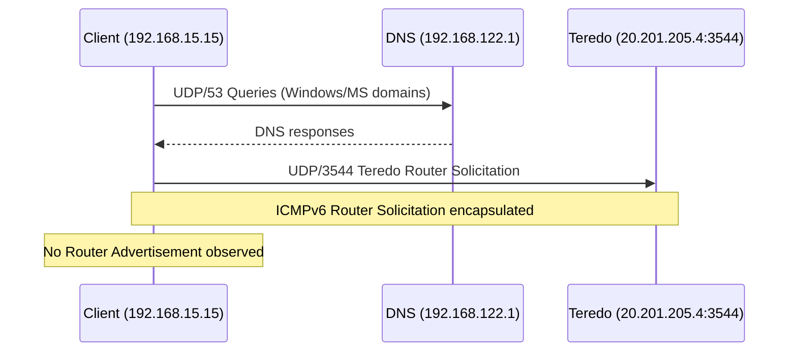
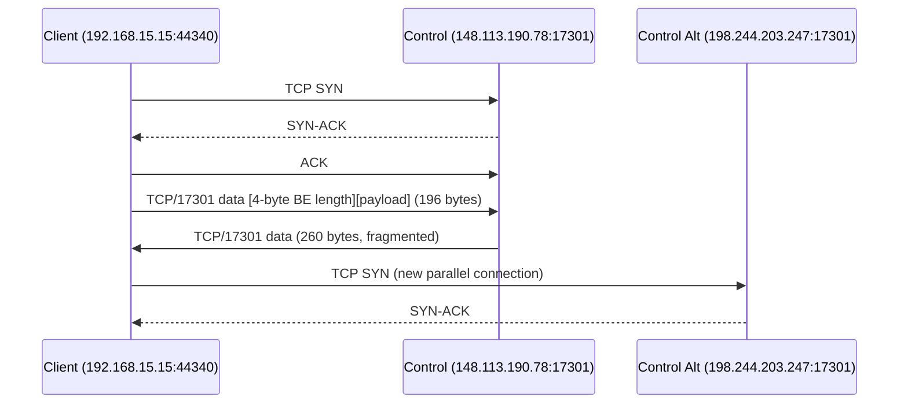
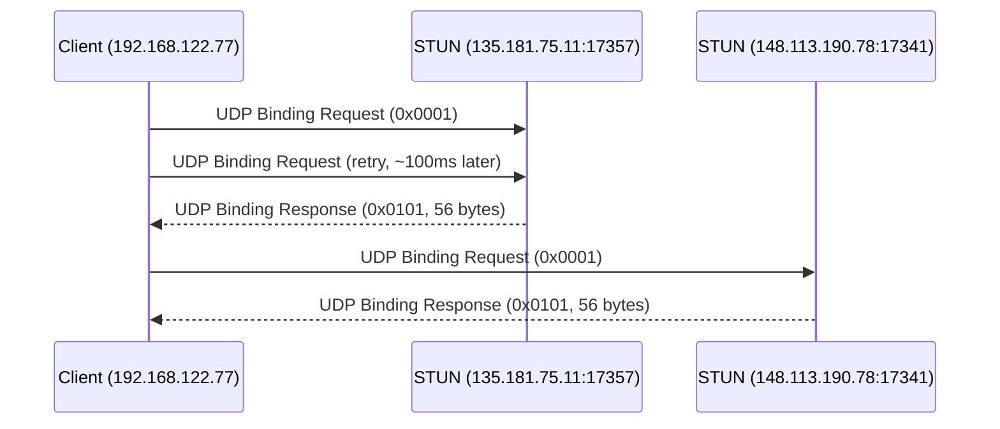
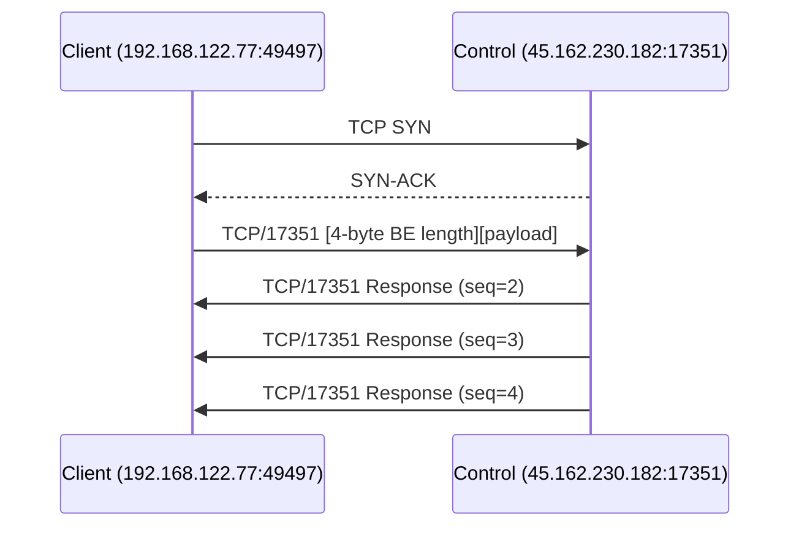
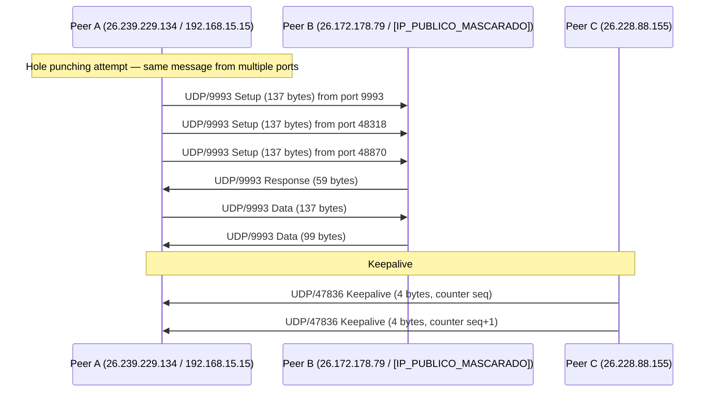

# PCAP Flow Map — Radmin VPN Traffic Analysis

**Project:** Radmin VPN Linux client (Rust, independent)  
**Capture directory:** `claude-handoff/pcaps/`  
**Analysis date:** 06 nov 2026  
**Language:** English  

---

## Communication Flow Overview

The diagram below shows communication paths identified in the captures, differentiating confirmed paths (CONFIRMED) from hypothetical paths (HYPOTHESIS).

```mermaid
graph TB
    subgraph Client["Radmin Client (radminvpn0)"]
        C1[Virtual IP: 26.239.229.134/8]
        C2[Physical IP: 192.168.15.15]
        C3[Interface: enp7s0]
        C4[Interface: radminvpn0]
    end

    subgraph Controle["Radmin Control Servers"]
        S1[148.113.190.78:17301]
        S2[198.244.203.247:17301]
        S3[45.162.230.182:17301/17351]
    end

    subgraph STUN["STUN Servers (non-standard ports)"]
        ST1[135.181.75.11:17357/17358]
        ST2[148.113.190.78:17341/17342]
        ST3[162.19.169.168:17309/17310]
        ST4[15.204.183.160:17342]
    end

    subgraph Peer["Remote Peer"]
        P1[Virtual IP: 26.172.178.79]
        P2[Physical IP: [IP_PUBLICO_MASCARADO]]
        P3[Virtual IP: 26.228.42.15]
        P4[Physical IP: 103.195.103.66]
        P5[Virtual IP: 26.228.88.155]
    end

    subgraph Teredo["Teredo Server"]
        T1[20.201.205.4:3544]
    end

    %% Control flows
    C2 -.->|TCP SYN → 17301<br/>CONFIRMED| S1
    C2 -.->|TCP SYN → 17301<br/>CONFIRMED| S2
    C2 -.->|TCP → 17351<br/>CONFIRMED| S3

    %% STUN flows
    C2 -.->|UDP Binding Request<br/>CONFIRMED| ST1
    C2 -.->|UDP Binding Request<br/>CONFIRMED| ST2
    C2 -.->|UDP Binding Request<br/>CONFIRMED| ST3
    C2 -.->|UDP Binding Request<br/>CONFIRMED| ST4

    %% Teredo flows
    C2 -.->|UDP Router Solicitation<br/>CONFIRMED| T1

    %% P2P flows
    C1 -.->|UDP/9993 Setup<br/>CONFIRMED| P1
    C2 -.->|UDP/9993 Setup<br/>CONFIRMED| P2
    C1 -.->|UDP/47836 Keepalive<br/>CONFIRMED| P5

    %% Physical↔Virtual encapsulation
    C1 ==>|Same payload, virtual IP<br/>CONFIRMED (limited)| C2
    P1 ==>|Same payload, physical IP<br/>CONFIRMED (limited)| P2

    %% Hypotheses
    P2 -.->|UDP/9993 Relay?<br/>HYPOTHESIS| P4
    S3 -.->|Relay?<br/>HYPOTHESIS| P1

    classDef confirmed fill:#e1f5e1,stroke:#2e7d32
    classDef hypothesis fill:#fff3e0,stroke:#ef6c00
    class C1,C2,S1,S2,S3,ST1,ST2,ST3,ST4,T1,P1,P2,P3,P4,P5,C3,C4 confirmed
```

---

## Detailed Flow by Phase

### Phase 1 — Initialization and Connectivity (T-114s to T+0s)



**Evidence:**
- `radmin_vm.pcap`: DNS queries for `api.msn.com`, `c.bing.com`, `config.edge.skype.com`, etc.
- `radmin_vm.pcap` frame 708: Teredo Router Solicitation to `20.201.205.4:3544`
- Classification: CONFIRMED (traffic observed), but likely Windows/Wine background traffic, not Radmin-specific

---

### Phase 2 — Control Connection (T+42s to T+95s)



**Evidence:**
- `radmin-connect.pcapng` frames 70–72: TCP handshake with 148.113.190.78:17301
- `radmin-connect.pcapng` frame 77: Data 192 bytes payload (length=0x000000c0)
- `radmin-connect.pcapng` frame 110: TCP SYN to 198.244.203.247:17301
- Classification: CONFIRMED

---

### Phase 3 — NAT Discovery via STUN (T+95s to T+97s)



**Evidence:**
- `radmin_vm.pcap` frame 5477: Binding Request to 135.181.75.11:17357
- `radmin_vm.pcap` frame 5489: Binding Response from 135.181.75.11:17357
- `radmin_vm.pcap` frame 5551: Binding Request to 148.113.190.78:17341
- `radmin_vm.pcap` frame 5575: Binding Response from 148.113.190.78:17341
- Classification: CONFIRMED (STUN observed), non-standard ports

---

### Phase 4 — Alternative Control (T+96s onward)



**Evidence:**
- `radmin_vm.pcap` frames 5483–5486: TCP handshake with 45.162.230.182:17351
- `radmin_vm.pcap` frame 5487: Response with seq=2
- `radmin_vm.pcap` frame 5494: Response with seq=3
- `radmin_vm.pcap` frame 5501: Response with seq=4
- Classification: CONFIRMED (framing and sequence)

---

### Phase 5 — P2P Active (UDP/9993 between peers)



**Evidence:**
- `radmin-mine.pcapng` frames 116–118: Same payload from ports 9993, 48318, 48870
- `radmin-mine.pcapng` frame 269: Response 59 bytes from 26.172.178.79:9993
- `radmin-mine.pcapng` frames 66–2295: Keepalive UDP/47836 with sequential counter
- Classification: CONFIRMED for transmission attempts; HYPOTHESIS for successful NAT traversal

---

## Physical-Virtual Correlation

### Address Mapping

| Virtual IP | Physical IP | Virtual MAC | Captures |
|---|---|---|---|
| 26.239.229.134 | 192.168.15.15 | 02:50:ce:a5:3a:26 | radmin-mine, radmin-mine-host, radmin-connect |
| 26.172.178.79 | [IP_PUBLICO_MASCARADO] | 02:50:06:00:35:fd | radmin-mine, radmin-mine-host |
| 26.228.42.15 | — | — | radmin-mine, radmin-mine-host |
| 26.228.88.155 | — | 02:50:eb:9a:6f:58 | radmin-mine, radmin-mine-host, radmin-connect |

### Payload Correlation

The same UDP/9993 payload (137 bytes) appears on both interfaces with differences only in the IP header addresses and TLV 0x0004 fields:

```
Virtual Interface (frame 116):
26.239.229.134:9993 → 26.172.178.79:9993
Payload: [identical 137 bytes]

Physical Interface (frame 130):
192.168.15.15:9993 → [IP_PUBLICO_MASCARADO]:9993
Payload: [identical 137 bytes]
```

**Conclusion:** CONFIRMED (limited) — the virtual interface carries real Radmin traffic between peers, with ARP for virtual address resolution. Based on 3 frame pairs from a single capture.

---

## Data Flows by Protocol

### TCP/17301 — Primary Control

```
Client:192.168.15.15:44340 ↔ 148.113.190.78:17301
Client:192.168.15.15:57924 ↔ 198.244.203.247:17301
Client:192.168.15.15:44342 ↔ 148.113.190.78:17301
```

- Multiple parallel TCP connections
- Framing: [4-byte BE length][payload]
- Fragmentation for messages > MSS
- Classification: CONFIRMED

### TCP/17351 — Alternative Control

```
Client:192.168.122.77:49497 ↔ 45.162.230.182:17351
```

- Sub-protocol with version `10 00 00 04` and incremental sequence
- Single server observed: 45.162.230.182
- Classification: CONFIRMED (framing and sequence), function not determined

### UDP/9993 — P2P Data

```
26.239.229.134:9993 ↔ 26.172.178.79:9993 (virtual)
192.168.15.15:9993 ↔ [IP_PUBLICO_MASCARADO]:9993 (physical)
192.168.15.15:48318 ↔ 103.195.103.66:9993 (physical)
192.168.15.15:9993 ↔ 25.33.236.186:9993 (physical)
```

- Multiple message sizes: 28, 33, 99, 137 bytes
- Hole punching: same message from ports 9993, 48318, 48870
- TLV 0x0004: IP + port of peer
- Classification: CONFIRMED

### UDP/47836 — Keepalive

```
26.228.88.155:47836 → 26.239.229.134:47836
```

- 4-byte payload, sequential little-endian counter
- Interval ~1 second
- One direction only observed
- Classification: CONFIRMED (format), INCONCLUSIVE (uint16 vs uint32 layout)

### STUN — NAT Discovery

```
192.168.122.77:54527 → 135.181.75.11:17357
192.168.122.77:54530 → 148.113.190.78:17341
192.168.122.77:54533 → 162.19.169.168:17309
```

- Binding Request (20 bytes) / Binding Response (56 bytes)
- Non-standard Radmin ports
- Classification: CONFIRMED (protocol variant), non-standard RFC 5389

### Teredo — IPv6 Connectivity

```
192.168.122.77:54778 → 20.201.205.4:3544
```

- Router Solicitation encapsulated
- Likely Windows/Wine background traffic
- Classification: CONFIRMED (observed), not confirmed as Radmin

---

## Confirmed vs Hypothetical Paths

### Confirmed (CONFIRMED)

| Path | Protocol | Evidence |
|---|---|---|
| Client → Control Server 17301 | TCP | Handshake + data in multiple captures |
| Client → Control Server 17351 | TCP | Handshake + data with sequence |
| Client → STUN Servers | UDP | Binding Request/Response on 9 ports |
| Client → Teredo Server | UDP | Router Solicitation to 20.201.205.4:3544 |
| Peer ↔ Peer (virtual) | UDP/9993 | Same payload on both interfaces |
| Peer ↔ Peer (physical) | UDP/9993 | Same payload as virtual |
| Peer → Peer keepalive | UDP/47836 | Sequential counter, ~1s interval |
| Virtual interface ↔ Physical | Encapsulation | Same payload, different IPs |

### Hypothetical (HYPOTHESIS)

| Path | Protocol | Justification |
|---|---|---|
| Peer → Relay → Peer | UDP/9993 | High-volume flow (3.1 MB) to [IP_PUBLICO_MASCARADO]:58358, not confirmed as Radmin relay |
| Control Server → Relay | TCP/17301/17351 | No evidence of relay on control servers |
| NAT Traversal via STUN | UDP | STUN observed, but no proof of successful traversal |
| Hole punching success | UDP/9993 | Transmission attempts observed, success not proven |

### Not Confirmed

| Path | Protocol | Reason |
|---|---|---|
| Initial handshake `00 00 00 04 03 00 00 00` | TCP/17301 | Does not appear at start of any captured connection |
| AES key exchange | TCP/UDP | Encrypted traffic, no keys visible |
| TLV `0x30` (192 bytes) | Any | Not found in any capture |

---

## Flow Map Limitations

1. **Encrypted traffic:** TCP/17301, TCP/17351, and UDP/9993 (region 0x2e–0x5d) content is encrypted. Application protocol inside these flows cannot be determined.
2. **Handshake not captured:** The initial 8-byte handshake (`00 00 00 04 03 00 00 00`) mentioned in previous reports does not appear at the start of any captured TCP connection. May occur before capture start.
3. **Relay not confirmed:** High-volume flow to [IP_PUBLICO_MASCARADO]:58358 may be relay, direct P2P, or another service. Insufficient evidence to classify.
4. **NAT type not determined:** Single STUN response per server is insufficient to classify NAT behavior.
5. **Limited frame pairs:** Only 3 virtual↔physical frame pairs compared for encapsulation analysis.

---

**Generated file:** `docs/PCAP_FLOW_MAP.md`  
**Original .pcapng files:** Preserved, unmodified