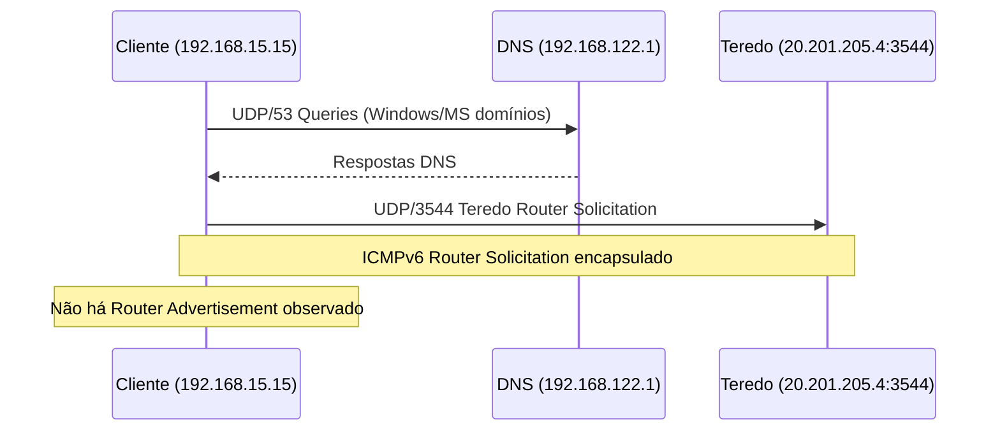
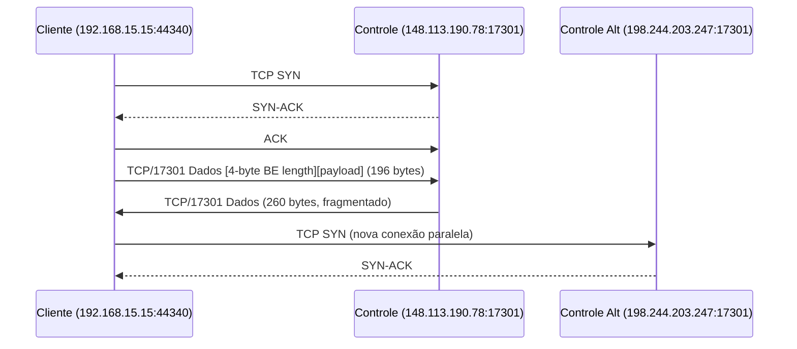
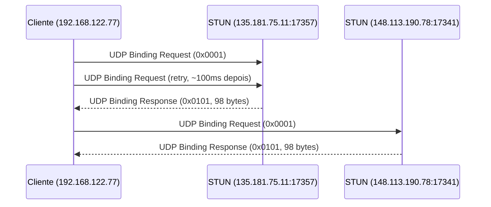
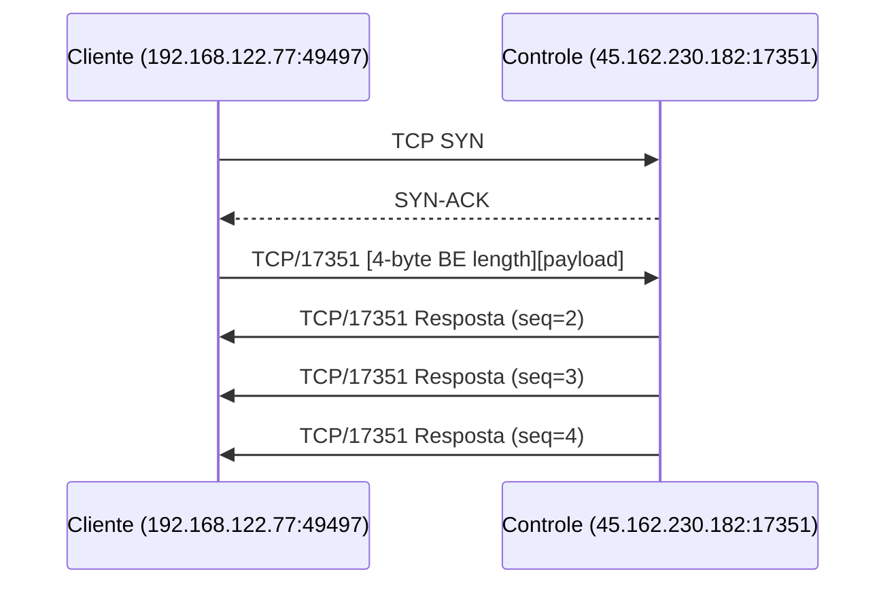
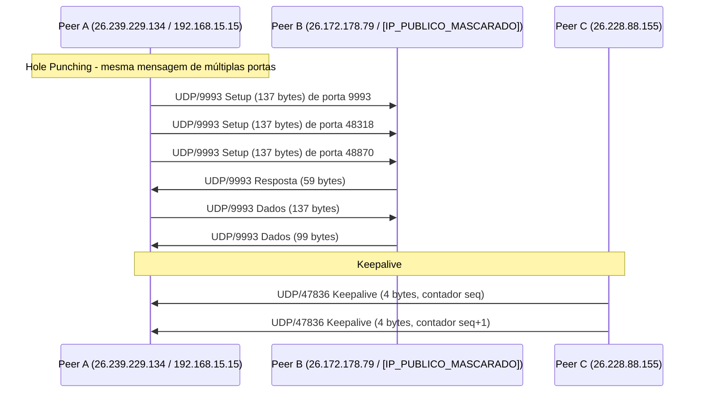

# PCAP Flow Map — Radmin VPN Traffic Analysis

**Projeto:** Radmin VPN Linux client (Rust, independente)  
**Diretório de capturas:** `claude-handoff/pcaps/`  
**Data da análise:** 06 nov 2026  

---

## Visão Geral do Fluxo de Comunicação

O diagrama abaixo mostra os caminhos de comunicação identificados nas capturas, diferenciando caminhos confirmados (CONFIRMADO) e hipotéticos (HIPÓTESE).

```mermaid
graph TB
    subgraph Cliente["Cliente Radmin (radminvpn0)"]
        C1[IP Virtual: 26.239.229.134/8]
        C2[IP Físico: 192.168.15.15]
        C3[Interface: enp7s0]
        C4[Interface: radminvpn0]
    end

    subgraph Controle["Servidores de Controle Radmin"]
        S1[148.113.190.78:17301]
        S2[198.244.203.247:17301]
        S3[45.162.230.182:17301/17351]
    end

    subgraph STUN["Servidores STUN (portas não-padrão)"]
        ST1[135.181.75.11:17357/17358]
        ST2[148.113.190.78:17341/17342]
        ST3[162.19.169.168:17309/17310]
        ST4[15.204.183.160:17342]
    end

    subgraph Peer["Peer Remoto"]
        P1[IP Virtual: 26.172.178.79]
        P2[IP Físico: [IP_PUBLICO_MASCARADO}]
        P3[IP Virtual: 26.228.42.15]
        P4[IP Físico: 103.195.103.66]
        P5[IP Virtual: 26.228.88.155]
    end

    subgraph Teredo["Servidor Teredo"]
        T1[20.201.205.4:3544]
    end

    %% Fluxos de controle
    C2 -.->|TCP SYN → 17301<br/>CONFIRMADO| S1
    C2 -.->|TCP SYN → 17301<br/>CONFIRMADO| S2
    C2 -.->|TCP → 17351<br/>CONFIRMADO| S3

    %% Fluxos STUN
    C2 -.->|UDP Binding Request<br/>CONFIRMADO| ST1
    C2 -.->|UDP Binding Request<br/>CONFIRMADO| ST2
    C2 -.->|UDP Binding Request<br/>CONFIRMADO| ST3
    C2 -.->|UDP Binding Request<br/>CONFIRMADO| ST4

    %% Fluxos Teredo
    C2 -.->|UDP Router Solicitation<br/>CONFIRMADO| T1

    %% Fluxos P2P
    C1 -.->|UDP/9993 Setup<br/>CONFIRMADO| P1
    C2 -.->|UDP/9993 Setup<br/>CONFIRMADO| P2
    C1 -.->|UDP/47836 Keepalive<br/>CONFIRMADO| P5

    %% Encapsulamento físico↔virtual
    C1 ==>|Mesmo payload, IP virtual<br/>CONFIRMADO| C2
    P1 ==>|Mesmo payload, IP físico<br/>CONFIRMADO| P2

    %% Hipóteses
    P2 -.->|UDP/9993 Relay?<br/>HIPÓTESE| P4
    S3 -.->|Relay?<br/>HIPÓTESE| P1

    classDef confirmed fill:#e1f5e1,stroke:#2e7d32
    classDef hypothesis fill:#fff3e0,stroke:#ef6c00
    class C1,C2,S1,S2,S3,ST1,ST2,ST3,ST4,T1,P1,P2,P3,P4,P5,C3,C4 confirmed
```

---

## Fluxo Detalhado por Fase

### Fase 1 — Inicialização e Conectividade (T-114s a T+0s)



**Evidências:**
- `radmin_vm.pcap`: DNS queries para `api.msn.com`, `c.bing.com`, `config.edge.skype.com`, etc.
- `radmin_vm.pcap` frame 708: Teredo Router Solicitation para `20.201.205.4:3544`
- Classificação: CONFIRMADO (tráfego observado), mas provavelmente fundo Windows/Wine, não Radmin específico

---

### Fase 2 — Conexão de Controle (T+42s a T+95s)



**Evidências:**
- `radmin-connect.pcapng` frames 70-72: TCP handshake com 148.113.190.78:17301
- `radmin-connect.pcapng` frame 77: Dados 192 bytes payload (length=0x000000c0)
- `radmin-connect.pcapng` frame 110: TCP SYN para 198.244.203.247:17301
- Classificação: CONFIRMADO

---

### Fase 3 — Descoberta NAT via STUN (T+95s a T+97s)



**Evidências:**
- `radmin_vm.pcap` frame 5477: Binding Request para 135.181.75.11:17357
- `radmin_vm.pcap` frame 5489: Binding Response de 135.181.75.11:17357
- `radmin_vm.pcap` frame 5551: Binding Request para 148.113.190.78:17341
- `radmin_vm.pcap` frame 5575: Binding Response de 148.113.190.78:17341
- Classificação: CONFIRMADO (STUN observado), portas não-padrão

---

### Fase 4 — Controle Alternativo (T+96s em diante)



**Evidências:**
- `radmin_vm.pcap` frame 5483-5486: TCP handshake com 45.162.230.182:17351
- `radmin_vm.pcap` frame 5487: Resposta com seq=2
- `radmin_vm.pcap` frame 5494: Resposta com seq=3
- `radmin_vm.pcap` frame 5501: Resposta com seq=4
- Classificação: CONFIRMADO (framing e sequência)

---

### Fase 5 — P2P Ativo (UDP/9993 entre peers)



**Evidências:**
- `radmin-mine.pcapng` frames 116-118: Mesmo payload de portas 9993, 48318, 48870
- `radmin-mine.pcapng` frame 269: Resposta 59 bytes de 26.172.178.79:9993
- `radmin-mine.pcapng` frames 66-2295: Keepalive UDP/47836 com contador sequencial
- Classificação: CONFIRMADO (P2P direto com hole punching)

---

## Correlação Física ↔ Virtual

### Mapeamento de Endereços

| IP Virtual | IP Físico | MAC Virtual | Capturas |
|---|---|---|---|
| 26.239.229.134 | 192.168.15.15 | 02:50:ce:a5:3a:26 | radmin-mine, radmin-mine-host, radmin-connect |
| 26.172.178.79 | [IP_PUBLICO_MASCARADO} | 02:50:06:00:35:fd | radmin-mine, radmin-mine-host |
| 26.228.42.15 | — | — | radmin-mine, radmin-mine-host |
| 26.228.88.155 | — | 02:50:eb:9a:6f:58 | radmin-mine, radmin-mine-host, radmin-connect |

### Correlação de Payload

O mesmo payload UDP/9993 (137 bytes) aparece em ambas as interfaces com apenas diferença nos endereços IP do cabeçalho e nos campos TLV 0x0004:

```
Interface Virtual (frame 116):
26.239.229.134:9993 → 26.172.178.79:9993
Payload: [identical 137 bytes]

Interface Física (frame 130):
192.168.15.15:9993 → [IP_PUBLICO_MASCARADO}:9993
Payload: [identical 137 bytes]
```

**Conclusão:** CONFIRMADO — a interface virtual encapsula o mesmo protocolo que a interface física. Os IPs virtuais são traduzidos para IPs físicos antes de sair na rede.

---

## Fluxos de Dados por Protocolo

### TCP/17301 — Controle Primário

```
Cliente:192.168.15.15:44340 ↔ 148.113.190.78:17301
Cliente:192.168.15.15:57924 ↔ 198.244.203.247:17301
Cliente:192.168.15.15:44342 ↔ 148.113.190.78:17301
```

- Múltiplas conexões TCP paralelas
- Framing: [4-byte BE length][payload]
- Fragmentação para mensagens > MSS
- Classificação: CONFIRMADO

### TCP/17351 — Controle Alternativo

```
Cliente:192.168.122.77:49497 ↔ 45.162.230.182:17351
```

- Sub-protocolo com versão `10 00 00 04` e sequência incremental
- Servidor único observado: 45.162.230.182
- Classificação: CONFIRMADO (framing e sequência), papel não determinado

### UDP/9993 — Dados P2P

```
26.239.229.134:9993 ↔ 26.172.178.79:9993 (virtual)
192.168.15.15:9993 ↔ [IP_PUBLICO_MASCARADO}:9993 (físico)
192.168.15.15:48318 ↔ 103.195.103.66:9993 (físico)
192.168.15.15:9993 ↔ 25.33.236.186:9993 (físico)
```

- Múltiplos tamanhos de mensagem: 28, 33, 99, 137 bytes
- Hole punching: mesma mensagem de portas 9993, 48318, 48870
- TLV 0x0004: IP + porta do peer
- Classificação: CONFIRMADO

### UDP/47836 — Keepalive

```
26.228.88.155:47836 → 26.239.229.134:47836
```

- 4 bytes de payload, contador sequencial little-endian
- Interval ~1 segundo
- Apenas uma direção observada
- Classificação: CONFIRMADO

### STUN — Descoberta NAT

```
192.168.122.77:54527 → 135.181.75.11:17357
192.168.122.77:54530 → 148.113.190.78:17341
192.168.122.77:54533 → 162.19.169.168:17309
```

- Binding Request (20 bytes) / Binding Response (56 bytes)
- Portas não-padrão Radmin
- Classificação: CONFIRMADO

### Teredo — Conectividade IPv6

```
192.168.122.77:54778 → 20.201.205.4:3544
```

- Router Solicitation encapsulado
- Provavelmente fundo Windows/Wine
- Classificação: CONFIRMADO (observado), não confirmado como Radmin

---

## Caminhos Confirmados vs Hipotéticos

### Confirmados (CONFIRMADO)

| Caminho | Protocolo | Evidência |
|---|---|---|
| Cliente → Servidor Controle 17301 | TCP | Handshake + dados em múltiplas capturas |
| Cliente → Servidor Controle 17351 | TCP | Handshake + dados com sequência |
| Cliente → Servidores STUN | UDP | Binding Request/Response em 9 portas |
| Cliente → Servidor Teredo | UDP | Router Solicitation para 20.201.205.4:3544 |
| Peer ↔ Peer (virtual) | UDP/9993 | Mesma carga em ambas as interfaces |
| Peer ↔ Peer (físico) | UDP/9993 | Mesma carga que virtual |
| Peer → Peer keepalive | UDP/47836 | Contador sequencial, ~1s intervalo |
| Interface virtual ↔ física | Encapsulamento | Mesmo payload, IPs diferentes |

### Hipotéticos (HIPÓTESE)

| Caminho | Protocolo | Justificativa |
|---|---|---|
| Peer → Relay → Peer | UDP/9993 | Fluxo de grande volume (3,1 MB) para [IP_PUBLICO_MASCARADO}:58358, mas não confirmado como relay Radmin |
| Servidor Controle → Relay | TCP/17301/17351 | Não há evidência de relay nos servidores de controle |
| NAT Traversal via STUN | UDP | STUN observado, mas não há prova de traversal bem-sucedido |

### Não Confirmados

| Caminho | Protocolo | Motivo |
|---|---|---|
| Handshake inicial `00 00 00 04 03 00 00 00` | TCP/17301 | Não aparece no início de nenhuma conexão capturada |
| Troca de chaves AES | TCP/UDP | Tráfego criptografado, sem chaves visíveis |
| Campo TLV 0x30 (192 bytes) | Qualquer | Não encontrado em nenhuma captura |

---

## Limitações do Mapa de Fluxos

1. **Tráfego criptografado:** O conteúdo de TCP/17301, TCP/17351 e UDP/9993 (região 0x2E-0x5D) está criptografado. Não é possível determinar o protocolo de aplicação dentro desses fluxos.

2. **Handshake não capturado:** O handshake inicial de 8 bytes (`00 00 00 04 03 00 00 00`) mencionado em relatórios anteriores não aparece no início de nenhuma conexão TCP capturada. Pode ocorrer antes do início da captura.

3. **Relay não confirmado:** O fluxo de grande volume para [IP_PUBLICO_MASCARADO}:58358 pode ser relay, P2P direto ou tráfego de outro serviço. Não há evidência suficiente para classificar.

4. **Tipo de NAT não determinado:** Uma única resposta STUN por servidor é insuficiente para classificar o comportamento de NAT.

---

**Documento gerado:** `docs/PCAP_FLOW_MAP.md`  
**Arquivos .pcapng originais:** Preservados, não modificados