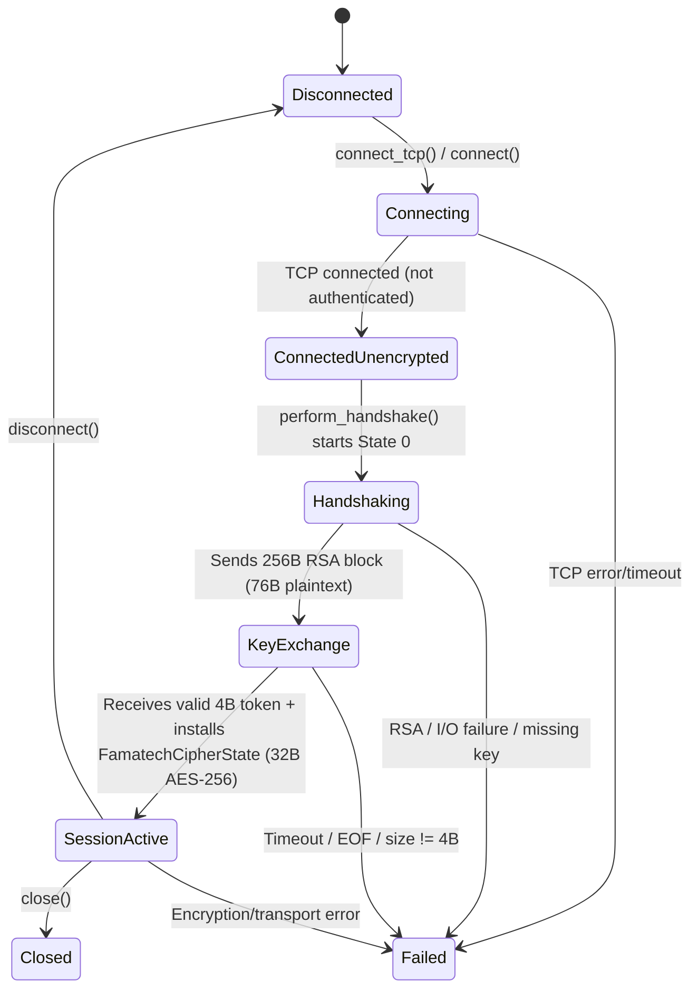

# Phase 1 Implementation Report — Session Core and Cryptographic Channel (`PHASE_1_IMPLEMENTATION_REPORT.md`)

## 1. Modified Files

| File | Nature of the Change |
|---|---|
| `src/session/handshake.rs` | Complete implementation of the real state machine of `SHelper_RSession` (`HandshakeNegotiator` for the client and `RSessionServer` for the server), per `shelper.dll!0x1006b860..0x1006bc30` and `RvROLClient.dll!0x10096660..0x100df470`, with regression unit tests. |
| `src/session/mod.rs` | Real integration of `HandshakeNegotiator` and `FamatechCipherState` into `SessionManager`, strict state machine (`Disconnected`, `Connecting`, `ConnectedUnencrypted`, `Handshaking`, `KeyExchange`, `SessionActive`, `Reconnecting`, `Failed`, `Closed`), automatic invalidation on failures, and removal of invented messages. |
| `src/crypto/famatech.rs` | Correction of the validation `pad_len >= total_len` (`shelper.dll!0x1006a00e`), support for separate send/receive keys (`0x10062e00` / `0x10062d60`), key installation from the 64-byte `RSession` buffer (`RvROLClient.dll!0x100df250` / `0x100df470`), memory cleanup (`0x10062c80`) and documented resolution of the checksum/trailer contradiction. |
| `src/crypto/mod.rs` | Export of constants (`AES_256_KEY_SIZE`, `RSESSION_KEY_BUFFER_SIZE`) and of the methods `with_cipher_state`, `set_cipher_state` and `clear()` in `CryptoChannel`. |
| `src/transport/mod.rs` | Addition of `enable_cipher`, `clear_cipher` and `cipher()` in `TcpChannel`, keeping the TCP framing fixes intact. |
| `tests/integration_test.rs` | Addition of the end-to-end integration test `test_e2e_phase1_rsession_handshake_and_cchannel_continuity`. |
| `PHASE_1_IMPLEMENTATION_REPORT.md` | Consolidated report of the Phase 1 implementation. |
| `PHASE_1_UNRESOLVED.md` | Formal record of the open questions outside the scope or dependent on additional evidence. |

---

## 2. Implemented Components

1. **Cryptographic handshake (`src/session/handshake.rs`)**:
   - `HandshakeNegotiator` reproducing `SHelper_RSession_CreateClient` (`0x1006b860`), `SHelper_RSession_GetNextBuffer` (`0x1006a2b0`), `SHelper_RSession_GetKey` (`0x1006ba80`) and `SHelper_RSession_GetServerDataOnClient` (`0x1006bbb0`).
   - `RSessionServer` reproducing `SHelper_RSession_CreateServer` (`0x1006b8f0`), State 1 (`0x1006a30c`), `SHelper_RSession_GetKey` (`0x1006ba80`) and `SHelper_RSession_GetClientDataOnServer` (`0x1006bc30`).
2. **Session cryptographic channel (`src/crypto/famatech.rs`, `src/crypto/mod.rs`)**:
   - `FamatechCipherState` reproducing `SHelper_CChannel` (`0x10062ca9`, `0x10062c80`, `0x10062e00`, `0x10062d60`, `0x10063000`, `0x100630f0`, `0x10069c20`, `0x10069f90`, `0x1006a0c0`, `0x100638f0`).
3. **Session manager (`src/session/mod.rs`, `src/transport/mod.rs`)**:
   - `SessionManager` integrating the TCP transport with 4-byte big-endian framing, the `SHelper_RSession` negotiation and the activation of `FamatechCipherState`.

---

## 3. Implemented Handshake Flow

As proven in `shelper.dll` (`0x1006b860`, `0x1006a2b0`, `0x1006a512`, `0x1006a30c`, `0x1006a4cc`, `0x1006ba80`) and `RvROLClient.dll` (`0x10096660..0x10096b28`, `0x10096bf0..0x10097060`, `0x100df250`, `0x100df470`):

1. **Initialization (`SHelper_RSession_CreateClient`, `0x1006b860` -> `0x1006a690`)**:
   - The client initializes `state = 0` (`ClientState0Initial`), stores the 3 parameter DWORDs at `+0x04..+0x0c`, sets `is_established = false` (`+0x10 = 0`) and builds the server's RSA-2048 public key via `BN_bin2bn` over the modulus (`256B` big-endian) and the exponent (`0x100660a7` -> `0x10065848`).
2. **Generation of the first packet — Client State 0 (`0x1006a512`)**:
   - Requires empty input (`in_buf == NULL && in_len == 0`).
   - Generates **64 bytes (`0x40`)** of cryptographically secure random data via `RAND_bytes` (`0x10063530` at `0x1006a56d`) and stores them at `[esi+0x30]`.
   - Builds a 76-byte plaintext buffer (`0x4c`) (`0x1006a522`):
     - Bytes `0..12`: `[d0, d1, d2]` in little-endian (`0x1006a55c..0x1006a569`).
     - Bytes `12..76`: the 64 CSPRNG bytes (`0x1006a582..0x1006a593`).
   - Encrypts the 76 bytes with the server's RSA-2048 public key using **`RSA_PKCS1_PADDING` (`padding = 1`)** (`0x10065ec0` via `0x10065ca0` at `0x1006a59c`), producing a block of **256 bytes (`0x100`)**.
   - Transitions to `state = 2` (`ClientState2WaitingServerToken`, `0x1006a5eb`) and keeps `is_complete = false` (`0x1006a5fd`).
3. **Server-side processing — State 1 (`0x1006a30c`)**:
   - Decrypts the 256-byte block with the server's RSA-2048 private key using **`RSA_PKCS1_PADDING`** (`0x10065de8` via `0x10065bc7` at `0x1006a354`).
   - Requires the decrypted size to be exactly **`0x4c` (76 bytes)** (`0x1006a36d: cmp [ebp-0x10], 0x4c; jne 0x1006a4c2`).
   - Extracts `[d0, d1, d2]` (`0..12`) and the 64 key bytes (`12..76`), emits the server's **4-byte (`0x04`)** token (`0x1006a472..0x1006a49b`), sets `is_established = true` (`[esi+0x10] = 1`) and `state = 3`.
4. **Token validation on the client — State 2 (`0x1006a4cc`)**:
   - Strictly requires `in_buf != NULL` and **`in_len == 4`** (`0x1006a4df: cmp [ebp+0xc], 0x4; jne 0x1006a614`).
   - Stores the server's 4-byte token at `[esi+0x14]` (`0x1006a4e9`), transitions to `state = 3` (`State3Completed`, `0x1006a4fc`), sets `is_established = true` (`0x1006a503`) and returns `is_complete = true`.
5. **Obtaining and installing the AES-256 key (`0x1006ba80` + `RvROLClient.dll!0x100df250` / `0x100df470`)**:
   - `SHelper_RSession_GetKey` (`0x1006ba80` -> `0x1006a270`) checks `is_established != 0` and returns the 64-byte CSPRNG buffer (`[ecx+0x30]`).
   - `RvROLClient.dll!0x100df250` (`CChannelWrapper::Create`) and `0x100df470` (`SetKey`), called at `0x10096f0d..0x10096f21` and `0x100969de..0x10096a16`, validate `len >= 0x20` (32 bytes) and install the first **32 bytes (`&key_material[0..32]`)** in both `key_enc` (`0x10062e00`) and `key_dec` (`0x10062d60`).

---

## 4. Resulting State Machine

### 4.1. Handshake State Machine (`HandshakeStage`)
- `ClientState0Initial` (`0`) -> `ClientState2WaitingServerToken` (`2`) -> `State3Completed` (`3`, with `is_established = true`).
- Any unexpected input, invalid size or out-of-order call immediately transitions to `HandshakeStage::Failed` and zeroes `key_material`.

### 4.2. Session State Machine (`SessionState`)

Applied invariants:
- `ConnectedUnencrypted` blocks `send_data()` and `receive_data()`.
- `activate_from_negotiator()` rejects any negotiator where `is_established() == false` (an isolated token without a key never activates the session).
- Any failure closes the `TcpChannel`, zeroes keys/IVs and sets `SessionState::Failed(reason)`.
- `close()` sets `SessionState::Closed` and prevents any reuse of the instance.

---

## 5. Confirmed Cryptographic Format (`SHelper_CChannel`)

1. **Algorithm and modes (`shelper.dll!0x10062ca9`, `0x10062e00`, `0x10062d60`, `0x10063000`, `0x100630f0`)**:
   - **AES-256-CBC** without OpenSSL's PKCS#7 padding (`crypter.pad(false)`).
   - `enc_iv` (`+0x1ec`) and `dec_iv` (`+0x1fc`) initialized with 16 zero bytes (`[0u8; 16]`) at `0x10062ca9`.
   - **Per-direction IV continuity**: `AES_cbc_encrypt` updates `enc_iv` in place with the last 16 bytes of the sent ciphertext (`0x10063000`) and updates `dec_iv` in place with the last 16 bytes of the received ciphertext (`0x100630f0`, before `0x10069f90`).
2. **Padding and 9-byte trailer (`shelper.dll!0x10069c20` and `0x10069f90`)**:
   - For a payload of `L >= 1` bytes:
     - `total_len = ((L + 24) / 16) * 16`
     - `pad_len = total_len - L` (`9 <= pad_len <= 24`, and necessarily `pad_len < total_len` per `0x1006a00e: cmp ebx, esi; jae`).
   - Layout of the 16-byte-aligned plaintext block:
     - `0..L`: original payload.
     - `L..(total_len - 9)`: `pad_len - 9` bytes filled with `0xCC` (`0x10069c77`).
     - `(total_len - 9)..(total_len - 1)`: **8 bytes of integrity (folded MD5)**.
     - `total_len - 1`: **1 byte `pad_len`**.
3. **Definitive resolution of the checksum divergence (`0x1006a0c0` + `0x100638f0`)**:
   - The previous report `02-cryptography.md` erroneously stated that the trailer would contain the raw 64-bit sum from `0x1006a0c0`.
   - The complete disassembly of `0x10069c20` proves:
     - `0x10069c9a`: calls `0x1006a0c0` over `buf[0 .. total_len - 9]` (sum of 64-bit LE words with zero-fill in the tail `< 8` bytes).
     - `0x10069ca2..0x10069ca6`: temporarily writes the 8 bytes of the sum at `[esi-0x9..esi-0x1]`.
     - `0x10069cb2`: calls `0x100638f0(&buf[total_len - 9], 8, &folded_md5)`, which computes the MD5 over those 8 bytes and folds the 16 bytes of the digest into 8 bytes (`folded[i] = digest[i].wrapping_add(digest[i + 8])`, `0x10063922..0x1006392a`).
     - `0x10069cbd..0x10069cc5`: overwrites `[esi-0x9..esi-0x1]` with the 8 bytes of the folded MD5.
   - The verifier `0x10069f90` (`0x1006a026..0x1006a06c`) executes exactly the same sequence (`0x1006a0c0` followed by `0x100638f0`).

---

## 6. Evidence Used (Functions, Addresses and Packets)

- **Binaries analyzed**:
  - `shelper.dll`: `0x10062c80`, `0x10062ca9`, `0x10062d60`, `0x10062e00`, `0x10063000`, `0x100630f0`, `0x10063510`, `0x10063530`, `0x100638f0`, `0x10065848`, `0x10065bc7`, `0x10065ca0`, `0x10065de8`, `0x10065ec0`, `0x100660a7`, `0x1006612f`, `0x10069c20`, `0x10069f90`, `0x1006a0c0`, `0x1006a270`, `0x1006a2b0`, `0x1006a30c`, `0x1006a4cc`, `0x1006a512`, `0x1006a630`, `0x1006a690`, `0x1006a730`, `0x1006a780`, `0x1006a8b0`, `0x1006ab90`, `0x1006b010`, `0x1006b1d0`, `0x1006b1e0`, `0x1006b860`, `0x1006b8f0`, `0x1006ba80`, `0x1006bb10`, `0x1006bbb0`, `0x1006bc30`.
  - `RvROLClient.dll`: `0x1003dd40..0x1003f530`, `0x10096660..0x10097060`, `0x100dc6e0..0x100df470`.
- **Packets of `radmin_17301.pcap` verified**:
  - **TCP flow `49494 <-> 185.158.113.100:17301`**:
    - Pkt #32 (`C->S`, payload `4B`: `03 00 00 00`), Pkt #35 (`S->C`, payload `192B`), Pkt #37 (`C->S`, payload `32B`), Pkt #39 (`S->C`, payload `256B`), Pkt #41 (`C->S`, payload `224B`), Pkt #42 (`S->C`, payload `224B`), Pkt #43 (`C->S`, payload `48B`), Pkt #45 (`S->C`, payload `48B`).
  - **TCP flow `49493 <-> 185.158.113.100:17301`**:
    - Pkt #40 (`C->S`, payload `4B`: `03 00 00 00`), Pkt #44 (`S->C`, payload `4B`: `03 00 00 00`), Pkt #46 (`S->C`, payload `192B`), Pkt #47 (`C->S`, payload `32B`), Pkt #48 (`S->C`, payload `256B`), Pkt #49 (`C->S`, payload `224B`), Pkt #50 (`S->C`, payload `224B`).
  - **Forensic conclusion on packets #35, #44, #46 and #48**:
    - The report `01-handshake.md` had mixed packets from the two concurrent flows on port `17301` (#48 is `S->C` of 256B on flow `49493`, and #44 is the 4-byte `03 00 00 00` echo `S->C` on flow `49493`), erroneously attributing them to `SHelper_RSession_*`. In reality, packets #32..#50 of `radmin_17301.pcap` belong to the `SHelper_*` family (`0x1006ab90` / `0x1006b1e0` / `0x1006b1d0` `version = 3`), invoked by `RvROLClient.dll!0x1003eb30`, while `SHelper_RSession_*` (`0x1006b860` / `0x1006a2b0`) is invoked by `RvROLClient.dll!0x10096660..0x10096ff2`.

---

## 7. Tests Performed and Results

1. **Initial result (before the changes)**:
   - `78 passed; 0 failed; 1 ignored` (unit) + `3 passed; 0 failed` (integration).
2. **Final result (after the Phase 1 implementation)**:
   - `cargo fmt --check`: OK (no differences).
   - `cargo clippy --locked --all-targets`: OK (zero warnings in the modified files).
   - `cargo test --locked`: **`85 passed; 0 failed; 1 ignored`** (unit) + **`4 passed; 0 failed`** (integration).

---

## 8. Remaining Limitations

- The initial control connection on port `17301` uses the second family exported by `shelper.dll` (`SHelper_CreateClient` `0x1006ab90` / `SHelper_GetNextBuffer` `0x1006b1e0`), whose internal subroutines (`192B`, `32B`, `256B`, `224B`, `48B`) are detailed in `PHASE_1_UNRESOLVED.md`.
- The Phase 1 tests validate the algorithmic and structural fidelity against the disassembled routines of `shelper.dll` and `RvROLClient.dll`, but they do not replace interoperability tests over a real network with the official server/peer.
