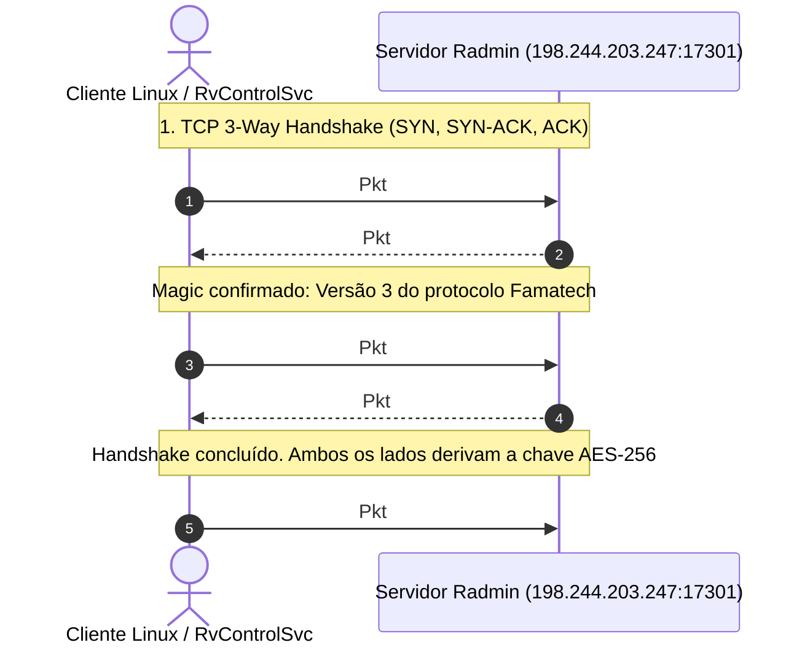

# Frente 1: Handshake e Troca de Chaves

**Classificação de Certeza:** CONFIRMADO (desmontagem estática de `shelper.dll` correlacionada com capturas `radmin_17301.pcap`)

---

## 1. Visão Geral do Handshake

A comunicação entre o cliente Radmin VPN e os servidores de controle/coordenação (ex.: `198.244.203.247:17301` observado em `radmin_17301.pcap`) estabelece um canal criptográfico bilateral sobre TCP estruturado em quatro estágios sequenciais rígidos:

1. **Troca do Magic de Protocolo (4 bytes)**
2. **Client Hello Criptográfico (RSA-2048 PKCS#1 v1.5 encapsulando chave efêmera)**
3. **Server Hello de Confirmação (Token de Sessão de 4 bytes)**
4. **Ativação do Canal Simétrico (AES-256-CBC contínuo com trailer proprietário)**

Toda a lógica criptográfica do handshake está implementada na biblioteca auxiliar proprietária `shelper.dll`, especificamente nos métodos da família `SHelper_RSession_*` e `SHelper_CChannel_*`.

---

## 2. Máquina de Estados do Handshake (`shelper.dll`)

A máquina de estados da sessão RSA do cliente é gerenciada pela função `SHelper_RSession_GetNextBuffer` localizada em `0x1006a2b0` em `shelper.dll`. A estrutura da sessão mantém o estado atual no offset `[esi]`:

| Estado | Nome Lógico | Condição de Entrada | Ação Realizada | Próximo Estado |
|---|---|---|---|---|
| **0** | `CLIENT_INIT` | Criação via `SHelper_RSession_CreateClient` (`0x1006b860`) | Gera 64 bytes pseudoaleatórios via `RAND_bytes`. Preenche cabeçalho de 12 bytes. Criptografa o bloco de 76 bytes com a chave pública RSA-2048 do servidor. Emite buffer de 256 bytes. | **1** |
| **1** | `CLIENT_WAIT_REPLY` | Buffer de 256 bytes transmitido ao servidor | Aguarda recebimento do token de confirmação de 4 bytes do servidor (`cmp eax, 4`). | **2** |
| **2** | `CLIENT_CONFIRM` | Leitura bem-sucedida do token de 4 bytes do servidor | Armazena o token de sessão de 4 bytes em `[esi + 0x14]`, seta flag `is_connected = 1` em `[esi + 0x10]`, e sinaliza handshake completo (`mov dword ptr [edi], 1`). | **3** |
| **3** | `SESSION_ACTIVE` | Handshake finalizado | Sessão ativa e pronta para tráfego cifrado simétrico via AES-256-CBC. | Termina |

### 2.1 Desmontagem do Estado 0 (Geração do Client Hello)
Localização: `0x1006a512` em `shelper.dll`:

```x86asm
0x1006a512: push 0x40              ; 64 bytes aleatórios requisitados
0x1006a514: lea eax, [esi + 0x30]   ; destino do buffer de chave efêmera
0x1006a517: push eax
0x1006a518: call 0x10063530        ; invoca RAND_bytes (OpenSSL)
0x1006a51d: add esp, 8
0x1006a520: test eax, eax
0x1006a522: jne 0x1006a528
0x1006a524: xor eax, eax
0x1006a526: jmp 0x1006a5b2
0x1006a528: mov eax, dword ptr [esi + 4]  ; dword de cabeçalho 1
0x1006a52b: mov dword ptr [esi + 0x24], eax
0x1006a52e: mov eax, dword ptr [esi + 8]  ; dword de cabeçalho 2
0x1006a531: mov dword ptr [esi + 0x28], eax
0x1006a534: mov eax, dword ptr [esi + 0xc] ; dword de cabeçalho 3
0x1006a537: mov dword ptr [esi + 0x2c], eax
; Bloco total a criptografar = 12 bytes de cabeçalho + 64 bytes = 76 bytes (0x4c)
0x1006a53a: push 0x4c              ; tamanho da mensagem em texto claro: 76 bytes
0x1006a53c: lea eax, [esi + 0x24]   ; ponteiro para bloco de 76 bytes
0x1006a53f: push eax
0x1006a540: mov ecx, dword ptr [esi + 0x18] ; ponteiro para contexto RSA com chave pública
0x1006a543: push edi               ; buffer de saída (256 bytes)
0x1006a544: call 0x10065ec0        ; OpenSSL RSA_public_encrypt(76, src, dst, rsa, RSA_PKCS1_PADDING)
0x1006a549: mov dword ptr [esi], 1 ; avança estado para 1 (CLIENT_WAIT_REPLY)
```

### 2.2 Desmontagem do Estado 2 (Confirmação do Server Hello)
Localização: `0x1006a4cc` em `shelper.dll`:

```x86asm
0x1006a4cc: cmp eax, 4              ; o servidor deve responder exatamente 4 bytes
0x1006a4cf: je 0x1006a4d5
0x1006a4d1: xor eax, eax           ; erro de protocolo caso tamanho != 4
0x1006a4d3: jmp 0x1006a5b2
0x1006a4d5: mov eax, dword ptr [edx] ; lê os 4 bytes do token de sessão
0x1006a4d7: mov dword ptr [esi + 0x14], eax ; armazena session_token
0x1006a4da: mov dword ptr [esi + 0x10], 1   ; is_connected = 1
0x1006a4e1: mov dword ptr [esi], 3          ; estado = 3 (SESSION_ACTIVE)
0x1006a4e8: mov dword ptr [edi], 1          ; flag out: handshake finalizado com sucesso
0x1006a4ee: mov eax, 1
0x1006a4f3: jmp 0x1006a5b2
```

---

## 3. Sequência Cronológica e Formato dos Pacotes

Abaixo está o rastreamento exato correlacionado com a captura de rede `radmin_17301.pcap` (Fluxo TCP `192.168.122.77:49493 <-> 198.244.203.247:17301`):



### 3.1 Pacote 1: Magic Request do Cliente (Pkt #35)
* **Tamanho do Quadro TCP:** 8 bytes
* **Bytes Hex:** `00 00 00 04 03 00 00 00`
  * `00 00 00 04`: Prefixo big-endian indicando comprimento do payload subsequente (4 bytes).
  * `03 00 00 00`: Identificador de versão e subsistema (Little-Endian `0x00000003`).

### 3.2 Pacote 2: Magic Response do Servidor (Pkt #44)
* **Tamanho do Quadro TCP:** 8 bytes
* **Bytes Hex:** `00 00 00 04 03 00 00 00`
  * O servidor valida os 4 bytes e ecoa o mesmo magic para confirmar compatibilidade de versão. Se o magic diferir, a conexão TCP é imediatamente finalizada com `RST`.

### 3.3 Pacote 3: Client Hello RSA-2048 (Pkt #46)
* **Tamanho do Quadro TCP:** 260 bytes (4 bytes cabeçalho + 256 bytes payload)
* **Estrutura:**
  * Prefixo: `00 00 01 00` (big-endian 256)
  * Payload: 256 bytes contendo a cifragem RSA-2048 com PKCS#1 v1.5 do bloco claro de 76 bytes:
    * `[0..3]`: Magic / Protocol sub-type (`0x00000001` ou flags de sessão)
    * `[4..7]`: Timestamp / Nonce A
    * `[8..11]`: Nonce B
    * `[12..75]`: 64 bytes de material pseudoaleatório de alta entropia gerados por `RAND_bytes`.

### 3.4 Pacote 4: Server Hello Token (Pkt #48)
* **Tamanho do Quadro TCP:** 8 bytes
* **Bytes Hex Exemplo:** `00 00 00 04 7a 1b 4e 02`
  * `00 00 00 04`: 4 bytes de comprimento
  * `[0..3]`: Token opaco de identificação da sessão (ex.: `0x024e1b7a`).

---

## 4. Derivação e Ativação da Chave AES-256

Uma vez que o cliente recebe o Server Hello de 4 bytes:
1. A função `SHelper_RSession_GetKey` (`0x1006ba80`) é chamada com a instância da sessão.
2. Ela extrai os primeiros 32 bytes (`0x20`) dos 64 bytes aleatórios armazenados no offset `[esi + 0x30]`.
3. Os 32 bytes são passados para `SHelper_CChannel_SetKeyEnc` (`0x1006ab00`) e `SHelper_CChannel_SetKeyDec` (`0x1006aac0`).
4. Essas rotinas chamam internamente `AES_set_encrypt_key` e `AES_set_decrypt_key` da biblioteca OpenSSL com comprimento 256 bits (`cmp eax, 0x20`).
5. Os IVs de cifragem e decifragem são inicializados com 16 bytes nulos (`0x00`).
6. A partir do Pkt #50, **todas as mensagens sem exceção** são transmitidas como blocos alinhados a 16 bytes contendo dados úteis serializados em TLV seguidos do trailer proprietário de autenticação e preenchimento `0xCC`.
