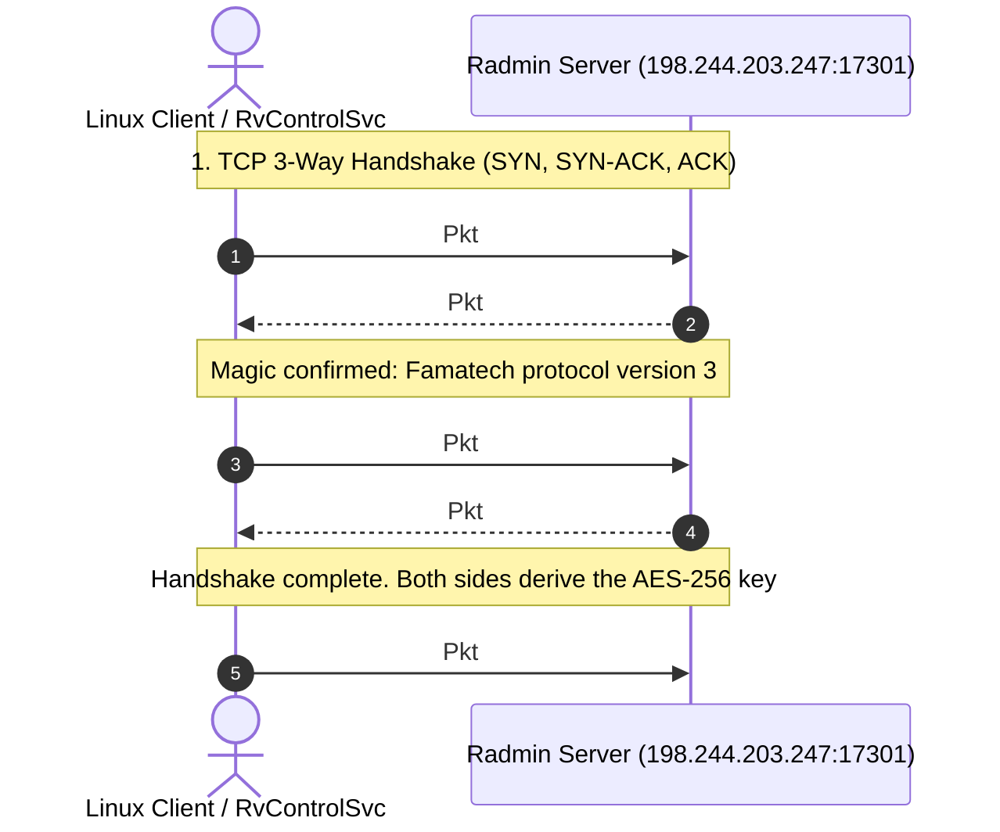

# Front 1: Handshake and Key Exchange

**Certainty classification:** CONFIRMED (static disassembly of `shelper.dll` correlated with the `radmin_17301.pcap` captures)

---

## 1. Overview of the Handshake

Communication between the Radmin VPN client and the control/coordination servers (for example `198.244.203.247:17301`, observed in `radmin_17301.pcap`) establishes a bilateral cryptographic channel over TCP, structured in four strict sequential stages:

1. **Protocol magic exchange (4 bytes)**
2. **Cryptographic Client Hello (RSA-2048 PKCS#1 v1.5 wrapping an ephemeral key)**
3. **Server Hello confirmation (4-byte session token)**
4. **Symmetric channel activation (continuous AES-256-CBC with a proprietary trailer)**

All of the handshake's cryptographic logic is implemented in the proprietary helper library `shelper.dll`, specifically in the methods of the `SHelper_RSession_*` and `SHelper_CChannel_*` families.

---

## 2. Handshake State Machine (`shelper.dll`)

The client's RSA session state machine is managed by the function `SHelper_RSession_GetNextBuffer`, located at `0x1006a2b0` in `shelper.dll`. The session structure keeps the current state at offset `[esi]`:

| State | Logical Name | Entry Condition | Action Performed | Next State |
|---|---|---|---|---|
| **0** | `CLIENT_INIT` | Creation via `SHelper_RSession_CreateClient` (`0x1006b860`) | Generates 64 pseudo-random bytes via `RAND_bytes`. Fills a 12-byte header. Encrypts the 76-byte block with the server's RSA-2048 public key. Emits a 256-byte buffer. | **1** |
| **1** | `CLIENT_WAIT_REPLY` | 256-byte buffer sent to the server | Waits to receive the server's 4-byte confirmation token (`cmp eax, 4`). | **2** |
| **2** | `CLIENT_CONFIRM` | Successful read of the server's 4-byte token | Stores the 4-byte session token at `[esi + 0x14]`, sets the `is_connected = 1` flag at `[esi + 0x10]`, and signals handshake completion (`mov dword ptr [edi], 1`). | **3** |
| **3** | `SESSION_ACTIVE` | Handshake finished | Session active and ready for symmetric AES-256-CBC encrypted traffic. | Ends |

### 2.1 Disassembly of State 0 (Client Hello Generation)
Location: `0x1006a512` in `shelper.dll`:

```x86asm
0x1006a512: push 0x40              ; 64 random bytes requested
0x1006a514: lea eax, [esi + 0x30]   ; destination of the ephemeral key buffer
0x1006a517: push eax
0x1006a518: call 0x10063530        ; invokes RAND_bytes (OpenSSL)
0x1006a51d: add esp, 8
0x1006a520: test eax, eax
0x1006a522: jne 0x1006a528
0x1006a524: xor eax, eax
0x1006a526: jmp 0x1006a5b2
0x1006a528: mov eax, dword ptr [esi + 4]  ; header dword 1
0x1006a52b: mov dword ptr [esi + 0x24], eax
0x1006a52e: mov eax, dword ptr [esi + 8]  ; header dword 2
0x1006a531: mov dword ptr [esi + 0x28], eax
0x1006a534: mov eax, dword ptr [esi + 0xc] ; header dword 3
0x1006a537: mov dword ptr [esi + 0x2c], eax
; Total block to encrypt = 12 bytes of header + 64 bytes = 76 bytes (0x4c)
0x1006a53a: push 0x4c              ; plaintext message size: 76 bytes
0x1006a53c: lea eax, [esi + 0x24]   ; pointer to the 76-byte block
0x1006a53f: push eax
0x1006a540: mov ecx, dword ptr [esi + 0x18] ; pointer to the RSA context with the public key
0x1006a543: push edi               ; output buffer (256 bytes)
0x1006a544: call 0x10065ec0        ; OpenSSL RSA_public_encrypt(76, src, dst, rsa, RSA_PKCS1_PADDING)
0x1006a549: mov dword ptr [esi], 1 ; advances state to 1 (CLIENT_WAIT_REPLY)
```

### 2.2 Disassembly of State 2 (Server Hello Confirmation)
Location: `0x1006a4cc` in `shelper.dll`:

```x86asm
0x1006a4cc: cmp eax, 4              ; the server must reply with exactly 4 bytes
0x1006a4cf: je 0x1006a4d5
0x1006a4d1: xor eax, eax           ; protocol error if size != 4
0x1006a4d3: jmp 0x1006a5b2
0x1006a4d5: mov eax, dword ptr [edx] ; reads the 4 bytes of the session token
0x1006a4d7: mov dword ptr [esi + 0x14], eax ; stores session_token
0x1006a4da: mov dword ptr [esi + 0x10], 1   ; is_connected = 1
0x1006a4e1: mov dword ptr [esi], 3          ; state = 3 (SESSION_ACTIVE)
0x1006a4e8: mov dword ptr [edi], 1          ; out flag: handshake finished successfully
0x1006a4ee: mov eax, 1
0x1006a4f3: jmp 0x1006a5b2
```

---

## 3. Chronological Sequence and Packet Format

The exact trace, correlated with the network capture `radmin_17301.pcap` (TCP flow `192.168.122.77:49493 <-> 198.244.203.247:17301`), is shown below:



### 3.1 Packet 1: Client Magic Request (Pkt #35)
* **TCP frame size:** 8 bytes
* **Hex bytes:** `00 00 00 04 03 00 00 00`
  * `00 00 00 04`: big-endian prefix indicating the length of the following payload (4 bytes).
  * `03 00 00 00`: version and subsystem identifier (little-endian `0x00000003`).

### 3.2 Packet 2: Server Magic Response (Pkt #44)
* **TCP frame size:** 8 bytes
* **Hex bytes:** `00 00 00 04 03 00 00 00`
  * The server validates the 4 bytes and echoes the same magic to confirm version compatibility. If the magic differs, the TCP connection is immediately terminated with `RST`.

### 3.3 Packet 3: RSA-2048 Client Hello (Pkt #46)
* **TCP frame size:** 260 bytes (4-byte header + 256-byte payload)
* **Structure:**
  * Prefix: `00 00 01 00` (big-endian 256)
  * Payload: 256 bytes containing the RSA-2048 PKCS#1 v1.5 encryption of the 76-byte plaintext block:
    * `[0..3]`: Magic / protocol sub-type (`0x00000001` or session flags)
    * `[4..7]`: Timestamp / Nonce A
    * `[8..11]`: Nonce B
    * `[12..75]`: 64 bytes of high-entropy pseudo-random material generated by `RAND_bytes`.

### 3.4 Packet 4: Server Hello Token (Pkt #48)
* **TCP frame size:** 8 bytes
* **Example hex bytes:** `00 00 00 04 7a 1b 4e 02`
  * `00 00 00 04`: 4-byte length
  * `[0..3]`: opaque session identification token (for example `0x024e1b7a`).

---

## 4. Derivation and Activation of the AES-256 Key

Once the client receives the 4-byte Server Hello:
1. The function `SHelper_RSession_GetKey` (`0x1006ba80`) is called with the session instance.
2. It extracts the first 32 bytes (`0x20`) of the 64 random bytes stored at offset `[esi + 0x30]`.
3. The 32 bytes are passed to `SHelper_CChannel_SetKeyEnc` (`0x1006ab00`) and `SHelper_CChannel_SetKeyDec` (`0x1006aac0`).
4. These routines internally call the OpenSSL functions `AES_set_encrypt_key` and `AES_set_decrypt_key` with a 256-bit length (`cmp eax, 0x20`).
5. The encryption and decryption IVs are initialized with 16 null bytes (`0x00`).
6. From Pkt #50 onward, **all messages without exception** are transmitted as 16-byte-aligned blocks containing payload data serialized in TLV, followed by the proprietary authentication and `0xCC` padding trailer.
