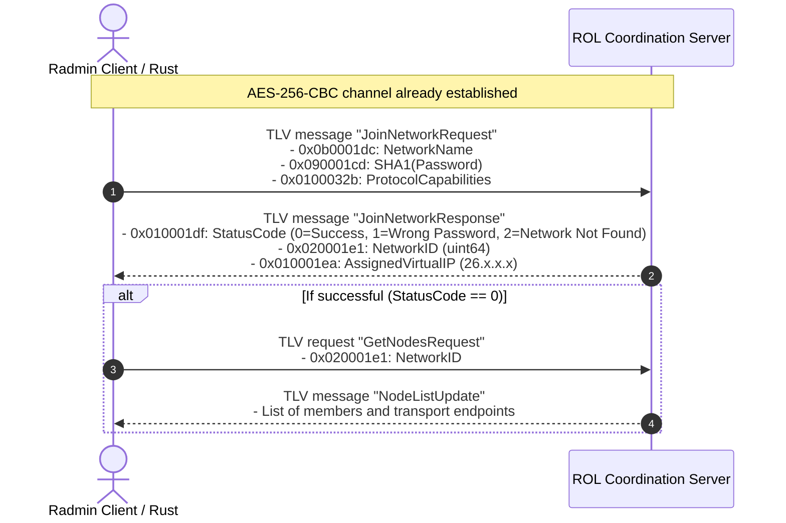

# Front 4: Authentication, Network and Member Management

**Certainty classification:** CONFIRMED (disassembly of `RvROLClient.dll` and `shelper.dll` at the authentication and password-hashing entry points)

---

## 1. Overview of the Radmin Network Layer

Radmin VPN organizes connected nodes into private virtual networks identified by a 64-bit `NetworkID` (`0x020001e1`) and a readable name (`0x0b0001dc`).
Network operations are mediated by the central coordination servers (ROL, *Radmin Online Service*) through the `RvROLClient.dll` library.

---

## 2. Authentication and Password Hashing Process

When requesting to join a password-protected network, the client never transmits the password in plaintext. The credential is derived by cryptographic routines in `shelper.dll`.

### 2.1 Disassembly of the hashing routine in `shelper.dll` (`0x10065790`)
The function invokes the default Windows cryptographic service provider (CryptoAPI), explicitly requesting the **SHA-1** algorithm (`CALG_SHA1 = 0x00008004`):

```x86asm
0x10065790: push ebp
0x10065791: mov ebp, esp
0x10065793: push esi
0x10065794: mov esi, dword ptr [ebp + 8]   ; pointer to the password string in UTF-8
0x10065797: push 0
0x10065799: push 0
0x1006579b: push 0x8004                    ; ALG_ID = CALG_SHA1 (0x8004)
0x100657a0: push dword ptr [ebp + 0xc]     ; HCRYPTPROV handle
0x100657a3: lea eax, [ebp - 4]             ; HCRYPTHASH *phHash
0x100657a6: push eax
0x100657a7: call dword ptr [0x100800dc]    ; CryptCreateHash(hProv, CALG_SHA1, 0, 0, &hHash)
0x100657ad: test eax, eax
0x100657af: je 0x100657e0
0x100657b1: push 0
0x100657b3: push dword ptr [ebp + 0x10]    ; password string size
0x100657b6: push esi                       ; password buffer
0x100657b7: push dword ptr [ebp - 4]       ; hHash
0x100657ba: call dword ptr [0x100800e0]    ; CryptHashData(hHash, pbData, dwDataLen, 0)
0x100657c0: lea eax, [ebp - 8]
0x100657c3: mov dword ptr [ebp - 8], 0x14  ; 20 bytes (160 bits of the SHA-1 hash)
0x100657ca: push 0
0x100657cc: push eax                       ; pdwDataLen (&20)
0x100657cd: push edi                       ; output buffer (20 bytes)
0x100657ce: push 2                         ; HP_HASHVAL
0x100657d0: push dword ptr [ebp - 4]       ; hHash
0x100657d3: call dword ptr [0x100800e4]    ; CryptGetHashParam(hHash, HP_HASHVAL, pbData, pdwDataLen, 0)
```

The resulting 20-byte digest is inserted directly into the TLV container associated with tag **`0x090001cd`** (`PROP_AUTH_HASH`).

---

## 3. Network Join Flow (`ROLClient_JoinNetwork`)

The entry points in `RvROLClient.dll` are located at:
* `0x100412a0`: `ROLClient_JoinNetwork` (high-level invocation)
* `0x1004a090`: construction of the TLV request container
* `0x100a16e0`: return registration and asynchronous dispatch



### 3.1 Error Handling and Status Codes (`0x010001df`)
In the disassembly of `RvROLClient.dll` (`0x1004a115`), the following numeric return codes are evaluated:
* `0`: `SUCCESS` — Join completed; virtual IP and Network ID bound.
* `1`: `ERR_INVALID_PASSWORD` — Password hash incorrect or rejected.
* `2`: `ERR_NETWORK_NOT_FOUND` — Network not present in the server directory.
* `3`: `ERR_NETWORK_FULL` — Member limit reached.
* `4`: `ERR_ALREADY_MEMBER` — The node is already a registered active member of the network.

---

## 4. Node and Member List Synchronization (`ROLClient_GetNodes`)

The member list is serialized inside a structured container with repeated records for each peer. Each member has the following associated TLV properties:

1. **`0x020001e2` (`PROP_NODE_ID`):** Unique peer identifier (64 bits).
2. **`0x010001ea` (`PROP_NODE_VIRTUAL_IP`):** Virtual IPv4 address in the `26.0.0.0/8` space (32 bits, big-endian).
3. **`0x0b0001eb` (`PROP_NODE_ALIAS`):** Display name or hostname of the peer (UTF-8).
4. **`0x040001e7` (`PROP_IS_ONLINE`):** 1-byte boolean indicating whether the node is connected to the ROL servers.
5. **`0x0200025e` (`PROP_NODE_LAST_SEEN`):** 64-bit Unix timestamp of the last heartbeat signal.
6. **`0x09000201` (`PROP_ENDPOINT_CANDIDATES`):** Binary buffer containing the list of tuples `(public_IP, STUN_port, local_IP, local_port)` for direct P2P connectivity discovery.
