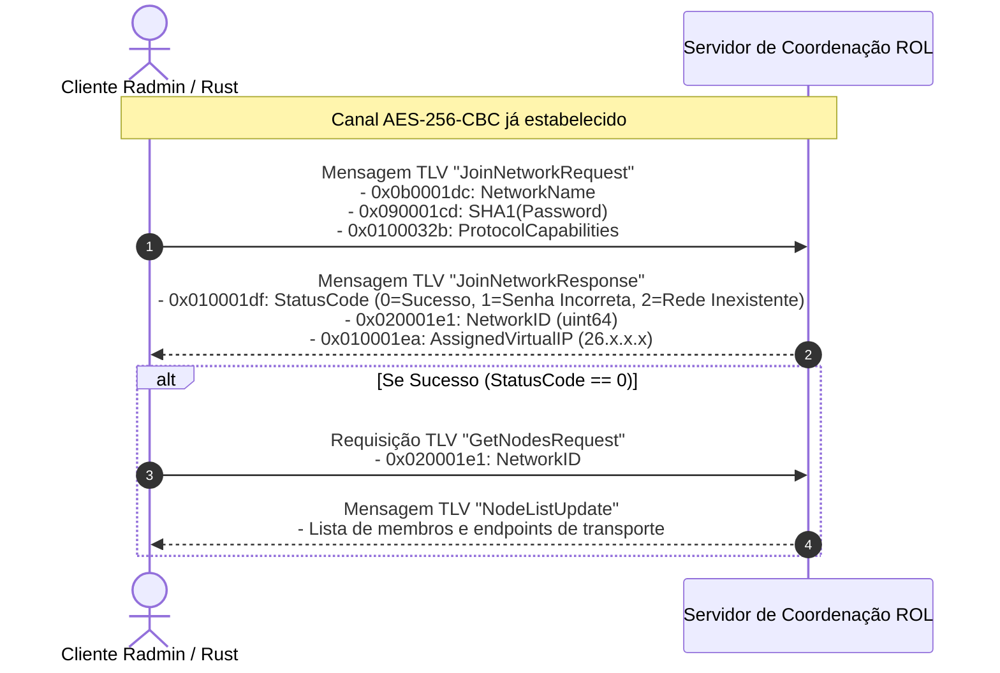

# Frente 4: Autenticação, Gerenciamento de Redes e Membros

**Classificação de Certeza:** CONFIRMADO (desmontagem de `RvROLClient.dll` e `shelper.dll` nos pontos de entrada de autenticação e hashing de senhas)

---

## 1. Visão Geral da Camada de Rede Radmin

O Radmin VPN organiza os nós conectados em redes virtuais privadas identificadas por um `NetworkID` de 64 bits (`0x020001e1`) e um nome legível (`0x0b0001dc`).
As operações de rede são mediadas pelos servidores centrais de coordenação (ROL - *Radmin Online Service*) através da biblioteca `RvROLClient.dll`.

---

## 2. Processo de Autenticação e Hashing de Senha

Ao solicitar ingresso em uma rede protegida por senha, o cliente nunca transmite a senha em texto claro. A derivação da credencial é realizada por rotinas criptográficas em `shelper.dll`.

### 2.1 Desmontagem do Hashing em `shelper.dll` (`0x10065790`)
A função invoca o provedor de serviços criptográficos padrão do Windows (CryptoAPI) solicitando explicitamente o algoritmo **SHA-1** (`CALG_SHA1 = 0x00008004`):

```x86asm
0x10065790: push ebp
0x10065791: mov ebp, esp
0x10065793: push esi
0x10065794: mov esi, dword ptr [ebp + 8]   ; ponteiro para string da senha em UTF-8
0x10065797: push 0
0x10065799: push 0
0x1006579b: push 0x8004                    ; ALG_ID = CALG_SHA1 (0x8004)
0x100657a0: push dword ptr [ebp + 0xc]     ; HCRYPTPROV handle
0x100657a3: lea eax, [ebp - 4]             ; HCRYPTHASH *phHash
0x100657a6: push eax
0x100657a7: call dword ptr [0x100800dc]    ; CryptCreateHash(hProv, CALG_SHA1, 0, 0, &hHash)
0x100657ad: test eax, eax
0x100657af: je 0x100657e0
0x100657b1: push 0
0x100657b3: push dword ptr [ebp + 0x10]    ; tamanho da string da senha
0x100657b6: push esi                       ; buffer da senha
0x100657b7: push dword ptr [ebp - 4]       ; hHash
0x100657ba: call dword ptr [0x100800e0]    ; CryptHashData(hHash, pbData, dwDataLen, 0)
0x100657c0: lea eax, [ebp - 8]
0x100657c3: mov dword ptr [ebp - 8], 0x14  ; 20 bytes (160 bits do hash SHA-1)
0x100657ca: push 0
0x100657cc: push eax                       ; pdwDataLen (&20)
0x100657cd: push edi                       ; buffer de saída (20 bytes)
0x100657ce: push 2                         ; HP_HASHVAL
0x100657d0: push dword ptr [ebp - 4]       ; hHash
0x100657d3: call dword ptr [0x100800e4]    ; CryptGetHashParam(hHash, HP_HASHVAL, pbData, pdwDataLen, 0)
```

O hash digest de 20 bytes resultante é inserido diretamente no contêiner TLV associado à tag **`0x090001cd`** (`PROP_AUTH_HASH`).

---

## 3. Fluxo de Ingresso na Rede (`ROLClient_JoinNetwork`)

Os pontos de entrada em `RvROLClient.dll` estão localizados em:
* `0x100412a0`: `ROLClient_JoinNetwork` (invocação de alto nível)
* `0x1004a090`: Construção do contêiner TLV de requisição
* `0x100a16e0`: Registro de retorno e despacho assíncrono



### 3.1 Tratamento de Erros e Códigos de Status (`0x010001df`)
Na desmontagem de `RvROLClient.dll` (`0x1004a115`), os seguintes códigos de retorno numéricos são avaliados:
* `0`: `SUCCESS` — Ingresso efetuado; IP virtual e Network ID vinculados.
* `1`: `ERR_INVALID_PASSWORD` — Hash da senha incorreto ou rejeitado.
* `2`: `ERR_NETWORK_NOT_FOUND` — Rede inexistente no diretório do servidor.
* `3`: `ERR_NETWORK_FULL` — Limite de membros atingido.
* `4`: `ERR_ALREADY_MEMBER` — O nó já é membro ativo registrado da rede.

---

## 4. Sincronização da Lista de Nós e Membros (`ROLClient_GetNodes`)

A lista de membros é serializada dentro de um contêiner estruturado contendo registros repetidos para cada peer. Cada membro possui as seguintes propriedades TLV associadas:

1. **`0x020001e2` (`PROP_NODE_ID`):** Identificador exclusivo do peer (64 bits).
2. **`0x010001ea` (`PROP_NODE_VIRTUAL_IP`):** Endereço IPv4 virtual no espaço `26.0.0.0/8` (32 bits, big-endian).
3. **`0x0b0001eb` (`PROP_NODE_ALIAS`):** Nome de exibição ou hostname do peer (UTF-8).
4. **`0x040001e7` (`PROP_IS_ONLINE`):** Booleano de 1 byte indicando se o nó está conectado aos servidores ROL.
5. **`0x0200025e` (`PROP_NODE_LAST_SEEN`):** Timestamp Unix de 64 bits do último sinal de vida (*heartbeat*).
6. **`0x09000201` (`PROP_ENDPOINT_CANDIDATES`):** Buffer binário contendo a lista de tuplas `(IP_público, Porta_STUN, IP_local, Porta_local)` para descoberta de conectividade direta P2P.
