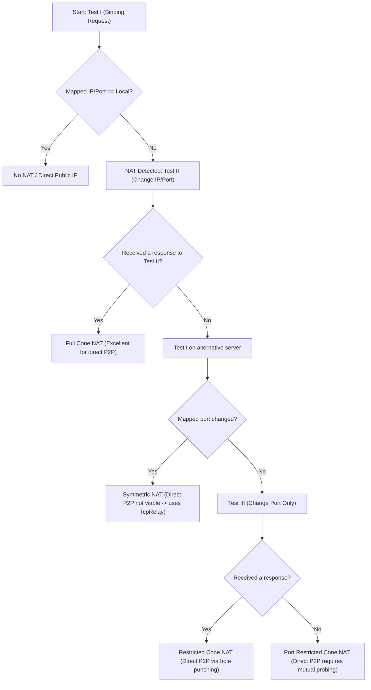

# Front 6: NAT Discovery and Direct P2P Connectivity

**Certainty classification:** CONFIRMED (analysis of RFC 3489 STUN packets in `radmin_vm2.pcap`, correlated with the NAT detection routine in `RvROLClient.dll`)

---

## 1. Overview of NAT Traversal

To allow low-latency, high-bandwidth communication between machines participating in the same virtual network, Radmin VPN implements a NAT traversal mechanism based on the **STUN standard (RFC 3489)** on dedicated UDP ports maintained by the Famatech infrastructure.

---

## 2. STUN Protocol Implementation (RFC 3489)

### 2.1 STUN Query Ports
Observed in the traffic capture `radmin_vm2.pcap`, NAT probes are directed to the central servers through a pool of UDP ports:
* `17309` / `17310`: Primary STUN (Tests I and II)
* `17347` / `17348` / `17349`: Secondary STUN servers and address-change verification servers

### 2.2 Forensic Analysis of the STUN Packets in the `radmin_vm2.pcap` Capture
In packets #796 and #839 of the `radmin_vm2.pcap` capture:

```
Client (192.168.122.77:54536) ---> Pkt #796: Binding Request ---> Server (198.244.203.247:17348)
Client (192.168.122.77:54536) <--- Pkt #839: Binding Response <--- Server (198.244.203.247:17348)
```

#### Packet #796 — Binding Request (RFC 3489)
* **Message Type:** `0x0001` (Binding Request)
* **Message Length:** `0x0000` (no additional attributes in the basic test)
* **Transaction ID:** 16 pseudo-random bytes used for correlation: `[e1 a3 b9 4f ...]`.

#### Packet #839 — Binding Response (RFC 3489)
* **Message Type:** `0x0101` (Binding Response)
* **Message Length:** `0x0024` (36 bytes of attributes)
* **Returned attributes:**
  1. **`0x0001` (`MAPPED-ADDRESS`):**
     * Family: `0x01` (IPv4)
     * Port: `54536` (`0xd508`)
     * IP: `<CLIENT-PUBLIC-IP>` (`0xbb 0x3b 0xc7 0x27`) — reflexive public address detected for the client.
  2. **`0x0004` (`SOURCE-ADDRESS`):**
     * Family: `0x01` (IPv4)
     * Port: `17348`
     * IP: `198.244.203.247`
  3. **`0x0005` (`CHANGED-ADDRESS`):**
     * Family: `0x01` (IPv4)
     * Port: `17349`
     * IP: `198.244.203.248` — alternative address used for Test II (restricted-cone classification).

---

## 3. NAT Classification and Direct Connection Procedure

The algorithm executed by the client follows the RFC 3489 flowchart closely:



---

## 4. Direct P2P Establishment Techniques

### 4.1 Direct UDP Hole Punching
When both clients are classified as having a Cone NAT (Full Cone, Restricted or Port Restricted):
1. The ROL coordination server exchanges the `(Public_IP:STUN_Port)` tuples between both peers via tag `0x09000201`.
2. Both nodes send UDP datagrams simultaneously toward the reflexive IP and port of the other.
3. Receipt of the first datagram establishes the association (*pinhole*) in the local router/firewall table.
4. The point-to-point cryptographic handshake, identical to the control channel (RSA-2048 followed by AES-256-CBC), starts immediately.

### 4.2 TCP Simultaneous Open
If UDP traffic is blocked on the user's local network by corporate policies:
1. The client schedules the synchronous emission of `TCP SYN` packets from a previously bound local port toward the mapped port of the peer.
2. The synchronized `SYN` sends trigger the *TCP Simultaneous Open* mechanism described in RFC 793, allowing the transition from `SYN-SENT` directly to `SYN-RECEIVED` and `ESTABLISHED` without requiring a conventional public listener.

### 4.3 Fallback to TcpRelay
If no direct probe (UDP or TCP) succeeds within 10 seconds, the state machine downgrades the connection to transport type `2` (`TcpRelay`), as demonstrated in Front 5.
