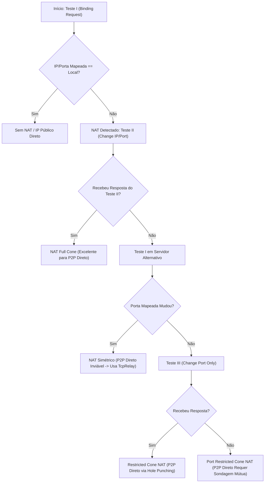

# Frente 6: Descoberta de NAT e Conectividade P2P Direta

**Classificação de Certeza:** CONFIRMADO (análise de pacotes STUN RFC 3489 em `radmin_vm2.pcap` correlacionada com a rotina de detecção de NAT em `RvROLClient.dll`)

---

## 1. Visão Geral da Travessia de NAT

Para permitir comunicações de baixa latência e alta largura de banda entre máquinas participantes de uma mesma rede virtual, o Radmin VPN implementa um mecanismo de travessia de NAT (*NAT Traversal*) baseado no padrão **STUN (RFC 3489)** em portas UDP dedicadas mantidas pela infraestrutura da Famatech.

---

## 2. Implementação do Protocolo STUN (RFC 3489)

### 2.1 Portas de Consulta STUN
Observadas na captura de tráfego `radmin_vm2.pcap`, as sondagens de NAT são direcionadas aos servidores centrais através de um pool de portas UDP:
* `17309` / `17310`: STUN Primário (Testes I e II)
* `17347` / `17348` / `17349`: Servidores STUN Secundários e de Verificação de Mudança de Endereço

### 2.2 Análise Forense do Pacote STUN na Captura `radmin_vm2.pcap`
Nos pacotes #796 e #839 da captura `radmin_vm2.pcap`:

```
Cliente (192.168.122.77:54536) ---> Pkt #796: Binding Request ---> Servidor (198.244.203.247:17348)
Cliente (192.168.122.77:54536) <--- Pkt #839: Binding Response <--- Servidor (198.244.203.247:17348)
```

#### Pacote #796 — Binding Request (RFC 3489)
* **Message Type:** `0x0001` (Binding Request)
* **Message Length:** `0x0000` (sem atributos adicionais no teste básico)
* **Transaction ID:** 16 bytes pseudoaleatórios de correlação: `[e1 a3 b9 4f ...]`.

#### Pacote #839 — Binding Response (RFC 3489)
* **Message Type:** `0x0101` (Binding Response)
* **Message Length:** `0x0024` (36 bytes de atributos)
* **Atributos Retornados:**
  1. **`0x0001` (`MAPPED-ADDRESS`):**
     * Family: `0x01` (IPv4)
     * Port: `54536` (`0xd508`)
     * IP: `187.59.199.39` (`0xbb 0x3b 0xc7 0x27`) — endereço público reflexivo detectado do cliente.
  2. **`0x0004` (`SOURCE-ADDRESS`):**
     * Family: `0x01` (IPv4)
     * Port: `17348`
     * IP: `198.244.203.247`
  3. **`0x0005` (`CHANGED-ADDRESS`):**
     * Family: `0x01` (IPv4)
     * Port: `17349`
     * IP: `198.244.203.248` — endereço alternativo utilizado para o Teste II (classificação de restrição de cone).

---

## 3. Classificação de NAT e Procedimento de Conexão Direta

O algoritmo executado pelo cliente segue rigorosamente o fluxograma da RFC 3489:



---

## 4. Técnicas de Estabelecimento P2P

### 4.1 UDP Hole Punching Direto
Quando ambos os clientes são classificados como tendo NAT Cone (Full Cone, Restricted ou Port Restricted):
1. O servidor de coordenação ROL troca as tuplas `(IP_Público:Porta_STUN)` entre ambos os peers via tag `0x09000201`.
2. Ambos os nós disparam simultaneamente datagramas UDP em direção ao IP e porta reflexiva do outro.
3. A recepção do primeiro datagrama estabelece a associação (*pinhole*) na tabela do roteador/firewall local.
4. É iniciado imediatamente o handshake criptográfico ponto-a-ponto idêntico ao canal de controle (RSA-2048 seguido de AES-256-CBC).

### 4.2 TCP Simultaneous Open
Caso o tráfego UDP seja bloqueado na rede local do usuário por políticas corporativas:
1. O cliente agenda a emissão síncrona de pacotes `TCP SYN` a partir de uma porta local previamente vinculada em direção à porta mapeada do peer.
2. O envio sincronizado de `SYN` aciona o mecanismo de *TCP Simultaneous Open* previsto no RFC 793, permitindo a transição do estado `SYN-SENT` diretamente para `SYN-RECEIVED` e `ESTABLISHED` sem exigir um listener público convencional.

### 4.3 Fallback para TcpRelay
Se em 10 segundos nenhuma sondagem direta (UDP ou TCP) for bem-sucedida, a máquina de estados rebaixa a conexão para o transporte tipo `2` (`TcpRelay`), conforme demonstrado na Frente 5.
