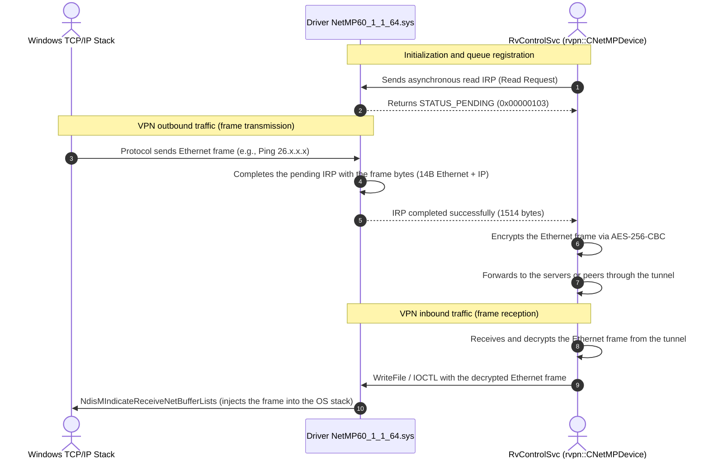

# Front 9: NDIS Virtual Adapter Driver and the Local Network Layer

**Certainty classification:** CONFIRMED (full disassembly of `NetMP60_1_1_64.sys` in the NDIS registration and of the 5 IOCTL codes in `RvControlSvc.exe`)

---

## 1. Overview of the Virtual Network Driver

On the Windows operating system, the virtual network interface of Radmin VPN is implemented by the kernel-mode driver **`NetMP60_1_1_64.sys`** (PDB project name: `RvNetMP60.pdb`).
The driver is designed as an **NDIS 6.0+ Miniport Driver** that creates a control device accessible from user mode via `NdisRegisterDeviceEx`.

---

## 2. Device Names and Registration in the Operating System

The initialization routine in `NetMP60_1_1_64.sys` (`0x14000c05c`) registers the following identifiers in the Windows Object Manager:

* **Kernel device name:** `\Device\RVPNNETMP` (offset `0x9dd0`, VA `0x14000d7d0`)
* **Symbolic link for user mode:** `\DosDevices\RVPNNETMP` (accessible via `CreateFileW(L"\\\\.\\RVPNNETMP", ...)` by the class `rvpn::CNetMPDevice` in `RvControlSvc.exe`)
* **Registry parameter for the MAC address:** `NetVRadminMacAddress`

---

## 3. Catalog and Reverse Engineering of the IOCTL Codes

Static analysis of the `DeviceIoControl` calls in `RvControlSvc.exe` revealed exactly **5 IOCTL codes** used by the service to control the virtual adapter:

```
CTL_CODE(DeviceType=0x22, Function, Method=METHOD_BUFFERED (0), Access)
```

| IOCTL Hex | Function Dec | Access | In/Out Buffer | Disassembly / Call Site | Semantics and Purpose |
|---|---|---|---|---|---|
| **`0x22c004`** | Function 1 | `READ \| WRITE` | In: 8 B, Out: 12 B | `0x4b017f` in `RvControlSvc.exe` | **Central device control:** Exchange of synchronization events and pointers to asynchronous I/O buffer descriptors |
| **`0x228014`** | Function 5 | `FILE_WRITE_DATA` | In: 6 B, Out: 0 B | `0x4b0123` (`push 6` at `0x4b0117`) | **MAC address configuration:** Sets the 6-byte Ethernet MAC address of the virtual adapter |
| **`0x224018`** | Function 6 | `FILE_READ_DATA` | In: 0 B, Out: 4 B | `0x4b003a` (`push 4` at `0x4b002d`) | **Statistics / MTU query:** Obtains the link speed or the driver's MTU limit |
| **`0x22801c`** | Function 7 | `FILE_WRITE_DATA` | In: 4 B, Out: 0 B | `0x4b00a4` (`push 4` at `0x4b0098`) | **Operational state / MTU setting:** Enables/disables packet flow or changes the maximum transmission unit |
| **`0x224020`** | Function 8 | `FILE_READ_DATA` | In: 0 B, Out: 1 B | `0x4aff8a` (`push 1` at `0x4aff7d`) | **Media status query:** Returns `0x01` for a connected cable (*MediaConnectStateConnected*) or `0x00` for disconnected |

---

## 4. The Ethernet Frame Pump Mechanism (Packet Pump)

Analysis of the dispatch routine in `NetMP60_1_1_64.sys` (`0x1400030cc` to `0x140003259`) confirms the asynchronous packet I/O model:



---

## 5. Direct Mapping to the Linux Architecture

On a native Linux environment, all of this proprietary NDIS driver infrastructure is **completely unnecessary**.

* **Linux equivalent:** Standard **TAP** interface (`/dev/net/tun` with the flags `IFF_TAP | IFF_NO_PI`).
* **Identical behavior:**
  1. The TAP interface operates at Layer 2 (Data Link Layer), receiving and transmitting raw Ethernet frames of 14-byte header plus IP payload.
  2. The default MTU of 1500 bytes (maximum frame size of 1514 bytes) is set natively with `ioctl(SIOCSIFMTU)`.
  3. The 6-byte MAC address is assigned natively with `ioctl(SIOCSIFHWADDR)`.
  4. Packet pumping is performed by simple asynchronous `read` and `write` calls on the `AsyncFd` of `/dev/net/tun`.
