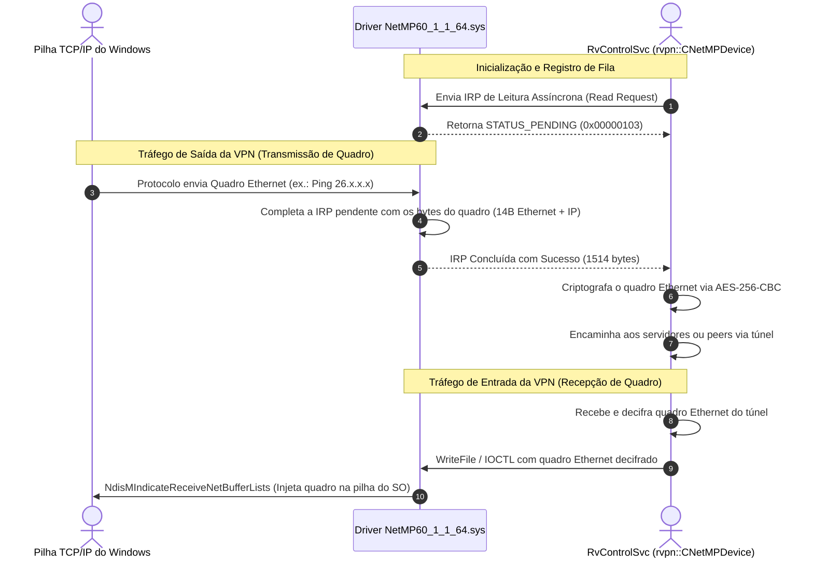

# Frente 9: Driver de Adaptador Virtual NDIS e Camada de Rede Local

**Classificação de Certeza:** CONFIRMADO (desmontagem completa de `NetMP60_1_1_64.sys` no registro NDIS e dos 5 códigos IOCTL em `RvControlSvc.exe`)

---

## 1. Visão Geral do Driver de Rede Virtual

No sistema operacional Windows, a interface de rede virtual do Radmin VPN é implementada pelo driver de modo kernel **`NetMP60_1_1_64.sys`** (nome do projeto PDB: `RvNetMP60.pdb`).
O driver é projetado como um **NDIS 6.0+ Miniport Driver** que cria um dispositivo de controle acessível ao modo de usuário via `NdisRegisterDeviceEx`.

---

## 2. Nomes de Dispositivo e Registro no Sistema Operacional

A rotina de inicialização em `NetMP60_1_1_64.sys` (`0x14000c05c`) registra as seguintes identificações no Object Manager do Windows:

* **Nome do Dispositivo do Kernel:** `\Device\RVPNNETMP` (offset `0x9dd0`, VA `0x14000d7d0`)
* **Link Simbólico para Modo de Usuário:** `\DosDevices\RVPNNETMP` (acessível via `CreateFileW(L"\\\\.\\RVPNNETMP", ...)` pela classe `rvpn::CNetMPDevice` em `RvControlSvc.exe`)
* **Parâmetro de Registro para o MAC Address:** `NetVRadminMacAddress`

---

## 3. Catálogo e Engenharia Reversa dos Códigos IOCTL

A análise estática das chamadas a `DeviceIoControl` em `RvControlSvc.exe` revelou exatamente **5 códigos IOCTL** utilizados pelo serviço para controlar o adaptador virtual:

```
CTL_CODE(DeviceType=0x22, Function, Method=METHOD_BUFFERED (0), Access)
```

| IOCTL Hex | Função Dec | Access | In/Out Buffer | Desmontagem / Ponto de Chamada | Semântica e Finalidade |
|---|---|---|---|---|---|
| **`0x22c004`** | Function 1 | `READ \| WRITE` | In: 8 B, Out: 12 B | `0x4b017f` em `RvControlSvc.exe` | **Controle Central do Dispositivo:** Troca de eventos de sincronização e ponteiros de descritores de buffer I/O assíncrono |
| **`0x228014`** | Function 5 | `FILE_WRITE_DATA` | In: 6 B, Out: 0 B | `0x4b0123` (`push 6` em `0x4b0117`) | **Configuração do MAC Address:** Define o endereço MAC Ethernet de 6 bytes do adaptador virtual |
| **`0x224018`** | Function 6 | `FILE_READ_DATA` | In: 0 B, Out: 4 B | `0x4b003a` (`push 4` em `0x4b002d`) | **Consulta de Estatísticas / MTU:** Obtém velocidade do link ou limite MTU do driver |
| **`0x22801c`** | Function 7 | `FILE_WRITE_DATA` | In: 4 B, Out: 0 B | `0x4b00a4` (`push 4` em `0x4b0098`) | **Definição de Estado Operacional / MTU:** Habilita/desabilita o fluxo de pacotes ou altera tamanho máximo de transmissão |
| **`0x224020`** | Function 8 | `FILE_READ_DATA` | In: 0 B, Out: 1 B | `0x4aff8a` (`push 1` em `0x4aff7d`) | **Consulta de Status de Mídia (Media Status):** Retorna `0x01` para cabo conectado (*MediaConnectStateConnected*) ou `0x00` para desconectado |

---

## 4. O Mecanismo de Bombeamento de Quadros Ethernet (Packet Pump)

A análise da rotina de despacho em `NetMP60_1_1_64.sys` (`0x1400030cc` a `0x140003259`) confirma o modelo assíncrono de I/O de pacotes:



---

## 5. Mapeamento Direto para a Arquitetura Linux

No ambiente Linux nativo, toda essa infraestrutura complexa de driver NDIS proprietário é **completamente desnecessária**.

* **Equivalente Linux:** Interface padrão **TAP** (`/dev/net/tun` com as flags `IFF_TAP | IFF_NO_PI`).
* **Comportamento Idêntico:**
  1. A interface TAP opera na Camada 2 (Data Link Layer), recebendo e transmitindo quadros Ethernet brutos de 14 bytes de cabeçalho + payload IP.
  2. O MTU padrão de 1500 bytes (tamanho máximo de quadro de 1514 bytes) é configurado nativamente com `ioctl(SIOCSIFMTU)`.
  3. O endereço MAC de 6 bytes é atribuído nativamente com `ioctl(SIOCSIFHWADDR)`.
  4. O bombeamento de pacotes é realizado por simples chamadas assíncronas de leitura (`read`) e escrita (`write`) na `AsyncFd` do `/dev/net/tun`.
