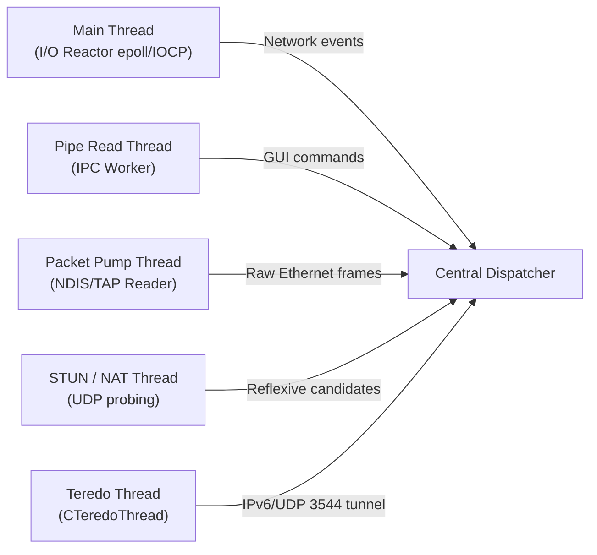
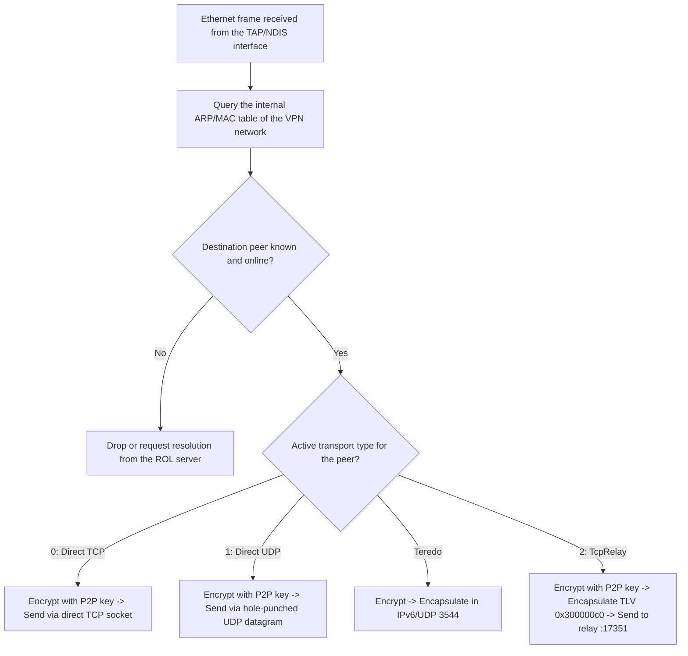

# Front 10: Global Architecture and Module Decomposition

**Certainty classification:** CONFIRMED (analysis of PE imports/exports, tracing of execution threads, and dependency mapping between the binaries of the official package)

---

## 1. Overview of the Official System

The official Radmin VPN 2.1 client is a layered, service-oriented architecture on Windows:

```mermaid
graph TD
    subgraph User Mode (Session 1)
        GUI["RvRvpnGui.exe<br/>(Graphical Interface Qt/MFC)"]
    end

    subgraph User Mode (SYSTEM Service)
        PIPE["Named Pipe<br/>\\\\.\\pipe\\RadminVpnGuiChannel"]
        SVC["RvControlSvc.exe<br/>(Control and Routing Service)"]
        ROL["RvROLClient.dll<br/>(ROL Coordination Client)"]
        UES["RvUESClient.dll<br/>(UES Event Subsystem)"]
        SHL["shelper.dll<br/>(Cryptographic Engine OpenSSL + CryptoAPI)"]
    end

    subgraph Kernel Mode (Ring 0)
        DEV["Control Device<br/>\\Device\\RVPNNETMP"]
        DRV["NetMP60_1_1_64.sys<br/>(NDIS 6.0 Miniport Driver)"]
        OS_NET["Windows TCP/IP Network Stack"]
    end

    GUI <-->|IPC Commands 0x3ec..0x3f6| PIPE
    PIPE <--> SVC
    SVC <-->|Network and Member Control| ROL
    SVC <-->|Asynchronous Signaling| UES
    ROL <-->|RSA-2048 / AES-256 / SHA-1| SHL
    SVC <-->|5 IOCTL Codes + Packet Pump| DEV
    DEV <--> DRV
    DRV <--> OS_NET
```

---

## 2. Responsibilities of the Official Modules

1. **`RvRvpnGui.exe`:**
   * Presents the interface to the end user.
   * Has no direct encryption code and does not handle VPN sockets; it delegates everything to the service through IPC commands on the Named Pipe.
2. **`RvControlSvc.exe`:**
   * Central orchestrator in user space.
   * Manages the lifecycle of the network interface, routes, name resolution and packet dispatch.
3. **`RvROLClient.dll`:**
   * Implements the client protocol for communicating with the Famatech cloud (*Radmin Online*).
   * Manages user authentication, network listing, member join/leave and node discovery.
   * Runs the NAT tests (RFC 3489 STUN) and orchestrates Teredo tunneling (`CTeredoThread`).
4. **`RvUESClient.dll`:**
   * Manages the asynchronous event queue and internal telemetry between subsystems.
5. **`shelper.dll`:**
   * Cryptographic security isolation layer.
   * Incorporates static OpenSSL routines (`RSA_public_encrypt`, `RSA_private_decrypt`, `AES_set_encrypt_key`, `AES_cbc_encrypt`, `RAND_bytes`) and a 64-bit additive integrity sum.
6. **`NetMP60_1_1_64.sys`:**
   * Virtual NDIS driver that exposes a Layer 2 Ethernet interface to the operating system.

---

## 3. Concurrency and Thread Model

In the system service (`RvControlSvc.exe` + `RvROLClient.dll`), the following specialized execution threads were identified:



1. **Control I/O thread:** Maintains the TCP connection to port 17301 of the ROL servers.
2. **Packet pump thread:** Continuously reads Ethernet frames from the network interface and hands them to the encryption layer.
3. **IPC server thread:** Waits for graphical interface instances to connect to the Named Pipe.
4. **P2P / TcpRelay connection threads:** Each active peer channel has its own independent symmetric encryption context with continuous IV chaining.

---

## 4. Frame Routing Decision Tree (Data Path)

When a local application sends an IP packet to a node on the virtual network (for example, `26.12.34.56`):



---

## 5. Architectural Mapping for the Rust Client on Linux

| Official Windows Component | Equivalent in the Rust Implementation (`radmin-vpn-linux-rs`) |
|---|---|
| `RvControlSvc.exe` | Background daemon in Rust (`radmin-vpn-daemon` or `main.rs`) |
| `NetMP60_1_1_64.sys` | Native kernel device `/dev/net/tun` with `IFF_TAP \| IFF_NO_PI` |
| `shelper.dll` | `aes`, `rsa`, `sha1` or `ring` crates with the proprietary trailer implementation |
| `RvROLClient.dll` | `src/session/` and `src/protocol/` modules |
| `\\.\pipe\RadminVpnGuiChannel` | UNIX domain socket `/var/run/radmin-vpn.sock` |
| `RvRvpnGui.exe` | Interactive CLI (`radmin-vpn-cli`) or GTK/Tauri GUI |
