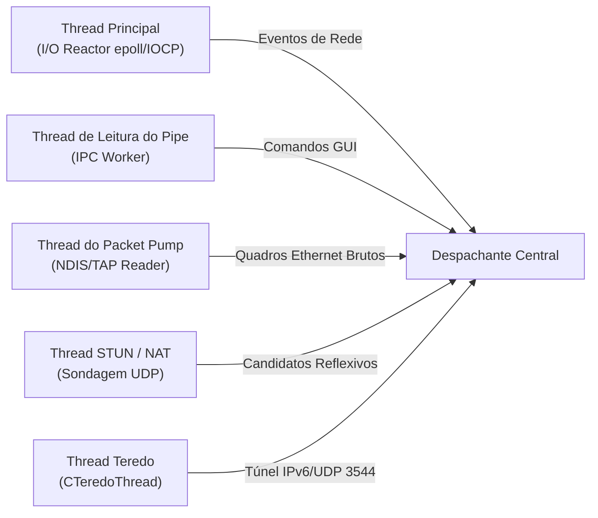
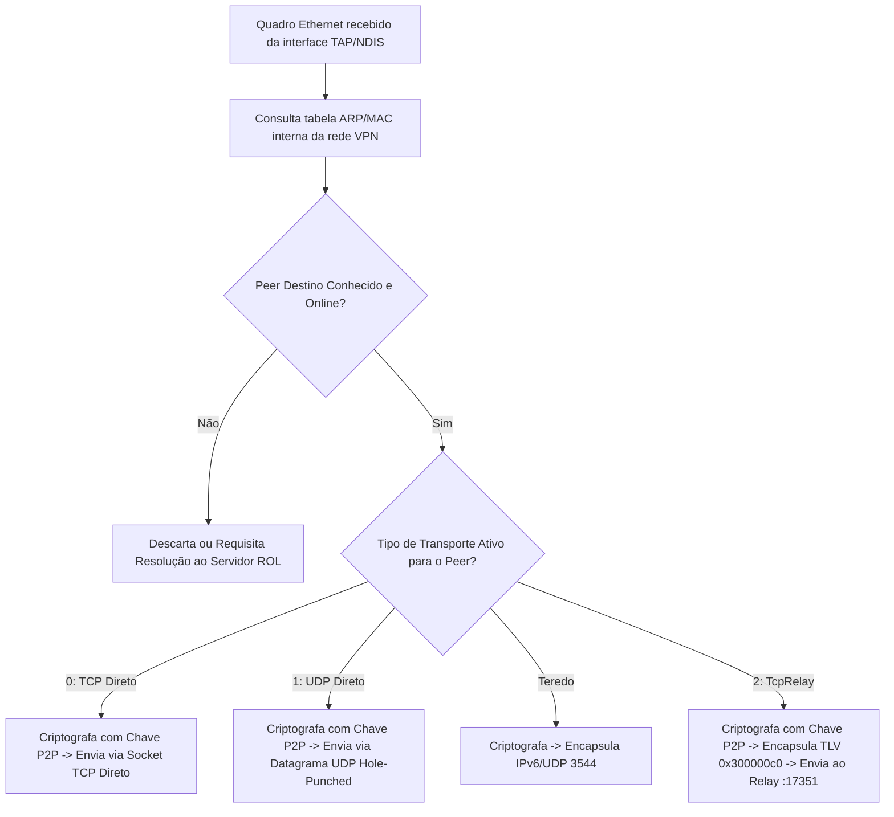

# Frente 10: Arquitetura Global e Decomposição de Módulos

**Classificação de Certeza:** CONFIRMADO (análise de importações/exportações PE, rastreamento de fios de execução e mapeamento de dependências entre binários do pacote oficial)

---

## 1. Visão Geral do Sistema Oficial

O cliente oficial do Radmin VPN 2.1 é composto por uma arquitetura em camadas orientada a serviços no Windows:

```mermaid
graph TD
    subgraph Modo de Usuário (Sessão 1)
        GUI["RvRvpnGui.exe<br/>(Interface Gráfica Qt/MFC)"]
    end

    subgraph Modo de Usuário (Serviço de Sistema SYSTEM)
        PIPE["Named Pipe<br/>\\\\.\\pipe\\RadminVpnGuiChannel"]
        SVC["RvControlSvc.exe<br/>(Serviço de Controle e Roteamento)"]
        ROL["RvROLClient.dll<br/>(Cliente de Coordenação ROL)"]
        UES["RvUESClient.dll<br/>(Subsistema de Eventos UES)"]
        SHL["shelper.dll<br/>(Motor Criptográfico OpenSSL + CryptoAPI)"]
    end

    subgraph Modo Kernel (Ring 0)
        DEV["Dispositivo de Controle<br/>\\Device\\RVPNNETMP"]
        DRV["NetMP60_1_1_64.sys<br/>(Driver Miniport NDIS 6.0)"]
        OS_NET["Pilha de Rede TCP/IP do Windows"]
    end

    GUI <-->|IPC Comandos 0x3ec..0x3f6| PIPE
    PIPE <--> SVC
    SVC <-->|Controle de Redes e Membros| ROL
    SVC <-->|Sinalização Assíncrona| UES
    ROL <-->|RSA-2048 / AES-256 / SHA-1| SHL
    SVC <-->|5 Códigos IOCTL + Packet Pump| DEV
    DEV <--> DRV
    DRV <--> OS_NET
```

---

## 2. Responsabilidades dos Módulos Oficiais

1. **`RvRvpnGui.exe`:**
   * Apresentação da interface ao usuário final.
   * Não possui código de criptografia direta nem manipula sockets da VPN; delega tudo ao serviço através de comandos IPC no Named Pipe.
2. **`RvControlSvc.exe`:**
   * Orquestrador central em espaço de usuário.
   * Gerencia ciclo de vida da interface de rede, rotas, resolução de nomes e despacho de pacotes.
3. **`RvROLClient.dll`:**
   * Implementa o protocolo cliente para comunicação com a nuvem Famatech (*Radmin Online*).
   * Gerencia autenticação de usuário, listagem de redes, ingresso/saída de membros e descoberta de nós.
   * Conduz os testes de NAT (RFC 3489 STUN) e orquestra o tunelamento Teredo (`CTeredoThread`).
4. **`RvUESClient.dll`:**
   * Gerencia fila de eventos assíncronos e telemetria interna entre subsistemas.
5. **`shelper.dll`:**
   * Camada de isolamento de segurança criptográfica.
   * Incorpora rotinas estáticas do OpenSSL (`RSA_public_encrypt`, `RSA_private_decrypt`, `AES_set_encrypt_key`, `AES_cbc_encrypt`, `RAND_bytes`) e soma aditiva de integridade de 64 bits.
6. **`NetMP60_1_1_64.sys`:**
   * Driver virtual NDIS que expõe uma interface Ethernet Camada 2 ao sistema operacional.

---

## 3. Modelo de Concorrência e Threads

No serviço de sistema (`RvControlSvc.exe` + `RvROLClient.dll`), foram identificados os seguintes fios de execução especializados:



1. **Thread de I/O de Controle:** Mantém a conexão TCP com a porta 17301 dos servidores ROL.
2. **Thread do Packet Pump:** Lê continuamente quadros Ethernet da interface de rede e entrega à camada de cifragem.
3. **Thread do Servidor IPC:** Aguarda conexões de instâncias de interface gráfica no Named Pipe.
4. **Threads de Conexão P2P / TcpRelay:** Cada canal de peer ativo possui seu próprio contexto de cifragem simétrica independente com encadeamento contínuo de IV.

---

## 4. Árvore de Decisão do Roteamento de Quadros (Data Path)

Quando uma aplicação local emite um pacote IP direcionado a um nó da rede virtual (ex.: `26.12.34.56`):



---

## 5. Mapeamento Arquitetural para o Cliente Rust no Linux

| Componente Windows Oficial | Equivalente na Implementação Rust (`radmin-vpn-linux-rs`) |
|---|---|
| `RvControlSvc.exe` | Daemon de background em Rust (`radmin-vpn-daemon` ou `main.rs`) |
| `NetMP60_1_1_64.sys` | Dispositivo de kernel nativo `/dev/net/tun` com `IFF_TAP \| IFF_NO_PI` |
| `shelper.dll` | Crate `aes`, `rsa`, `sha1` ou `ring` com implementação do trailer proprietário |
| `RvROLClient.dll` | Módulo `src/session/` e `src/protocol/` |
| `\\.\pipe\RadminVpnGuiChannel` | Socket de domínio UNIX `/var/run/radmin-vpn.sock` |
| `RvRvpnGui.exe` | CLI interativa (`radmin-vpn-cli`) ou GUI GTK/Tauri |
